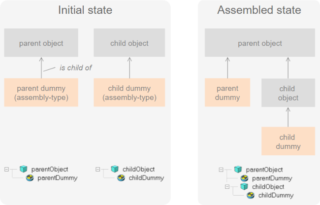

# Assembly operation

[Scene objects](objects.md) are usually attached to each other via a parent-child relationship. To be able to precisely control where the two objects connect or come together, you can use *assembly*-type [dummies](dummies.md) on both the parent and child object, which are then taken into account in a subsequent assemble operation via the related *assemble* [toolbar](userInterface.md#toolbars) button:

*[Assemble / disassemble toolbar buttons]*

The assembly operation contains 3 steps:

- Select the child object
- Select the parent dummy (i.e. the desired attachment point)
- Click the assemble toolbar button

After a successful assembly operation, both dummies (i.e. the parent- and child-dummy) overlap. An assembly compatibility tag can be specified for assembly-type dummies with [`dummy.assemblyTag`](sim-2/property_dummy_assemblyTag.htm). Items can also be assembled via [`sceneObject:setParent`](sim-2/sceneObject_setParent.htm).

*[Assembly, initial and assembled state]*
