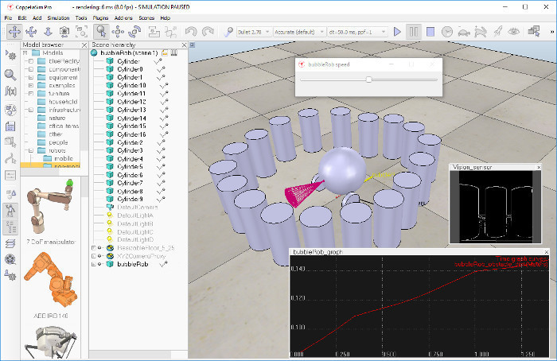
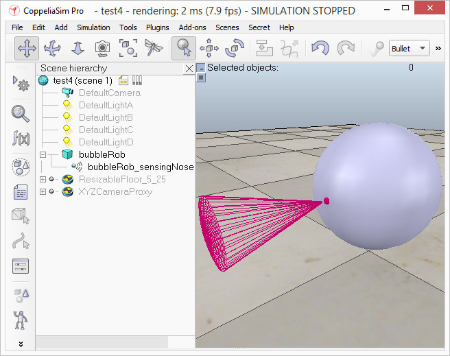
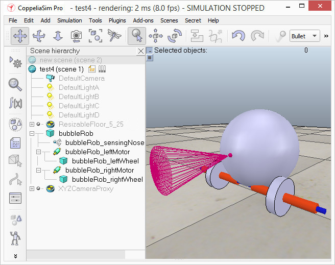
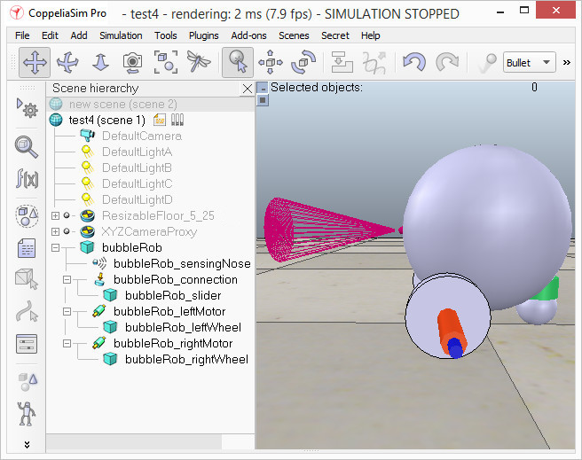
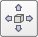

# BubbleRob tutorial

This tutorial introduces various functionality while designing the simple mobile robot *BubbleRob*. The CoppeliaSim scene file related to this tutorial is located in *scenes/tutorials/BubbleRob*. The following figure illustrates the simulation scene that we will design:



Since this tutorial will fly over many different aspects, make sure to also have a look at the [other tutorials](tutorials.md), mainly the [tutorial about building a simulation model](buildingAModelTutorial.md). First of all, freshly start CoppeliaSim. The simulator displays a default [scene](scenes.md). We will start with the body of *BubbleRob*.

We add a primitive sphere of diameter 0.2 to the scene with [Add > Primitive shape > Sphere]. We adjust the **X-size** item to 0.2, then click **OK**. The created sphere will appear in [visibility layer](layerSelectionDialog.md) 1 by default, and be [dynamic and respondable](designingDynamicSimulations.md#staticAndRespondable) (since we kept the item **Create dynamic and respondable shape** enabled). This means that *BubbleRob's* body will be falling and able to react to collisions with other respondable shapes (i.e. simulated by the physics engine). We can see this in the [shape dynamics dialog](shapeDynamicsProperties.md): items **Body is respondable** and **Body is dynamic** are enabled. We start the simulation (via the toolbar button, or by pressing &lt;control-space> in the scene window), and copy-and-paste the created sphere (with [Edit > Copy object(s)] then [Edit -> Paste buffer], or with &lt;control-c> then &lt;control-v>): the two spheres will react to collision and roll away. We stop the simulation: the duplicated sphere will automatically be removed. This default behavior can be modified in the [simulation dialog](simulationPropertiesDialog.md).

We also want *BubbleRob's* body to be usable by the other calculation modules (e.g. [distance calculation](distanceCalculation.md)). For that reason, we enable [Collidable](collidableObjects.md), [Measurable](measurableObjects.md) and [Detectable](detectableObjects.md) in the [scene object common properties](sceneObjectPropertiesDialog.md#common) for that shape, if not already enabled. If we wanted, we could now also change the visual appearance of our sphere in the [shape dialog](shapeProperties.md).

Now we open the [position dialog](positionDialog.md) on the **translation** tab, select the sphere representing *BubbleRob's* body, and enter 0.02 for **Along Z**. We make sure that the **Relative to**-item is set to **World**. Then we click **Translate selection**. This translates all selected objects by 2 cm along the absolute Z-axis, and effectively lifts our sphere a little bit. In the [scene hierarchy](userInterface.md#SceneHierarchy), we double-click the sphere's name, so that we can edit it. We enter *bubbleRob* and press enter.

Next we will add a [proximity sensor](proximitySensors.md) so that *BubbleRob* knows when it is approaching obstacles: we select [Add > Proximity sensor > Cone type]. In the [orientation dialog](orientationDialog.md) on the **orientation** tab, we enter 90 for **Around Y** and for **Around Z**, then click **Rotate selection**. In the [position dialog](positionDialog.md), on the **position** tab, we enter 0.1 for **X-coord.** and 0.12 for **Z-coord.** The proximity sensor is now correctly positioned relative to *BubbleRob's* body. We double-click the proximity sensor's icon in the [scene hierarchy](userInterface.md#SceneHierarchy) to open [its properties dialog](proximitySensorPropertiesDialog.md). We click **Show volume parameter** to open the [proximity sensor volume dialog](proximitySensorVolumeDialog.md). We adjust items **Offset** to 0.005, **Angle** to 30 and **Range** to 0.15. Then, in the proximity sensor dialog, we click **Show detection parameters**. This opens the [proximity sensor detection parameter dialog](proximitySensorDetectionParameterDialog.md). We uncheck item **Don't allow detections if distance smaller than** then close that dialog again. In the scene hierarchy, we double-click the proximity sensor's name to edit it. We enter *sensingNose* and press enter.

We select *sensingNose*, then control-select *bubbleRob*, then click [Edit > Set parent, keep pose(s)]. This attaches the sensor to the body of the robot. We could also have dragged *sensingNose* onto *bubbleRob* in the scene hierarchy. This is what we now have:



*[Proximity sensor attached to *bubbleRob's* body]*

Next we will take care of *BubbleRob's* wheels. We create a new scene with [File > New scene]. It is often very convenient to work across several scenes, to visualize and work only on specific elements. We add a primitive cylinder with dimensions (0.08,0.08,0.02). As for the body of *BubbleRob*, we enable [Collidable](collidableObjects.md), [Measurable](measurableObjects.md) and [Detectable](detectableObjects.md) in the [scene object common properties](sceneObjectPropertiesDialog.md#common) for that cylinder, if not already enabled. Then we set the cylinder's absolute position to (0.05,0.1,0.04) and its absolute orientation to (-90,0,0). We change the name to *leftWheel*. We copy and paste the wheel, and set the absolute Y coordinate of the copy to -0.1. We rename the copy to *rightWheel*. We select the two wheels, copy them, then switch back to scene 1, then paste the wheels.

We now need to add [joints](joints.md) (or motors) for the wheels. We click [Add > Joint > Revolute] to add a revolute joint to the scene. Most of the time, when adding a new object to the scene, the object will appear at the origin of the world. We keep the joint selected, then control-select *leftWheel*. In the [position dialog](positionDialog.md), on the **position** tab, we click the **Apply to selection** button: this positions the joint at the center of the left wheel. Then, in the [orientation dialog](orientationDialog.md), on the **orientation** tab, we do the same: this orients the joint in the same way as the left wheel. We rename the joint to *leftMotor*. We now double-click the joint's icon in the scene hierarchy to open the [joint dialog](jointProperties.md). Then we click **Show dynamic parameters** to open the [joint dynamics dialog](jointDynamicsProperties.md). We select the *velocity* **control mode**. We now repeat the same procedure for the right motor and rename it to *rightMotor*. Now we attach the left wheel to the left motor, the right wheel to the right motor, then attach the two motors to *bubbleRob*. This is what we have:



*[Proximity sensor, motors and wheels]*

We run the simulation and notice that the robot is falling backwards. We are still missing a third contact point with the floor. We now add a small slider (or caster). In a new scene we add a primitive sphere with diameter 0.05 and make the sphere [Collidable](collidableObjects.md), [Measurable](measurableObjects.md) and [Detectable](detectableObjects.md) (if not already enabled), then rename it to *slider*. We set the **Material** to *noFrictionMaterial* in the [shape dynamics dialog](shapeDynamicsProperties.md). To rigidly link the slider with the rest of the robot, we add a [force sensor object](forceSensors.md) with [Add > Force sensor]. We rename it to *connection* and shift it up by 0.05. We attach the slider to the force sensor, then copy both objects, switch back to scene 1 and paste them. We then shift the force sensor by -0.07 along the absolute X-axis, then attach it to the robot body. If we run the simulation now, we can notice that the slider is slightly moving in relation to the robot body: this is because both objects (i.e. *slider* and *bubbleRob*) are colliding with each other. To avoid strange effects during dynamics simulation, we have to inform CoppeliaSim that both objects do not mutually collide, and we do this in the following way: in the [shape dynamics dialog](shapeDynamicsProperties.md), for *slider* we set the **local respondable mask** to 00001111, and for *bubbleRob*, we set the **local respondable mask** to 11110000. If we run the simulation again, we can notice that both objects do not interfere anymore. This is what we now have:



*[Proximity sensor, motors, wheels and slider]*

We run the simulation again and notice that *BubbleRob* slightly moves, even with locked motors. We also try to run the simulation with different physics engines: the result will be different. Stability of dynamic simulations is tightly linked to masses and inertia matrices of the involved non-static shapes. For an explanation of this effect, make sure to carefully read [these](designingDynamicSimulations.md#masses) and [those](designingDynamicSimulations.md#inertias) sections. We now try to correct for that undesired effect. We select the two wheels and the slider, and increase the masses by a factor of 8 via [Edit > Shape mass and inertia > scale mass...]. We do the same with the inertia matrices of the 3 selected shapes ([Edit > Shape mass and inertia > scale inertia...]), then run the simulation again: stability has improved. In the joint dynamics dialog, we set the **Target velocity** to 50 for both motors. We run the simulation: *BubbleRob* now moves forward and eventually falls off the floor. We reset the **Target velocity** item to zero for both motors.

The object *bubbleRob* is at the base of all [objects](objects.md) that will later form the *BubbleRob* [model](models.md). We will define the model a little bit later. Next we are going to add a [graph object](graphs.md) to *BubbleRob* to display its clearance distance. We click [Add > Graph] and rename it to *graph*. We attach the graph to *bubbleRob*, and set the graph's absolute coordinates to (0,0,0.005).

Now we set one motor **target velocity** to 50, run the simulation, and see *BubbleRob's* trajectory displayed in the scene. We then stop the simulation and reset the motor target velocity to zero.

We add a primitive cylinder with the following dimensions: (0.1, 0.1, 0.2). We want this cylinder to be static (i.e. not influenced by gravity or collisions) but still exerting some collision responses on non-static respondable shapes. For this, we disable **Body is dynamic** in the [shape dynamics dialog](shapeDynamicsProperties.md). We also want our cylinder to be [Collidable](collidableObjects.md), [Measurable](measurableObjects.md) and [Detectable](detectableObjects.md). We do this in the [scene object common properties](sceneObjectPropertiesDialog.md#common). Now, while the cylinder is still selected, we click the object translation toolbar button:



Now we can drag any point in the scene: the cylinder will follow the movement while always being constrained to keep the same Z-coordinate. We copy and paste the cylinder a few times, and move them to positions around *BubbleRob* (it is most convenient to perform that while looking at the scene from the top). During object shifting, holding down the shift key allows you to perform smaller shift steps. Holding down the ctrl key allows you to move in a direction orthogonal to the *regular* direction(s). When done, select the camera pan toolbar button again:


We now need to finish **BubbleRob** as a [model](models.md) definition. We select the model base (i.e. object *bubbleRob*) then check **Object is model base** in the [scene object common properties](sceneObjectPropertiesDialog.md#common): there is now a stippled bounding box that encompasses all objects in the model hierarchy. We select the two joints, the proximity sensor and the graph, then enable item **Ignored by model bounding box** and click **Apply to selection**, in the same dialog: the model bounding box now ignores the two joints and the proximity sensor. Still in the same dialog, we disable **camera visibility layer** 2, and enable **camera visibility layer** 10 for the two joints and the force sensor: this effectively hides the two joints and the force sensor, since layers 9-16 are disabled by default. At any time we can [modify the visibility layers for the whole scene](layerSelectionDialog.md). To finish the model definition, we select the vision sensor, the two wheels, the slider, and the graph, then enable item **Select base of model instead**: if we now try to select an object in our model in the scene, the whole model will be selected instead, which is a convenient way to handle and manipulate the whole model as a single object. Additionally, this protects the model against inadvertent modification. Individual objects in the model can still be selected in the scene by click-selecting them with control-shift, or normally selecting them in the scene hierarchy. We finally collapse the model tree in the scene hierarchy.

Next we will add a [vision sensor](visionSensors.md), at the same pose as *BubbleRob's* proximity sensor. We open the model hierarchy again, then click [Add > Vision sensor > Perspective type], then attach the vision sensor to the proximity sensor, and set the local pose of the vision sensor to (0,0,0). We also make sure the vision sensor is not visible, not part of the model bounding box, and that if clicked, the model will be selected instead. To customize the vision sensor, we open [its properties dialog](visionSensorPropertiesDialog.md). We set the **Far clipping plane** item to 1, and the **Resolution x** and **Resolution y** items to 256 and 256. We add a floating view to the scene, and over the newly added floating view, right-click [Popup menu > View > Associate view with selected vision sensor] (we make sure the vision sensor is selected during that process).

We attach a simulation script to the vision sensor by clicking [Add > Script object > simulation script > Non threaded > Lua]. We double-click the new script icon in the scene hierarchy: this opens the simulation script that we just added. We copy and paste the following code into the [script editor](scriptEditor.md), then close it:

```lua
import 'sim-2'
import 'simVision'

function sysCall_vision(inData)
    simVision.sensorImgToWorkImg(inData.sensor.handle)
    simVision.edgeDetectionOnWorkImg(inData.sensor.handle, 0.2)
    simVision.workImgToSensorImg(inData.sensor.handle)
end
```

To be able to see the vision sensor's image, we start the simulation, then stop it again.

The last thing that we need for our scene is a [simulation script](simulationScripts.md) that controls *BubbleRob's* behavior. We select *bubbleRob* and click [Add > Script object > simulation script > Non threaded > Lua]. We double-click the new script icon in the scene hierarchy and copy and paste the following code into the [script editor](scriptEditor.md), then close it:

```lua
import 'sim-2'
import 'simUI'

function sysCall_init()
    -- This is executed exactly once, the first time this script is executed
    bubbleRobBase = sim.self:getObject('..') -- this is bubbleRob
    leftMotor = sim.self:getObject("../leftMotor") -- the left motor
    rightMotor = sim.self:getObject("../rightMotor") -- the right motor
    noseSensor = sim.self:getObject("../sensingNose") -- the proximity sensor
    minMaxSpeed = {50 * math.pi / 180, 300 * math.pi / 180} -- Min and max speeds for each motor
    backUntilTime = -1 -- Tells whether bubbleRob is in forward or backward mode
    robotCollection = sim.scene:createObject({type = 'collection'})
    robotCollection:addItem(bubbleRobBase, {mode = 'tree'})
    distanceMarker = sim.scene:createObject({type = 'marker', ['marker.type'] = 'tubes', itemCnt = 1, itemColor = Color('yellow')})
    distanceMarker.parent = bubbleRobBase
    robotTraceMarker = sim.scene:createObject({type = 'marker', ['marker.type'] = 'lines', cyclic = true, itemCnt = 200, itemColor = Color('cyan')})
    robotPrevPos = bubbleRobBase.worldPosition
    graph = sim.self:getObject('../graph')
    --graph:removeTrace(-1)
    distStream = graph:addSignal({name='bubbleRob clearance', unit='m', color=Color'red', drawLine=true})
    -- Create the custom UI:
    xml = '<ui title="' .. bubbleRobBase:getName({mode='shortPath'}) .. ' speed" closeable="false" resizable="false" activate="false">'..[[
                <hslider minimum="0" maximum="100" on-change="speedChange_callback" id="1"/>
            <label text="" style="* {margin-left: 300px;}"/>
        </ui>
        ]]
    ui = simUI.create(xml)
    speed = (minMaxSpeed[1] + minMaxSpeed[2]) * 0.5
    simUI.setSliderValue(ui, 1, 100 * (speed - minMaxSpeed[1]) / (minMaxSpeed[2] - minMaxSpeed[1]))
end

function sysCall_sensing()
    distanceMarker:clearItems()
    local result, distance, pt1, pt2 = robotCollection:checkDistance()
    if result then
        distanceMarker:addItems(pt1:horzcat(pt2))
        graph:setSignalPoint(distStream, distance)
    end
    robotTraceMarker:addItems(robotPrevPos:horzcat(bubbleRobBase.worldPosition))
    robotPrevPos = bubbleRobBase.worldPosition
end

function speedChange_callback(ui, id, newVal)
    speed = minMaxSpeed[1] + (minMaxSpeed[2] - minMaxSpeed[1]) * newVal / 100
end

function sysCall_actuation()
    result = noseSensor.detectedObject
    -- If we detected something, we set the backward mode:
    if result then
        backUntilTime = sim.scene.simulation.time + 4
    end

    if backUntilTime < sim.scene.simulation.time then
        -- When in forward mode, we simply move forward at the desired speed
        leftMotor.targetVelocity = speed
        rightMotor.targetVelocity = speed
    else
        -- When in backward mode, we simply backup in a curve at reduced speed
        leftMotor.targetVelocity = -speed / 2.0
        rightMotor.targetVelocity = -speed / 8.0
    end
end

function sysCall_cleanup()
    simUI.destroy(ui)
end
```

We run the simulation. *BubbleRob* now moves forward while trying to avoid obstacles (in a very basic fashion). While the simulation is still running, change *BubbleRob's* velocity, and copy/paste it a few times. Be aware that the minimum distance calculation functionality might be slowing down the simulation, depending on the environment.

Using a script to control a robot or model is only one way of doing it. CoppeliaSim offers many different ways (also combined). Have a look at the [external controller tutorial](externalControllerTutorial.md).
