# Building a clean model tutorial

This tutorial guides us step by step through building a clean simulation model of a robot or any other item. We will build the following manipulator:

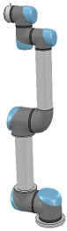

*[Model of robotic manipulator]*

## Building the visible shapes

When building a new model, we first handle only its visual aspect, and leave the dynamic aspect, joints, sensors, etc. for later.

We could directly create simple [shapes](shapes.md) in CoppeliaSim with [Add > Primitive shape > ...]. When doing so, we have the option to create primitive shapes or regular shapes. Primitive shapes are optimized for dynamic interaction and are also directly dynamically enabled (i.e. they fall and collide, but this can be disabled at a later stage). Primitive shapes are simple meshes, which might not contain enough detail or geometric accuracy for our application. In that case, our other option is to import a mesh from an external application.

When importing CAD data from an external application, the most important thing is to make sure that the CAD model is not too heavy, i.e. that it doesn't contain too many triangles. This requirement is important because a heavy model will be slow to display, and will also slow down various calculation modules that might be used at a later stage (e.g. [minimum distance calculation](distanceCalculation.md) or [dynamics](dynamicsModule.md)). The following example is typically a no-go (even though, as we will see later, there are ways to simplify the data within CoppeliaSim):

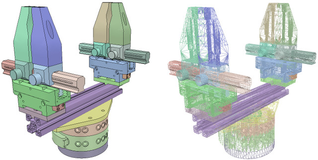

*[Complex CAD data (in solid and wireframe)]*

The above CAD data is very heavy: it contains many triangles (more than 47'000), which would be acceptable if we only used a single instance of it in an empty scene. Most of the time, however, we will want to simulate several instances of the same robot, attach various types of grippers, and maybe have those robots interact with other robots, devices, or the environment. In that case, a simulation scene can quickly become too slow. Generally, we recommend modeling a robot with no more than a total of 20'000 triangles, but most of the time 5'000-10'000 triangles will do just fine. Remember: less is better, in almost every respect.

What makes the above model so heavy? First, models that contain holes and small details require many more triangular faces for a correct representation. So, if possible, we should remove all holes, screws, object interiors, etc. from the original model data. If the original model data is represented as parametric surfaces/objects, then it is usually a simple matter of selecting the items and deleting them (e.g. in Solidworks). The second important step is to export the original data with limited precision: most CAD applications let us specify the level of detail of exported meshes. When the drawing consists of both large and small objects, it might also be important to export the objects in several steps; this avoids having large objects defined too precisely (too many triangles) and small objects defined too roughly (too few triangles): we simply export the large objects first (after adjusting the desired precision settings), then the small objects (after increasing the precision settings).

Now suppose that we have applied all possible simplifications described in the previous section. We might still end up with a mesh that is too heavy after import:

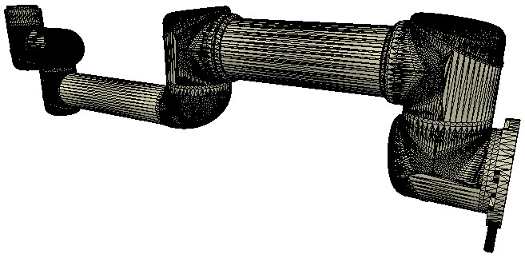

*[Imported CAD data]*

We notice that the whole robot was imported as a single mesh. We will see later how to divide it appropriately. Notice also the wrong orientation of the imported mesh: it is best to keep the orientation as it is until the whole model has been built, since, if at a later stage we want to import other items related to the same robot, they will automatically have the correct position/orientation relative to the original mesh.

At this stage, we have several functions at our disposal to simplify the mesh:

- **Automatic mesh division:** generates a new shape for each group of elements that are not linked together via a common edge. This does not always work for the selected mesh, but it is always worth a try, since working on individual mesh elements gives us more control than working on all elements at the same time. The function can be accessed with [Edit > Shape grouping/merging > divide]. Sometimes, a mesh will be divided more than expected. In that case, we simply merge the elements that logically belong together (i.e. that will have the same visual attributes and that are part of the same link) back into a single shape ([Edit > Shape grouping/merging > merge]). See also [`shape:divide`](sim-2/shape_divide.md) and [`sim.scene:mergeShapes`](sim-2/scene_mergeShapes.md).
- **Extract the convex hull:** simplifies the mesh by transforming it into a convex hull. The function can be accessed with [Modules > Geometry / Mesh > Convex hull...].
- **Extract the convex decomposed mesh:** transforms the mesh into a compound of convex meshes. This is particularly useful for dynamically enabled shapes, so that the physics engine can operate efficiently. The function can be accessed with [Modules > Geometry / Mesh > Convex decomposition].
- **Decimate the mesh:** reduces the number of triangles contained in the mesh. The function can be accessed with [Modules > Geometry / Mesh > Mesh decimation...].

There is no predefined order in which the above functions can or should be applied (except for the first item in the list, which should always be tried first); it heavily depends on the geometry of the mesh we are trying to simplify. The following image illustrates the above functions applied to the imported mesh (let's suppose the first item in the list didn't work for us):

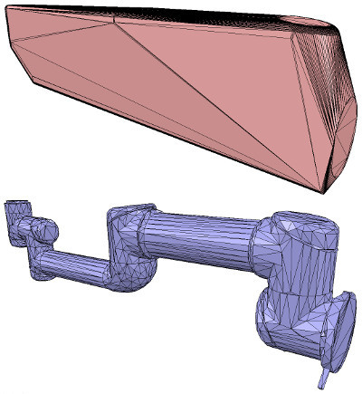

*[Convex hull, and decimated mesh]*

Notice how the convex hull doesn't help us at this stage. We decide to use the mesh decimation function first, and run it twice to reduce the number of triangles by a total factor of 50. We end up with a mesh containing a total of 2'660 triangles (the original imported mesh contained more than 136'000 triangles). The number of triangles/vertices a shape contains can be seen in the [shape geometry dialog](geometryDialog.md). 2'660 triangles is extremely few for a whole robot model, and the visual appearance might suffer a little from it. See also [`shape.meshes`](sim-2/property_shape_meshes.md), [`mesh.vertices`](sim-2/property_mesh_vertices.md) and [`mesh.indices`](sim-2/property_mesh_indices.md).

At this stage, we can start dividing the robot into separate links (remember, we currently have only a single shape for the whole robot). We can do this in two different ways:

- **Automatic mesh division:** this function, already described in the previous section, inspects the shape and generates a new shape for each group of elements that are not linked together via a common edge. This does not always work, but it is always worth a try. The function can be accessed with [Edit > Shape grouping/merging > Divide].
- **Manual mesh division:** via the [triangle edit mode](triangleEditMode.md), we can manually select the triangles that logically belong together, then click **Extract shape**. This generates a new shape in the scene. We then delete the selected triangles.

In the case of our mesh, method 1 worked fine:

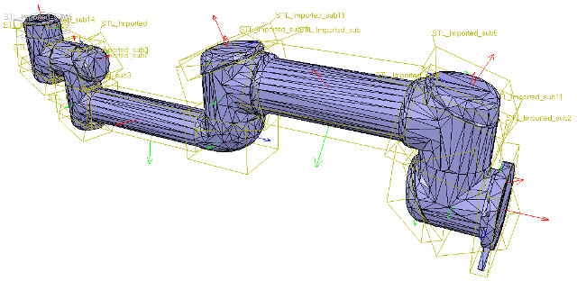

*[Divided mesh]*

Now, we could further refine/simplify individual shapes. Sometimes, a shape might also look better if its convex hull is used instead. At other times, we will have to apply several of the techniques described above iteratively to obtain the desired result. Take for instance the following mesh:

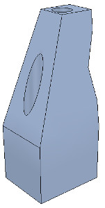

*[Imported mesh]*

The problem with the above shape is that we cannot simplify it nicely because of the holes it contains. So we have to take the more complicated route via the [shape edit mode](shapeEditModes.md), where we can extract individual elements that logically belong to the same convex sub-entity. This process can take several iterations: we first extract 3 approximately convex elements. For now, we ignore the triangles that are part of the two holes. While editing a shape in the shape edit mode, it can be convenient to toggle the [visibility layers](layerSelectionDialog.md) to see what is hidden behind other scene items.

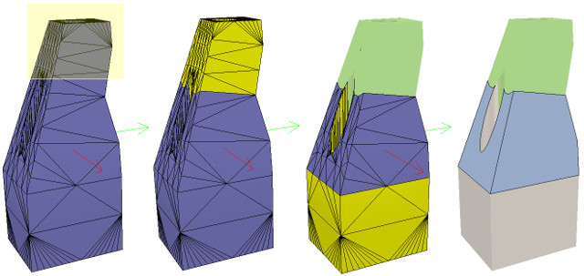

*[Step 1]*

We end up with a total of three shapes, but two of them need further improvement. Now we can erase the triangles that are part of the holes. Finally, we extract the convex hull of each of the 3 shapes individually, then merge them back together with [Edit > Shape grouping/merging > merge]:

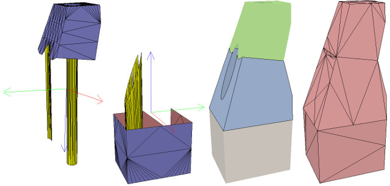

*[Step 2]*

In CoppeliaSim, we can specify a **shading angle** that dictates how faceted the shape will appear. That parameter, and a few others such as the shape **color**, can be adjusted in the [shape dialog](shapeProperties.md). See also [`shape.applyShadingAngle`](sim-2/property_shape_applyShadingAngle.md), [`shape.applyColor_diffuse`](sim-2/property_shape_applyColor_diffuse.md) and similar. Remember that [shapes come in various flavors](shapes.md). So far in this tutorial, we have only dealt with simple shapes: a simple shape has a single set of visual attributes (i.e. one color, one shading angle, etc.). If we merge two shapes, the result is a simple shape. We can also group shapes, in which case each shape retains its visual attributes.

In the next step, we merge the elements that logically belong together (i.e. that are part of the same rigid element and have the same visual attributes). Then we change the visual attributes of the various elements. The easiest approach is to first adjust one shape for each distinct set of colors and visual attributes; if we give a color a specific name, we can later easily change that color programmatically, even if the shape is part of a compound shape. Then we select all shapes that should have the same visual attributes, control-select the shape that was already adjusted, and click **Apply to selection** in the [shape dialog](shapeProperties.md), once for the **Colors** and once for the **other properties**: this transfers all visual attributes to the selected shapes (including the color name, if one was provided). We end up with 17 individual shapes:

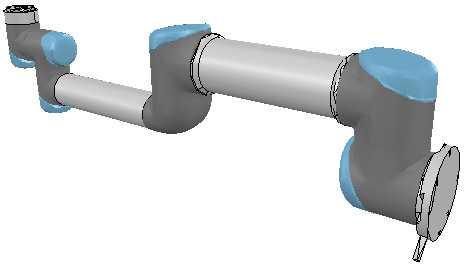

*[Adjusted visual attributes]*

Now we can group the shapes that are part of the same link with [Edit > Shape grouping/merging > group]. See also [`sim.scene:groupShapes`](sim-2/scene_groupShapes.md). We end up with 7 shapes: the base of the robot (or base of the robot's hierarchy tree), and 6 mobile links. It is also important to name our objects correctly: we do this by double-clicking the object name in the [scene hierarchy](userInterface.md#SceneHierarchy). By default, shapes are assigned to visibility layer 1, but this can be changed in the [scene object common properties](sceneObjectPropertiesDialog.md#common). By default, only [visibility layers 1-8 are activated for the scene](layerSelectionDialog.md). See also [`sceneObject.name`](sim-2/property_sceneObject_name.md) and [`sceneObject.layer`](sim-2/property_sceneObject_layer.md). We now have the following:

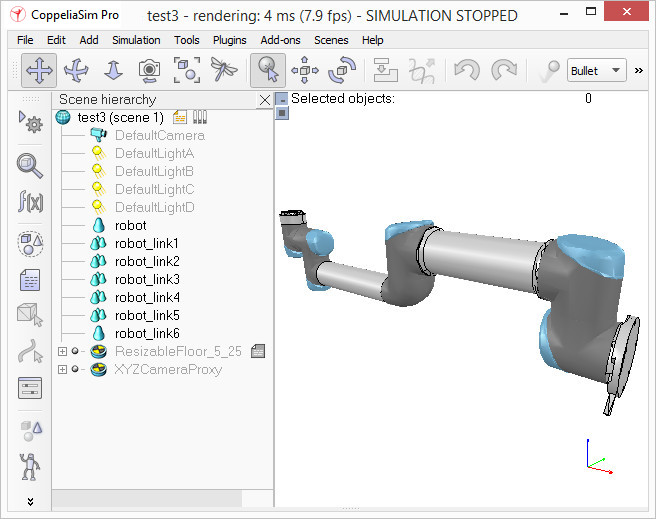

*[Individual elements composing the robot]*

When a shape is created or imported, CoppeliaSim automatically sets its reference frame position and bounding box orientation. Both can be changed at any time via [Edit > Shape reference frame > ...] or [Edit > Shape bounding box > ...]. We select the robot shapes and align their bounding boxes with the world. See also [`shape:relocateFrame`](sim-2/shape_relocateFrame.md) and [`shape:alignBoundingBox`](sim-2/shape_alignBoundingBox.md).

## Building the joints

Now we will take care of the joints/motors. Most of the time, we know the exact pose of each joint. In that case, we simply add the joints with [Add > Joint > ...], then change their pose with the [position dialog](positionDialog.md) and [orientation dialog](orientationDialog.md). In other situations, we only have the Denavit-Hartenberg (i.e. D-H) parameters. In that case, we can build our joints via the tool model located in *Models/tools/Denavit-Hartenberg joint creator.ttm* in the model browser. At other times, we have no information about the joint positions and orientations. Then we need to extract them from the imported mesh. Let's suppose this is our case. Instead of working on the modified, more approximate mesh, we open a new scene and import the original CAD data again. Most of the time, we can extract meshes or primitive shapes from the original mesh. The first step is to subdivide the original mesh. If that does not work, we do it via the [triangle edit mode](triangleEditMode.md). Let's suppose that we could divide the original mesh. We now have smaller objects that we can inspect. We are looking for revolute shapes that can serve as references for creating joints at their locations, with the same orientation. First, we remove all objects that are not needed. It is sometimes also useful to work across several open scenes, for easier visualization/manipulation. In our case, we first focus on the base of the robot: it contains a cylinder that has the correct position for the first joint. In the triangle edit mode, we have:

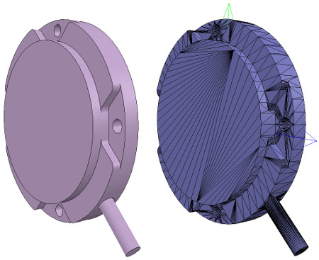

*[Robot base: normal and triangle edit mode visualization]*

We change the camera view via the [page selector](userInterface.md#toolbars) [toolbar button](userInterface.md#toolbars) to look at the object from the side. The [fit-to-view toolbar button](userInterface.md#toolbars) can come in handy to correctly frame the object being edited. Then we switch to the [vertex edit mode](vertexEditMode.md) and select all vertices that belong to the upper disc. Remember that by switching some [layers](layerSelectionDialog.md) on/off, we can hide other objects in the scene. Then we switch back to the triangle edit mode:

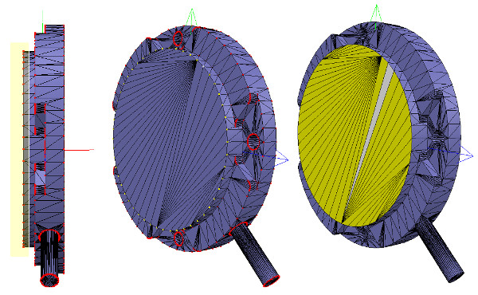

*[Selected upper disc, vertex edit mode (1 & 2), triangle edit mode (3)]*

Now we click **Extract cylinder** (**Extract shape** would also work in this case), which creates a cylinder shape in the scene based on the selected triangles. We leave the edit mode and discard the changes. Now we add a revolute joint with [Add > Joint > Revolute], keep it selected, then control-select the extracted cylinder shape. In the [position dialog](positionDialog.md), on the **position** tab, we click **Apply to selection**: this copies the x/y/z position of the cylinder to the joint. Both positions are now identical. In the [orientation dialog](orientationDialog.md), on the **orientation** tab, we also click **Apply to selection**: the orientations of our selected objects are now also identical. Sometimes, we will additionally need to rotate the joint by 90/180 degrees around its own reference frame to obtain the correct orientation or rotation direction. We can do that on the **rotation** tab of that dialog if needed (in that case, we must not forget to click the **Own frame** button). In a similar way, we could also shift the joint along its axis, or even perform more complex operations. This is what we have:

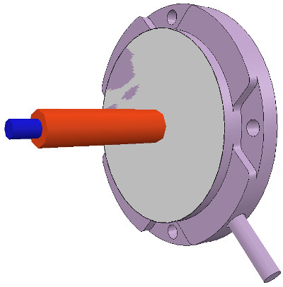

*[Joint in correct location, with the correct orientation]*

Now we copy the joint back into our original scene and save it (we should not forget to save our work regularly). The undo/redo function is useful, but doesn't protect us against other mishaps. We repeat the above procedure for all joints of our robot, then rename them. We also make all joints a little longer in the [joint dialog](jointProperties.md), to see them all. By default, joints are assigned to visibility layer 2, but this can be changed in the [scene object common properties](sceneObjectPropertiesDialog.md#common). We now assign all joints to visibility layer 10, then temporarily [enable visibility layer 10 for the scene](layerSelectionDialog.md) to also see those joints (by default, only visibility layers 1-8 are activated for the scene). This is what we have:

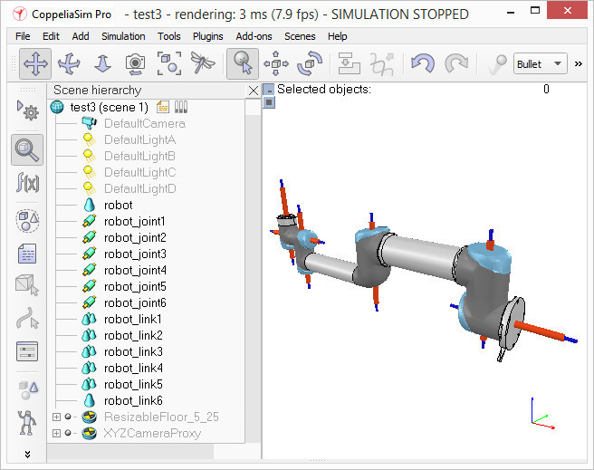

*[Joints in correct configuration]*

At this point, we could start building the model hierarchy and finish the model definition. But if we want our robot to be [dynamically enabled](designingDynamicSimulations.md), there is an additional intermediate step:

## Building the dynamic shapes

If we want our robot to be [dynamically enabled](designingDynamicSimulations.md), i.e. to react to collisions, fall, etc., then we need to create/configure the shapes appropriately. A shape can be:

- **Dynamic or static:** a dynamic (or non-static) shape will fall and be influenced by external forces/torques. A static (or non-dynamic) shape, on the other hand, will stay in place, or follow the movement of its parent in the scene hierarchy. See also [`shape.dynamics.dynamic`](sim-2/property_shape_dynamics_dynamic.md).
- **Respondable or non-respondable**: a respondable shape causes a collision reaction with other respondable shapes. The shape and/or its collider will be influenced in their movement if they are dynamic. Non-respondable shapes, on the other hand, do not produce a collision response when they collide with other shapes. See also [`shape.dynamics.respondable`](sim-2/property_shape_dynamics_respondable.md) and [`shape.dynamics.respondableLayers`](sim-2/property_shape_dynamics_respondableLayers.htm).

The above two points are illustrated [here](designingDynamicSimulations.md#staticAndRespondable). Respondable shapes should be as simple as possible, to allow for a fast and stable simulation. A physics engine can simulate the following 5 types of shapes, with varying degrees of speed and stability:

- [Primitive shapes](designingDynamicSimulations.md#pureShapes)**:** a primitive shape is stable and handled very efficiently by the physics engine. The drawback is that primitive shapes are limited in geometry: mostly cuboids, cylinders, spheres and capsules. If possible, we use them for items that are in contact with other items for longer periods (e.g. the feet of a humanoid robot, the base of a serial manipulator, the fingers of a gripper). Primitive shapes can be created with [Add > Primitive shape].
- [Primitive compound shapes](designingDynamicSimulations.md#pureShapes)**:** a primitive compound shape is a group of several primitive shapes. It performs as well as primitive shapes and shares similar properties. Primitive compound shapes can be generated by grouping several primitive shapes with [Edit > Shape grouping/merging > group].
- [Convex shapes](designingDynamicSimulations.md#convexShapes): a convex shape is slightly less stable and takes slightly more computation time when handled by the physics engine. It allows for a more general geometry than primitive shapes (the only requirement: it needs to be convex). If possible, we use convex shapes for items that are only sporadically in contact with other items (e.g. the various links of a robot). Convex shapes can be generated with [Modules > Geometry / Mesh > Convex hull...].
- [Compound convex shapes, or convex decomposed shapes](designingDynamicSimulations.md#convexShapes): a convex decomposed shape is a group of several convex shapes. It performs as well as convex shapes and shares similar properties. Convex decomposed shapes can be generated by grouping several convex shapes with [Edit > Shape grouping/merging > group], or with [Modules > Geometry / Mesh > Convex decomposition].
- **Random shapes**: a random shape is a shape that is neither convex nor primitive. It generally has poor performance (in calculation speed and stability). We avoid using random shapes as much as possible.

So the order of preference is: primitive shapes, convex shapes and random shapes. See also [`sim.scene:createObject`](sim-2/scene_createObject.md). For the robot we want to build, we will make the base of the robot a primitive cylinder, and the other links convex or convex decomposed shapes.

We could also use the dynamically enabled shapes as the visible parts of the robot, but that would probably not look good enough. Instead, for each visible shape we created in [the first part of the tutorial](#visibleShapes), we will build a dynamically enabled counterpart, which we will keep hidden: the hidden part will represent the dynamic model and be used exclusively by the physics engine, while the visible part will be used for visualization, but also for [minimum distance calculations](distanceCalculation.md), [proximity sensor detections](proximitySensors.md), etc.

We select object *robot*, copy and paste it into a new scene (to keep the original model intact), and start the [triangle edit mode](triangleEditMode.md). If object *robot* were a compound shape, we would first have to ungroup it ([Edit > Shape grouping/merging > ungroup]), then merge the individual shapes ([Edit > Shape grouping/merging > merge]) before being able to start the triangle edit mode. Now we select the few triangles that represent the power cable and erase them. Then we select all triangles of the shape and click Extract cylinder. We can now leave the edit mode, and our base object is represented as a primitive cylinder:

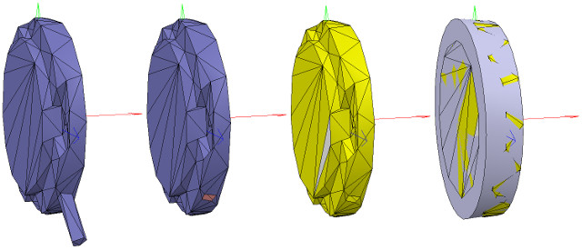

*[Primitive cylinder generation procedure, in the triangle edit mode]*

We rename the new shape (by double-clicking its name in the [scene hierarchy](userInterface.md#SceneHierarchy)) to *robot_dyn*, assign it to visibility layer 9, then copy it to the original scene. The remaining links will be modeled as convex shapes or compound convex shapes. We now select the first mobile link (i.e. object *robot_link1*) and generate a convex shape from it with [Modules > Geometry / Mesh > Convex hull...]. We rename it to *robot_link_dyn1* and assign it to visibility layer 9. If the convex hull doesn't retain enough detail of the original shape, we can still manually extract several convex hulls from its constituent elements, then group all the convex hulls with [Edit > Shape grouping/merging > group]. If that turns out to be problematic or time-consuming, we can automatically generate a convex decomposed shape with [Modules > Geometry / Mesh > Convex decomposition]:

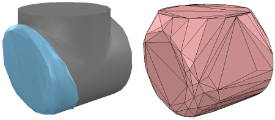

*[Original shape, and convex shape counterpart]*

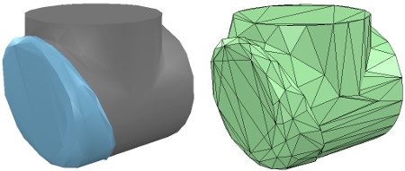

*[Original shape, and convex decomposed shape counterpart]*

We now repeat the same procedure for all remaining robot links. Once that is done, we attach each visible shape to its corresponding invisible dynamic counterpart. We do this by first selecting the visible shape, then control-clicking its dynamic counterpart, then selecting [Edit > Set parent, keep pose(s)]. The same result can be achieved by dragging the visible shape onto its dynamic counterpart in the [scene hierarchy](userInterface.md#SceneHierarchy):

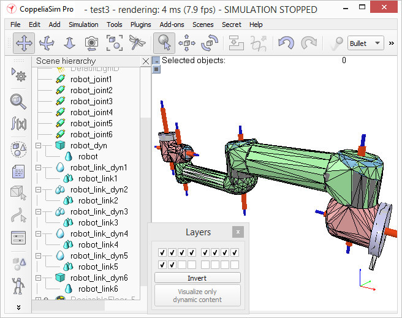

*[Visible shapes attached to their dynamic counterparts]*

We still need to take care of a few things. First, since we want the dynamic shapes to be visible only to the physics engine, and not to the other calculation modules, we uncheck all **object special properties** for the dynamic shapes in the [scene object common properties](sceneObjectPropertiesDialog.md#common).

Then, we still have to configure the dynamic shapes as *dynamic* and *respondable*. We do this in the [shape dynamics dialog](shapeDynamicsProperties.md). We first select the dynamic base shape (i.e. *robot_dyn*), then check the **Body is respondable** item. We enable the first 4 **Local respondable mask** flags and disable the last 4 **Local respondable mask** flags: it is important that consecutive respondable links do not collide with each other. For the first mobile dynamic link of our robot (i.e. *robot_link_dyn1*), we also enable the **Body is respondable** item, but this time we disable the first 4 **Local respondable mask** flags and enable the last 4. We repeat this procedure for all other dynamic links, always alternating the **Local respondable mask** flags: once the model is defined, consecutive dynamic shapes of the robot will not generate any collision response when interacting with each other. We should always try to end up with a construction where the dynamic base of the robot and the last dynamic link of the robot have only the first 4 **Local respondable mask** flags enabled, so that we can attach the robot to a mobile platform, or attach a gripper to the last dynamic link of the robot, without dynamic collision interference.

Finally, we still need to tag our dynamic shapes as **Body is dynamic**. We also do this in the [shape dynamics dialog](shapeDynamicsProperties.md). We can then enter the mass and inertia matrix properties manually, or have those values computed automatically for the selected shapes via [Edit > Shape mass and inertia > compute from uniform density...]. See also [`shape.dynamics:computeInertia`](sim-2/shape_dynamics_computeInertia.md). We should also keep in mind [these](designingDynamicSimulations.md#masses) and [those](designingDynamicSimulations.md#inertias) dynamic design considerations. The dynamic base of the robot is a special case: most of the time, we want the base of the robot (i.e. *robot_dyn*) to be non-dynamic (i.e. static); otherwise, when used alone, the robot might fall over during movement. But as soon as we attach the base of the robot to a mobile platform, we want the base to become dynamic (i.e. non-static). We achieve this by enabling the **Set to dynamic if gets parent** item, then disabling the **Body is dynamic** item. See also [`shape.dynamics.setToDynamicWithParent`](sim-2/property_shape_dynamics_setToDynamicWithParent.md). Now we run the simulation: all dynamic shapes, except for the base of the robot, should fall. The attached visual shapes will follow their dynamic counterparts.

## Model definition

Now we are ready to define our model. We start by building the model hierarchy: we attach the last dynamic robot link (*robot_link_dyn6*) to its corresponding joint (*robot_joint6*) by selecting *robot_link_dyn6*, then control-selecting *robot_joint6*, then selecting [Edit > Set parent, keep pose(s)]. We could also have done this step by simply dragging object *robot_link_dyn6* onto *robot_joint6* in the [scene hierarchy](userInterface.md#SceneHierarchy). We continue by attaching *robot_joint6* to *robot_link_dyn5*, and so on, until we arrive at the base of the robot. We now have the following scene hierarchy:

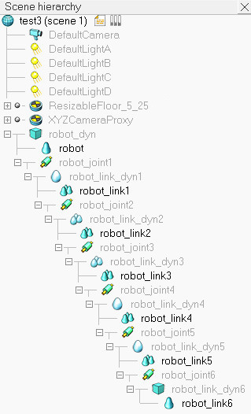

*[Robot model hierarchy]*

It is nicer and more logical to have a simple name for the model base, since the model base also represents the model itself. So we rename *robot_dyn* to *robot*. Now we select the base of the hierarchy tree (i.e. object *robot*), and in the [scene object common properties](sceneObjectPropertiesDialog.md#common) we enable **Object is model base** (see also [`sceneObject.modelBase`](sim-2/property_sceneObject_modelBase.md)). A model bounding box appears, encompassing the whole robot. However, the bounding box appears to be too large: this is because it also encompasses invisible items, such as the joints. We now exclude the joints from the model bounding box by enabling the **Don't show as inside model selection** item for all joints. We could apply the same procedure to all invisible items in our model. This option is also useful for excluding large sensors or other items from the model bounding box. We now have the following situation:

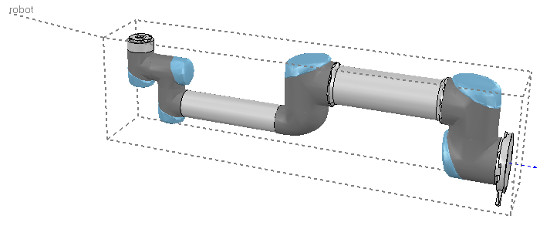

*[Robot model bounding box]*

Next, we protect our model from accidental modification. We select all visible objects of the robot, then enable **Select base of model instead** (see also [`sceneObject.selectModel`](sim-2/property_sceneObject_selectModel.md)): if we now click a visible link in the scene, the base of the robot is selected instead. This allows us to manipulate the model as if it were a single object. We can still select visible objects of the robot by control-shift-clicking them in the scene, or by selecting them in the scene hierarchy. We now put the robot into a correct default position/orientation. First, we save the current scene as a reference (e.g. in case we need to import CAD data at a later stage that has the same orientation as the current robot). Then we select the model and [modify its position/orientation](coordinateDialog.md) appropriately. It is considered good practice to position the model (i.e. its base object) at X=0 and Y=0.

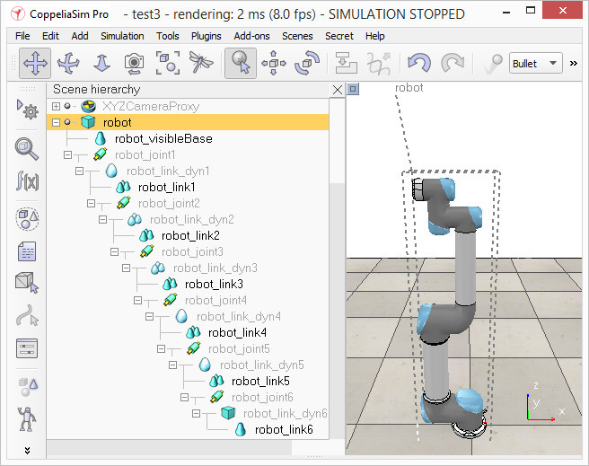

*[Robot model in default configuration]*

We now run the simulation: the robot collapses, since the joints are not controlled by default. [When we added the joints in the previous stage](#joints), we created joints in dynamic mode, but they are currently not controlled. We can now adjust our joints to our requirements; in our case, we want a simple position controller for each of them. In the joint dynamics dialog, we select **Position** as the **Control mode**. We now run the simulation again: the robot should hold its position. We can also switch the current physics engine to check whether the behavior is consistent across all supported physics engines. We can do this via the appropriate [toolbar button](userInterface.md#toolbars), or in the [simulation dialog](simulationPropertiesDialog.md).

During simulation, we now verify the dynamic content of the scene via the [Dynamic content visualization & verification toolbar button](userInterface.md#toolbars). Now, only the items that are taken into account by the physics engine are displayed, and the display is [color-coded](designingDynamicSimulations.md#dynamicContentVisualization). It is very important to always do this, especially when our dynamic model doesn't behave as expected, to debug the model quickly. Similarly, we should always look at the scene hierarchy during simulation: dynamically enabled objects should display a bouncing-ball icon to the right of their names.

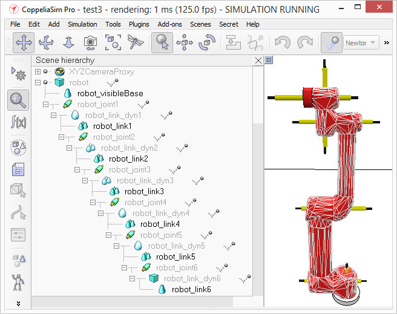

*[Dynamic content visualization & verification]*

Finally, we need to prepare the robot so that we can easily attach a gripper to it, or easily attach the robot to a mobile platform, for instance. Two dynamically enabled shapes can be rigidly attached to each other in two different ways:

- **By grouping them**: select the shapes, then [Edit > Shape grouping/merging > group].
- **By attaching them via a force/torque sensor**: a [force/torque sensor](forceSensors.md) can also act as a rigid link between two separate dynamically enabled shapes.

In our case, only option 2 is of interest. We create a force/torque sensor with [Add > Force sensor], move it to the tip of the robot, then attach it to object *robot_link_dyn6*. We change its size and visual appearance appropriately (a red force/torque sensor is often perceived as an optional attachment point; see the various available robot models). We also change its name to *robot_attachment*:

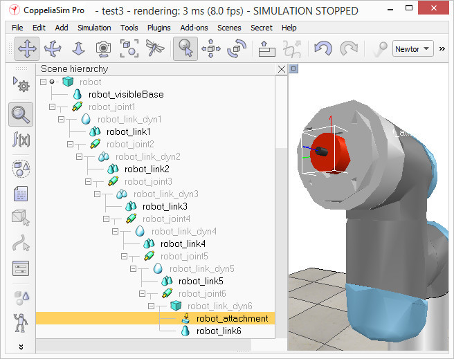

*[Attachment force/torque sensor]*

Now we drag a gripper model into the scene, keep it selected, control-click the attachment force sensor, then click the [Assembling/disassembling toolbar button](userInterface.md#toolbars). The gripper moves into place:

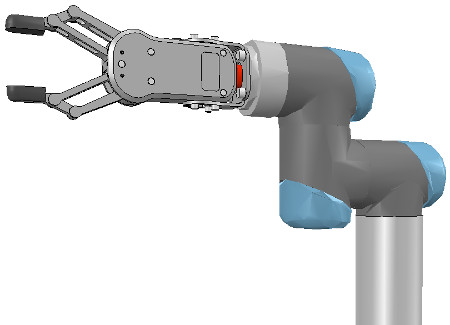

*[Attached gripper]*

The gripper knew how to attach itself because it was configured during its model definition to [assemble](assembly.md) correctly. We follow the same instructions so that the robot and the mobile base assemble correctly. To verify that we did everything right, we drag the model *Models/robots/mobile/KUKA Omnirob.ttm* into the scene. Then we select our robot model, control-click one of the attachment points on the mobile platform, and click the [Assembling/disassembling toolbar button](userInterface.md#toolbars). Our robot should correctly place itself on top of the mobile robot:

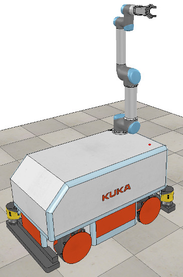

*[Attached robot]*

Now we could add further items to our robot, such as sensors. At some point, we might also want to attach [embedded scripts](scripts.md) to our model, to control its behavior or configure it for various purposes. In that case, we should make sure to understand [how object handles are accessed from embedded scripts](accessingSceneObjects.md). We can also control/access/interface our model from a [plugin](plugins.md), a [remote API](remoteApiOverview.md) client, a [ROS](rosInterfaces.md) node, or an [add-on](addOns.md).

Finally, we make sure that we have reverted the changes made during the robot and gripper attachment, collapse the hierarchy tree of our robot model, select the base of our model, then save it with [File > Save model as...]. If we save it in the *model* folder, the model will be available in the [model browser](userInterface.md#ModelBrowser). See also [`sceneObject:saveModel`](sim-2/sceneObject_saveModel.md).
