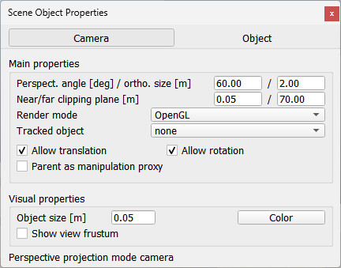

# Camera dialog

The camera dialog is part of the [scene object dialog](sceneObjectPropertiesDialog.md), which is located at [Tools > Scene object properties]. You can also open the dialog with a double-click on an object icon in the [scene hierarchy](userInterface.md#SceneHierarchy), or with a click on its [toolbar](userInterface.md#toolbars) button:

*[Scene object properties toolbar button]*

In the scene object dialog, click the **Camera** button to display the camera dialog (the **Camera** button only appears if the last selection is a [camera](cameras.md)). The dialog displays the settings and parameters of the last selected camera. If more than one camera is selected, then some parameters can be copied from the last selected camera to the other selected cameras (**Apply to selection**-buttons):

*[Camera dialog]*

- **Perspective angle**: the maximum opening angle of the view trapezoid, when the camera is in perspective projection mode. Refer also to [`camera.perspective`](sim-2/property_camera_perspective.md) and [`camera.viewAngle`](sim-2/property_camera_viewAngle.md).
- **Orthographic size**: the orthographic projection size (or view size), when the camera is in orthographic projection mode. Refer also to [`camera.perspective`](sim-2/property_camera_perspective.md) and [`camera.viewSize`](sim-2/property_camera_viewSize.md).
- **Near / far clipping plane**: distance from the camera origin point from which the camera starts / stops *seeing*. If close / far objects should not be displayed, increase / reduce this value. These parameters are directly linked with the rendering precision, especially when an associated view is in perspective projection mode, then you should always be careful not to have too big a gap between the far and near clipping planes, otherwise you might experience some visual artifacts known as *z-fighting* (when surfaces or pixels farther away appear to overlap surfaces/pixels closer to the camera). Refer also to [`camera.clippingPlanes`](sim-2/property_camera_clippingPlanes.md).
- **Render mode**: the render mode of the camera.
- **Tracked object**: object to be tracked by the camera. Tracking an object will not influence the camera's position, only its orientation will be automatically adjusted to *follow* the tracked object. Refer also to [`camera.trackedObject`](sim-2/property_camera_trackedObject.md).
- **Allow translation**: translation movements of the camera are allowed. Refer also to [`camera.translationEnabled`](sim-2/property_camera_translationEnabled.md).
- **Allow rotation**: rotation movements of the camera are allowed. Refer also to [`camera.rotationEnabled`](sim-2/property_camera_rotationEnabled.md).
- **Parent as manipulation proxy**: if enabled, then the camera manipulation toolbar buttons will not affect the camera's position directly, but instead will affect the camera's parent object. This option is useful if you wish to have several cameras linked to each other (e.g. the default scene in CoppeliaSim has 3 cameras arranged orthogonally to each other. If one is moved, the two others will follow). Refer also to [`camera.parentAsManipulationProxy`](sim-2/property_camera_parentAsManipulationProxy.md).
- **Object size**: size of the camera. This parameter has only a visual effect and no functional meaning. Refer also to [`camera.size`](sim-2/property_camera_size.md).
- **Color**: allows adjusting a camera's color.
- **Show view frustum**: if selected, the view frustum (volume) is shown. Refer also to [`camera.showFrustum`](sim-2/property_camera_showFrustum.md)
