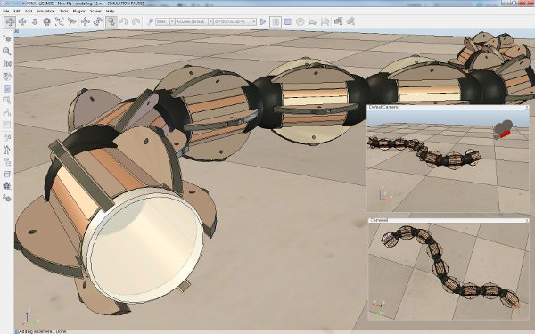
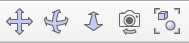
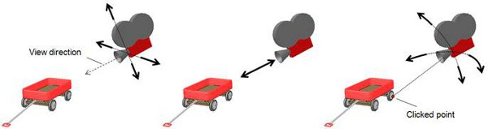

# Cameras

A camera is an instance of the [camera type](mainObjectTypes.md#camera), which in turn derives from the [sceneObject type](mainObjectTypes.md#sceneObject). Cameras are [viewable objects](viewableObjects.md). You can have as many cameras as needed in your [scene](scenes.md), each one of them offering a different [view](pagesAndViews.md) of the scene. The following shows an example of a scene containing several cameras:

*[Scene displaying views of three different cameras]*

Make sure not to mix up cameras with [vision sensors](visionSensors.md). The following are the main differences:

- A camera has no specific resolution (i.e. it adjusts automatically to the view size). A vision sensor has a fixed resolution.
- A camera's image content is not directly available via the [API](apisOverview.md) (but via a callback mechanism), and image processing is not directly supported. A vision sensor's image content can be accessed via the API, and processed via the [vision callback functions](visionCallbackFunctions.md).
- A camera generally requires less CPU time and operates faster than vision sensors.
- A camera can display all [object types](objects.md). A vision sensor mainly displays [shapes](shapes.md), [oc trees](octrees.md) and [point clouds](pointClouds.md).

A camera can be added to the scene with [Add > Camera]. Refer also to [sim.scene:createObject](sim/scene_createObject.htm) and [camera-related methods and properties](apiFunctions.md#methodsAndProperties_camera). However adding a camera in this way adds the [object](objects.md) in a default pose. It is a better practice to add cameras by right-clicking on a specific view of a scene and selecting [Popup menu > Add > Camera]. This adds the object just in front of the current view. The added camera is automatically selected and you can then *look through it* with [Popup menu > View > Associate view with selected camera]. For this to work you will have to make sure the popup menu is activated on a view. When a view is created but not yet associated with a viewable object, the [Popup menu > Add > Camera] command will add a camera and directly associate it with the view (i.e. *look through it*). A camera can be associated with any number of views.

Alternatively you can also associate a view with a camera by activating the following popup in a view: [Popup menu > View > View selector..]. This will allow you to select the desired camera view from a preview window. When a camera is associated with a view, it can be manipulated with the mouse with the following toolbar buttons:

*[Camera navigation toolbar buttons: pan, rotate, shift, zoom, and fit-to-view]*

- **Pan button**: allows shifting the camera in a perpendicular plane to the view direction. The clicked point in the scene will shift at the same rate as the mouse movement. If no specific point is clicked (i.e. when the background is clicked), the shift operation will be performed for an invisible point close to the camera.
- **Rotate button**: allows rotating the camera about the clicked point in the scene. If no specific point is clicked (i.e. when the background is clicked), the rotate operation will be performed about an invisible point close to the camera.
- **Shift button**: allows shifting the camera along the view direction. This has a zoom effect on camera views that are in perspective projection mode, but camera views in orthogonal projection mode might not see any effect (the cameras will however be shifted along their view direction).
- **Camera angle button**: allows adjusting the perspective projection angle of a camera view (when in perspective projection mode), or allows adjusting the view size of a camera view (when in orthogonal projection mode).
- **Fit-to-view button**: adjusts the camera of the view that has the focus to nicely frame all selected objects, or the entire scene if no object is selected.

While the left mouse button allows above operations, the wheel of the mouse allows shifting the camera along the view direction (if the camera view is in perspective projection mode) or allows adjusting the view size of the camera view (if the camera view is in orthogonal projection mode). The right button, when clicked without a mouse movement, will activate a popup menu; however, if the right button is kept pressed while moving the mouse, a camera rotation about the clicked point can be achieved.

When the camera shift button is activated, it is very easy to navigate in the scene to any desired pose using: (1) the left mouse button for shifting perpendicular to the view direction, (2) the mouse wheel for shifting along the view direction, and (3) the right mouse button for rotating about the clicked point:

*[Default camera navigation: (1) pan with left mouse button, (2) shift with mouse wheel, (3) rotate with right mouse button]*

Cameras can automatically track objects (i.e. follow them as they move) by selecting the object to track, then selecting in the appropriate view [Popup menu > View > Track selected object]. A tracking camera will keep its position, but automatically adjust its viewing direction to always keep the object to track in its view field. This is different from having a camera attached to that object through a parent-child relationship.
