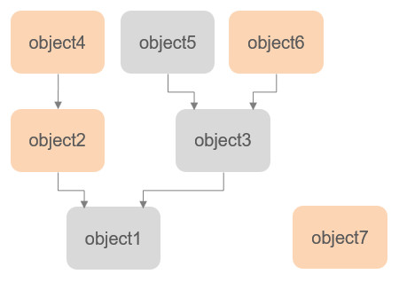

# Collections

A collection is a user-defined collection of [scene objects](objects.md). Both collections and scene objects are [entities](entities.md). Collections are useful when referring to several objects like a robot for instance, when performing a specific operation, such as [checking for collision](collisionDetection.md) between two robots for example.

Collections are [collidable](collidableObjects.md), [measurable](measurableObjects.md) and [detectable](detectableObjects.md) entities. This means that collections:

- Can be used in [collision detections](collisionDetection.md) against other collidable entities. Refer also to [`collection:checkCollision`](sim-2/collection_checkCollision.md)
- Can be used in [minimum distance calculations](distanceCalculation.md) with other measurable entities. Refer also to [`collection:checkDistance`](sim-2/collection_checkDistance.md)
- Can be detected by [proximity sensors](proximitySensors.md). Refer also to [`proximitySensor:checkSensor`](sim-2/proximitySensor_checkSensor.md)

Even if a collection itself is collidable, measurable and detectable, this doesn't mean that all objects contained in the collection are collidable, measurable and detectable:

- During collision detection, only the collidable objects of a collection (subset of the collection) are tested against another collidable entity.
- During distance measurement, only the measurable objects of a collection (subset of the collection) are measured against another measurable entity.
- Only the detectable objects of a collection (subset of the collection) can be detected by proximity sensors.

A collection can however override the collidable, measurable and detectable properties of its objects, when creating the collection with [`sim.scene:createObject`](sim-2/scene_createObject.md).

A collection is defined by one or several items that can be combined in an additive or subtractive manner. The following items are supported:

- A single object
- A tree of objects: this item represents all descendants of a single object (located at the tree root). If the tree grows or shrinks, the item will dynamically grow/shrink too.
- A chain of objects: this represents all objects encountered when following all ancestors of a single object. If the chain grows or shrinks, the item will dynamically grow/shrink too.
- All scene objects

A collection is not static, and is constantly evaluated/updated to determine its containing objects (refer also to [`collection.objects`](sim-2/property_collection_objects.md)). A given collection can also be defined in many different ways, depending on specific needs:



*[Example collection containing 4 objects (the colored objects]*

The above collection could be defined as a combination of 4 items, resulting in the following code:

```python
import sim

# Collection defined as: <object2> + <object4> + <object6> + <object7>

object2 = sim.self:getObject('/object2')
object4 = sim.self:getObject('/object4')
object6 = sim.self:getObject('/object6')
object7 = sim.self:getObject('/object7')
collection = sim.scene:createObject({'type': 'collection'})
collection:addItem(object2)
collection:addItem(object4)
collection:addItem(object6)
collection:addItem(object7)
```

```lua
import 'sim-2'

-- Collection defined as: <object2> + <object4> + <object6> + <object7>

local object2 = sim.self:getObject('/object2')
local object4 = sim.self:getObject('/object4')
local object6 = sim.self:getObject('/object6')
local object7 = sim.self:getObject('/object7')
local collection = sim.scene:createObject({type = 'collection'})
collection:addItem(object2)
collection:addItem(object4)
collection:addItem(object6)
collection:addItem(object7)
```

But a similar collection could also be defined as a combination of the following 3 items too:

```python
import sim

# Collection defined as: <all objects> - <tree starting at object1> + <object6>

object1 = sim.self:getObject('/object1')
object6 = sim.self:getObject('/object6')
collection = sim.scene:createObject({'type': 'collection'})
collection:addItem(-1, {'mode': 'all'}
collection:removeItem(object1, {'mode': 'tree'}
collection:addItem(object6, {'mode': 'single'}
```

```lua
import 'sim-2'

-- Collection defined as: <all objects> - <tree starting at object1> + <object6>

local object1 = sim.getObject('/object1')
local object6 = sim.getObject('/object6')
local collection = sim.scene:createObject({type = 'collection'})
collection:addItem(-1, {mode = 'all'})
collection:removeItem(object1, {mode = 'tree'})
collection:addItem(object6, {mode = 'single'})
```
