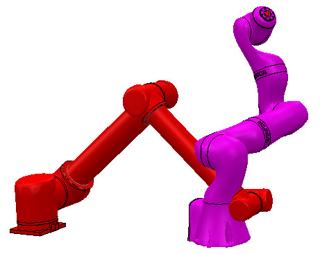

# Collision detection

CoppeliaSim can detect collisions between two [collidable](collidableObjects.md) [entities](entities.md) in a flexible way. The calculation is an exact interference calculation. Collision detection only detects collisions and does not react to them (for collision response, refer to the [dynamics module](dynamicsModule.md)).



*[Collision detection between two manipulators]*

Using [`sceneObject:checkCollision`](sim-2/sceneObject_checkCollision.md) and [`collection:checkCollision`](sim-2/collection_checkCollision.md), you can easily check for collision between entities, for instance between a robot and its environment, from within a [simulation script](simulationScripts.md), in each simulation step:

```python
import sim
from types import SimpleNamespace
state = SimpleNamespace()

def sysCall_init():
    robotBase = sim.self.getObject('/robotModelName')
    state.robotCollection = sim.scene.createObject({'type': 'collection'})
    state.robotCollection.addItem(robotBase, {'mode': 'tree'})

def sysCall_sensing():
    result, pairHandles = state.robotCollection.checkCollision(sim.handle.all)
    if result > 0:
        print(f'Robot is colliding. Colliding pair is {getAsString(pairHandles)}')
```

```lua
import 'sim-2'

function sysCall_init()
    local robotBase = sim.self:getObject('/robotModelName')
    robotCollection = sim.scene:createObject({type = 'collection'})
    robotCollection:addItem(robotBase, {mode = 'tree'})
end

function sysCall_sensing()
    local result, pairHandles = robotCollection:checkCollision(sim.handle.all)
    if result > 0 then
        print('Robot is colliding. Colliding pair is ' .. getAsString(pairHandles))
    end
end
```

One can also temporarily modify the color of [objects](objects.md) or whole [collections](collections.md), to visually indicate a collision:

```python
import sim
from types import SimpleNamespace
state = SimpleNamespace()

def change_pair_color(entity_pair, color_pair):
    state.original_color_data = []
    state.original_color_data.append(entity_pair[0])
    state.original_color_data.append(entity_pair[0].changeColor(color_pair[0]))
    state.original_color_data.append(entity_pair[1])
    state.original_color_data.append(entity_pair[1].changeColor(color_pair[1]))

def restore_pair_color():
    if hasattr(state,'original_color_data'):
        state.original_color_data[0].restoreColor(state.original_color_data[1])
        state.original_color_data[2].restoreColor(state.original_color_data[3])

def sysCall_init():
    robot_base = sim.self.getObject('/irb360')
    state.robot_collection = sim.scene.createObject({'type': 'collection'})
    state.robot_collection.addItem(robot_base, {'mode': 'tree'})
    state.collision_colors = [[1, 0, 0, 255], [1, 0, 1, 255]]  # collider and collidee

def sysCall_sensing():
    result, pair_handles = state.robot_collection.checkCollision(sim.handle.all)
    restore_pair_color()
    if result:
        # Change color of the collider and collidee objects:
        change_pair_color([pair_handles[0], pair_handles[1]], state.collision_colors)

def sysCall_cleanup():
    restore_pair_color()
```

```lua
import 'sim-2'

function changePairColor(entityPair, colorPair)
    originalColorData = {}
    originalColorData[1] = entityPair[1]
    originalColorData[2] = entityPair[1]:changeColor(colorPair[1])
    originalColorData[3] = entityPair[2]
    originalColorData[4] = entityPair[2]:changeColor(colorPair[2])
end

function restorePairColor()
    if originalColorData then
        originalColorData[1]:restoreColor(originalColorData[2])
        originalColorData[3]:restoreColor(originalColorData[4])
        originalColorData = nil
    end
end

function sysCall_init()
    local robotBase = sim.self:getObject('/irb360')
    robotCollection = sim.scene:createObject({type = 'collection'})
    robotCollection:addItem(robotBase, {mode = 'tree'})
    collisionColors = {Color('red'), Color('green)}  -- collider and collidee
end

function sysCall_sensing()
    local result, pairHandles = robotCollection:checkCollision(sim.handle.all)
    restorePairColor()
    if result then
        -- Change color of the collider and collidee objects:
        changePairColor({pairHandles[1], pairHandles[2]}, collisionColors)
    end
end

function sysCall_cleanup()
    restorePairColor()
end
```

CoppeliaSim's collision detection functionality is also available as stand-alone routines via the [Coppelia geometric routines](coppeliaGeometricRoutines.md).

See also the [add-on](addOns.md) in [Modules > Geometry / Mesh > Collision check ] that allows you to quickly check for self-collision, collision with the environment, or collision between two entities.
