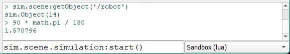

# Commands/settings

You can adjust the way CoppeliaSim operates via a [plugin](plugins.md) or an [add-on](addOns.md), but you can also modify its behavior via:

- [Command line](#commandLine) arguments
- The [overall settings file](#settingsFile)
- [Environment variables](#environment)
- The [status bar commander](#commander)

Additionally, you can interact with CoppeliaSim via script functions and the [commander](#commander).

## <a id="commandLine"></a>Command line

When you start CoppeliaSim via the command line, you have the following command line options that are supported:

- **-v&lt;verbosity>**: sets the verbosity level in the console. Default is **loadinfos**. Other accepted values are **none**, **errors**, **warnings**, loadinfos, **scripterrors**, **scriptwarnings**, **scriptinfos**, **infos**, **debug**, **trace**, **tracelua** and **traceall**. Plugins should output messages via [simAddLog](sim/simAddLog.htm), scripts via [sim.addLog](sim/simAddLog.htm). Verbosity can change during runtime: from within CoppeliaSim, global verbosity can be adjusted with [app.consoleVerbosity](sim/property_app_consoleVerbosity.htm) and [app.statusbarVerbosity](sim/property_app_statusbarVerbosity.htm), and plugin verbosity with [app:setPluginInfo](sim/app_setPluginInfo.htm). By default, plugin verbosity follows global verbosity. Command line verbosity setting can be overridden via the *verbosity* value in *system/usrset.txt*. Additionally, console log messages can be filtered via the *consoleLogFilter* value in *system/usrset.txt*.
- **-w&lt;verbosity>**: similar to the **-v** setting above, but for the verbosity level in the [status bar](userInterface.md#statusBar). Default is **scriptinfos**. Status bar verbosity setting can be overridden via the *statusbarVerbosity* value in *system/usrset.txt*.
- **-x&lt;verbosity>**: similar to the -**v** or **-w** setting above, but for the verbosity level for simple dialogs. Default is **infos**. Other accepted values are **none**, **errors**, **warnings** and **questions**. Dialog verbosity setting can be overridden via the *dialogVerbosity* value in *system/usrset.txt*.
- **-c&lt;scriptString>**: executes the script string as soon as the sandbox is initialized.
- **-H**: runs CoppeliaSim in *true* headless mode (i.e. without any GUI or GUI dependencies). A display server is however still required. Instead of using library *coppeliaSim*, library *coppeliaSimHeadless* will be used. Keep in mind that in that case, [vision sensors](visionSensors.md) won't operate, unless they use the Pov-Ray rendering mode (and the [Pov-Ray plugin](https://github.com/CoppeliaRobotics/simPovRay) is installed, binaries available [here](https://github.com/CoppeliaRobotics/simPovRay/tree/master/binaries)), and that rendering will be drastically slower.
- **-h**: runs CoppeliaSim in an *emulated* headless mode: this simply suppresses all GUI elements (e.g. doesn't open the main window), but otherwise runs normally.
- **-s&lt;simulationTimeInMM>**: automatically starts the simulation and runs it for a certain amount of milliseconds. Use a value of 0 to disable automatic stopping.
- **-q**: automatically quits CoppeliaSim after the first simulation run has ended.
- **-a&lt;addOn.lua>** and/or **-b&lt;addOn.lua>**: loads and runs an additional [add-on](addOns.md) specified via its filename.
- **-G&lt;key>=&lt;value>**: named parameter, can be queried within CoppeliaSim with [named parameter properties](properties.md#namedParams). With **-Glicense=licenseKey** you can enable a specific license key string.
- **-g&lt;string>**: represents an optional string argument that can be queried with [sim.app.args](sim/property_app_args.htm).
- **-O&lt;bitCoded>**: disables [specific GUI items](apiConstants.md#startupOptions).
- **-f&lt;scene.ttt>** or **-f&lt;scene.simscene.xml**>: loads a [CoppeliaSim scene](scenes.md).
- **-f&lt;model.ttm**> or **-f&lt;model.simmodel.xml**>: loads a [CoppeliaSim model](models.md).

For example, to start CoppeliaSim in headless mode, load the scene *myScene.ttt*, run the simulation for 5 seconds, then stop the simulation and automatically leave CoppeliaSim again, type from within the CoppeliaSim main folder:

```
Windows:
$ coppeliaSim.exe -h -s5000 -q myScene.ttt

Linux:
$ ./coppeliaSim.sh -h -s5000 -q myScene.ttt

Mac:
$ ./coppeliaSim.app/Contents/MacOS/coppeliaSim -h -s5000 -q ../Resources/myScene.ttt
```

## <a id="settingsFile"></a>Overall settings file

When CoppeliaSim starts, the file *usrset.txt* is read and values applied. Settings apply to various areas, such as:

- debugging
- rendering/display
- directories
- serialization
- messaging
- compatibility
- Floating license
- etc.

The location of file *usrset.txt* can be queried via [sim.app.paths.settings](sim/property_app_paths_settings.htm).

## <a id="environment"></a>Environment variables

The following environment variables allow you to modify the behavior of CoppeliaSim:

- COPPELIASIMPLUGIN_IGNORE_MISSING_SYMBOLS. If defined, then plugins will ignore missing symbols
- COPPELIASIM_USER_SETTINGS_FOLDER_SUFFIX. Will append a suffix to the user settings folder. This can be used to start several CoppeliaSim instances, with different user settings.
- COPPELIASIM_CONSOLE_LOG_FORMAT. The format of the console log, e.g. "[{origin}:{verbosity}] {message}"
- COPPELIASIM_STATUSBAR_LOG_FORMAT. The format of the status bar log, e.g. "&lt;font color='grey'>[{origin}:{verbosity}]&lt;/font> &lt;font color='{color}'>{message}&lt;/font>"
- COPPELIASIM_STATUSBAR_LOG_FORMAT_UNDECORATED. The format of the status bar log when *undecorated* is specified, e.g. "&lt;font color='{color}'>{message}&lt;/font>"
- COPPELIASIM_STATUSBAR_LOG_TO_CONSOLE. If set, send statusbar messages to the console too

## <a id="commander"></a>Status bar commander

The commander, implemented via the [simCmd plugin](https://github.com/CoppeliaRobotics/simCmd), is a read-eval-print loop that adds a text input to the CoppeliaSim status bar, which allows entering and executing Python or Lua code on the fly, like in a terminal. The code can be run in the [sandboxes](sandboxScript.md), or any other active script in CoppeliaSim. The behavior of the plugin can be controlled via [Modules > Developer tools > commander]. It also offers its own [API functions](simCmd/simCmd.htm). Additionally, *help()* will display usage tips.



*[Commander]*
