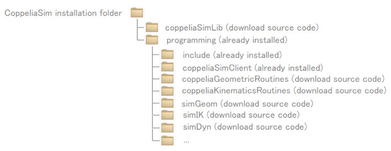

# Compiling CoppeliaSim and related items

The full source code of CoppeliaSim (including most plugin source codes and others) can be found [here](https://github.com/CoppeliaRobotics). While the CoppeliaSim library ([coppeliaSimLib](https://github.com/CoppeliaRobotics/coppeliaSimLib)) is GNU GPL licensed, the geometric and kinematics plugins ([simGeom](https://github.com/CoppeliaRobotics/simGeom) and [simIK](https://github.com/CoppeliaRobotics/simIK)) have a specific license attached. In short, only educational entities (students, teachers, professors, schools or Universities) may download and use that plugin without explicit permission.

CoppeliaSimLib and the geometric plugin are [Qt](http://qt-project.org/) projects, and will require you to have Qt installed on your computer. Try to comply with the following list of requirements to encounter least problems during compilation:

- If possible, try using the same Qt version as the one that was used to compile the binary CoppeliaSim Edu (click [Help > About CoppeliaSim Edu...] to display the Qt version)
- For Qt projects, make sure to use the same compiler as the one that was used to compile the binary CoppeliaSim Edu.
- Ubuntu is the preferred Linux distribution.
- You will need to download and compile [QScintilla2](http://www.riverbankcomputing.com/software/qscintilla/intro) (C++ editor control).
- You will need to download and install the [Boost C++ library](http://www.boost.org/).
- You will need to download the [Lua5.4](http://www.lua.org/) binaries and headers.

Download and install CoppeliaSim Edu. Then download the CoppeliaSimLib library source code (and optionally the plugin source codes) into the CoppeliaSim Edu installation folder. You should have the following folder structure:

When using CoppeliaSim in conjunction with a plugin, make sure to use the source code / binaries that come from the same release (check the release tags), to avoid incompatibilities. Finally, before being able to compile the CoppeliaSim project, you will have to adjust various paths in the *config.pri* file.

CoppeliaSimLib compiles to a shared library. The default client application that loads and runs the library is *coppeliaSim* or *coppeliaSim.exe*. You can use the precompiled one, or recompile it yourself (refer to the following repositories: [coppeliaSimClient](https://github.com/CoppeliaRobotics/coppeliaSimClient) and [coppeliaSimClientPython](https://github.com/CoppeliaRobotics/coppeliaSimClientPython)). The load operation of the library is successful only if:

- The client application could find all needed functions in the shared library
- The shared library could find all shared libraries that it depends on (e.g. the Lua shared library)

The easiest for you is to copy the compiled libraries into the CoppeliaSim folder, then you will be sure that CoppeliaSim should start and won't complain about missing dependencies.

It is very important that you do not mix various Qt versions, or binaries from various compilers. If your main CoppeliaSimLib library was compiled with Qt X and compiler Y, then all plugins related to CoppeliaSim should also have been compiled with Qt X and compiler Y, otherwise, you can experience strange behaviors (library that cannot load, sudden crashes, etc.). This requirement can be relaxed if your plugin is not making use of any Qt function.
