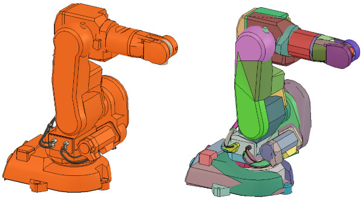

# Convex decomposition

CoppeliaSim allows calculating and adding the convex decomposition of specified [shapes](shapes.md). Convex shapes perform faster and are more stable than random shapes, with regard to dynamic collision response calculation. They are however not as fast nor as stable as [primitive shapes](shapes.md).

You can generate the convex decomposition equivalent of a shape with [Modules > Geometry / Mesh > Convex decomposition]:

*[Non-convex model (left) and corresponding convex-decomposed model (right)]*

See also the [simOpenMesh API](simOpenMesh/simOpenMesh.md) and [calculation of a shape's convex hull](convexHull.md).
