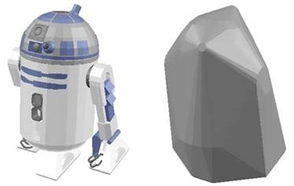

# Convex hull

CoppeliaSim allows calculating and adding the convex hull of specified [objects](objects.md). The convex hull of a collection of meshes is the smallest convex envelope that encompasses all meshes. CoppeliaSim allows extracting the convex hull of [measurable objects](measurableObjects.md) only.

To add a convex hull, select objects that you want to have included in the convex hull and select [Modules > Geometry / Mesh > Convex hull...].

Depending on situations, convex hulls can drastically reduce calculation times in case of [distance calculations](distanceCalculation.md) or [proximity sensor](proximitySensors.md) simulations for instance. [Collision detection](collisionDetection.md) can also be performed faster if a rougher approximation (i.e. the convex hull) of a complex [shape](shapes.md) is used instead. One can also extract the convex hull of a [model](models.md) (e.g. robot), hide it, but perform all calculations (collision detection, distance calculations) using the invisible convex hull instead of the complex model.

*[Objects forming a robot model (left) and corresponding simplified representation as convex hull (right)]*

See also the [simConvex API](simConvex/simConvex.md) and [calculation of a shape's convex decomposition](convexDecomposition.md).
