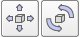

# Position/orientation manipulation

The user can modify and manipulate an object or item's pose by using one of the following [toolbar](userInterface.md#toolbars) buttons:

*[Manipulation toolbar buttons (position and orientation)]*

The first displays the [position dialog](positionDialog.md), while the second displays the [orientation dialog](orientationDialog.md). In both cases, the user will also be able to [move the selected objects or items with the mouse](objectMovement.md).
