# CoppeliaSim main features

## 5 Programming Approaches

[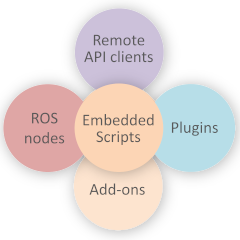](writingCode.md#sixMethods)

Simulator and simulations are fully customizable, with 5 programming approaches that are mutually compatible and that can even work hand-in-hand. 6 supported programming languages.

## Powerful APIs, 7 languages

[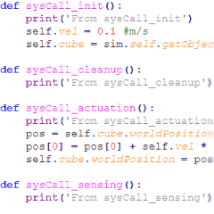](apisOverview.md)

**Regular API**: Python, Lua and C/C++

**Remote API**: C/C++, Python, Java, JavaScript, Matlab & Octave

**ROS interfaces**: publishers, subscribers & service calls. Support all standard messages, extendable.

## Remote API

[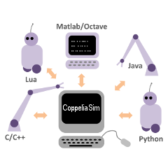](remoteApiOverview.md)

Control a simulation or the simulator itself remotely (e.g. from a real robot or another PC)

## Dynamics/Physics

[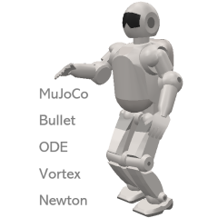](dynamicsModule.md)

5 physics engines (MuJoCo, Bullet Physics, ODE, Vortex and Newton Dynamics) for fast and customizable dynamics calculations, to simulate real-world physics and object interactions (collision response, grasping, etc.)

## Inverse/Forward Kinematics

[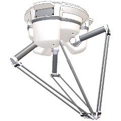](kinematics.md)

Inverse/forward kinematics calculations for any type of mechanism (branched, closed, redundant, containing nested loops, etc.). An embeddable version of the IK/FK algorithms is available (i.e. can run on your robot).

## Soft Bodies

[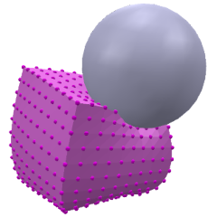](apiFunctions.md#particleObject)

CoppeliaSim supports soft bodies, strings, ropes, cloths, etc. via the MuJoCo engine.

## Collision Detection

[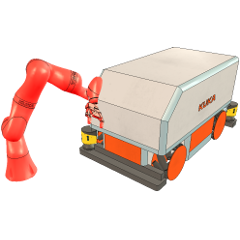](collisionDetection.md)

Fast interference checking between any mesh, OC tree, point cloud, or collection of those.

## Minimum Distance Calculation

[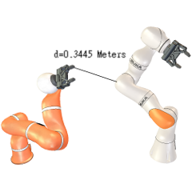](distanceCalculation.md)

Fast and exact minimum distance calculation between any mesh (convex, concave, open, closed), OC tree, point cloud, or collection of those.

## Cross-Platform & Portable

[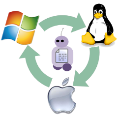](simulationScripts.md)

CoppeliaSim is cross-platform, and allows the creation of portable, scalable and easily maintainable content: a single portable file can contain a fully functional model (or scene), including control code.

## Proximity Sensor Simulation

[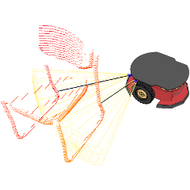](proximitySensorDescription.md)

Powerful and realistic proximity sensor simulation (exact min. distance calculation within a customizable detection volume). Much more continuous operation than with discrete ray sensors. Operates on meshes, OC trees and point clouds

## Vision Sensor Simulation

[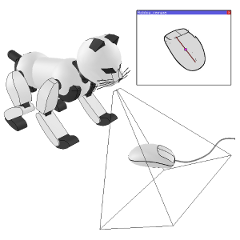](visionSensors.md)

Simulation of vision sensors with many possibilities for image processing, fully customizable and extendable (e.g. via plugin)

## Building Block Concept

[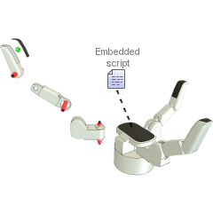](objects.md)

Anything - from sensors or actuators, to whole robotic systems - can be built within CoppeliaSim by combining basic objects and linking various functionality via embedded scripts. Every scene object can have its own embedded script!

## Path/Motion Planning

[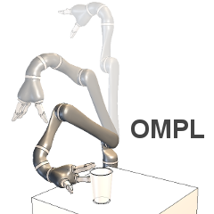](pathAndMotionPlanningModules.md)

Path planning / motion planning is supported in a very flexible way via the [OMPL library](http://ompl.kavrakilab.org/) wrapped in a plugin for CoppeliaSim

## Data Recording and Visualization

[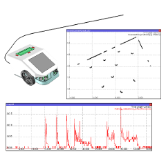](graphs.md)

A large variety of recordable data streams (including user-defined) can display time-graphs, or can be combined with each other to form x/y-graphs, or 3D curves

## Custom User Interfaces

[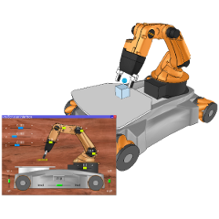](customUIPlugin.md)

Unlimited number of fully customizable user interface elements

## Integrated Edit Modes

[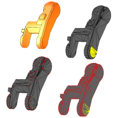](shapeEditModes.md)

Special mesh edit modes are supported (including a semi-automatic primitive shape extraction method, convex decomposition, mesh decimation, etc.)

## Easy Data Import/Export

[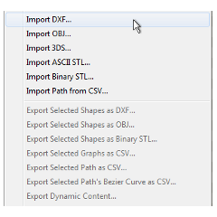](importExport.md)

Many formats are supported: URDF, SDF, Collada, STL, DXF, OBJ, glTF, etc.

## RRS Interface & Motion Library

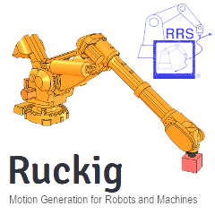

The [RRS-1](http://www.realistic-robot-simulation.org/) interface specifications are fully implemented, and the [Reflexxes](http://www.reflexxes.com) Motion Library and [Ruckig Online Trajectory Generator](https://github.com/pantor/ruckig#readme) are fully supported.

## Full-Featured Scene Hierarchy

[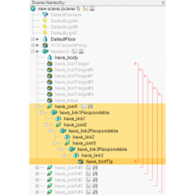](userInterface.md#SceneHierarchy)

The scene composition is intuitively visualized in a scene hierarchy view, indicating object names, types, associated control scripts, loop closures, selection and visibility states, warnings, etc.

## Convenient Model Browser

[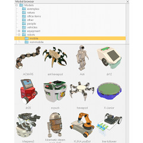](userInterface.md#ModelBrowser)

The integrated model browser supports drag-and-drop operations (also during simulation!) for convenient scene composition. The available model library, updated at each release, can be easily extended by the user

## Full Interaction

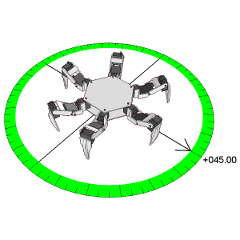

Full interaction also during simulations: models, together with their associated behavior (i.e. embedded scripts) can be shifted, rotated, copy/pasted, scaled, erased, etc. without having to adjust any code

## Free Educational License

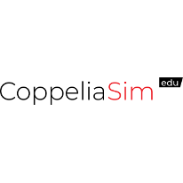

Educational entities (hobbyists, students, teachers, professors, schools and Universities) can use CoppeliaSim Edu for free. The source code of all elements is available. Refer to the [licensing page](licensing.md) for details

## Lite Version

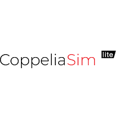

A CoppeliaSim Lite runtime version is available, meant to be embedded and shipped with your own application.

## Many More features

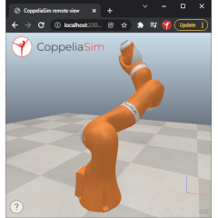

e.g. three.js browser-based viewer, multilevel undo/redo, movie recorder, simulation of paint or welding seams, OC trees, point clouds, exhaustive documentation.
