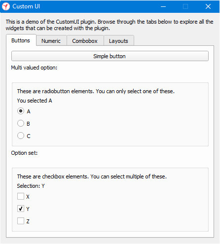

# Custom user interfaces

CoppeliaSim offers custom user interfaces (custom UIs) via a plugin wrapping some functionality of the Qt framework. The plugin, courtesy of Federico Ferri, exports several [API functions related to user interfaces](simUI/simUI.md). Its source code can be found [here](https://github.com/CoppeliaRobotics/simUI).

The custom UIs offer Qt-style widgets such as dialogs integrating buttons, edit-boxes, sliders, labels, images, plots. Any action on custom UIs (e.g. button-click, text edition, slider movement) is reported as a script callback. A custom UI is described via an XML string that follows [a specific syntax](simUI/simUI-widgets.md). The following displays a typical custom UI:

*[Custom UI example]*

Specialized user interfaces are also available, via specific API functions:

- [Message boxes](simUI/simUI.md#msgBox)
- [Input dialogs](simUI/simUI.md#inputDialog)
- [File dialogs](simUI/simUI.md#fileDialog)
- [Color dialogs](simUI/simUI.md#colorDialog)
- [Auxiliary consoles](apiFunctions.md#auxiliaryConsoles)
- [Text/code editors](apiFunctions.md#textEditors)

CoppeliaSim also offers [Qt QML](https://doc.qt.io/qt-5/qmlapplications.html) functionality. See the [API functions related to QML](simQML/simQML.md) and the [QML plugin source code](https://github.com/CoppeliaRobotics/simQML).
