# Designing dynamic simulations

In CoppeliaSim, only a limited number of [objects](objects.md) will be dynamically simulated. Those are [shapes](shapes.md), [joints](joints.md) and [force sensors](forceSensors.md), but it depends on the [scene](scenes.md) structure and object properties, whether a given object is dynamically simulated. Dynamically simulated objects are easily recognized during [simulation](simulation.md), since following icon appears next to the object's name in the [scene hierarchy](userInterface.md#SceneHierarchy):

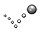

*[Icon marking dynamically simulated objects]*

Double-clicking the icon in the scene hierarchy (during simulation only) displays some information related to the object's dynamic behavior. Objects that are supposed to be dynamically simulated but which, for one reason or another, cannot be dynamically simulated, display following icon instead:

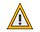

*[Warning icon when an object cannot be dynamically simulated]*

## Static/non-static, respondable/non-respondable shapes

[Shapes](shapes.md) can be classified into 4 types depending on their behavior during dynamic simulation:

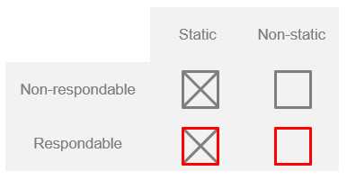

*[Dynamic simulation main shape types]*

During dynamic simulation, static shapes are not influenced (i.e. their position relative to their parent object is fixed), whereas non-static shapes are directly influenced by gravity or other constraints (e.g. dynamically enabled joints, see hereafter). See also [`shape.dynamics.dynamic`](sim-2/property_shape_dynamics_dynamic.md).

Respondable shapes influence each other during dynamic collision (i.e. they produce a mutual *collision reaction*, they bounce off each other). The following figure illustrates the static/non-static, respondable/non-respondable behaviors:

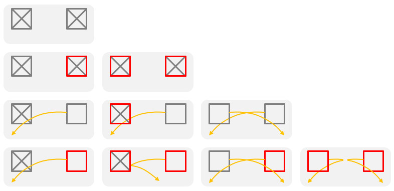

*[Static/non-static, respondable/non-respondable shape behaviors and interactions]*

Two respondable shapes always produce a collision reaction, unless their respective collision masks don't overlap. Static/non-static, respondable/non-respondable shape properties, as well as collision masks can be set in the [shape dynamics dialog](shapeDynamicsProperties.md). See also [`shape.dynamics.respondable`](sim-2/property_shape_dynamics_respondable.md) and [`shape.dynamics.respondableMask`](sim-2/property_shape_dynamics_respondableMask.md).

Note: in MuJoCo, static shapes (*mocap* bodies) do not transmit friction forces. For that reason, static shapes in MuJoCo will always be represented as a *mocap* body linked to a non-static free body via a *weld* constraint (unless [`shape.dynamics.kinematic`](sim-2/property_shape_dynamics_kinematic.md) is set to false).

## Simple constraints between shapes

Non-static shapes fall (i.e. are influenced by gravity) if they are not otherwise constrained. Dynamic constraints between shapes can be set up by attaching two shapes together via a *dynamically enabled* [joint](joints.md), a *dynamically enabled* [force sensor](forceSensors.md), or via a [dummy](dummies.md)-dummy [dynamic overlap constraint](#overlap).

The following represents a simple constraint between two shapes:

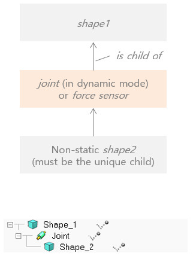

*[Dynamically enabled joint or force sensor]*

Above joint is considered to be dynamically enabled.

## Loop closures and other constraints

Sometimes a mechanism displays loops, e.g. in parallel machines, and other times additional rigid constraints between shapes are required. In those situations, special dummy-dummy *dynamic overlap constraints* can be introduced:

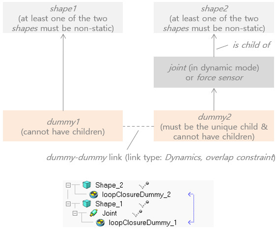

*[Dynamic overlap constraint involving a joint or force sensor]*

Above joint is also considered to be dynamically enabled.

The following represents a rigid constraint between two shapes that do not have to be in the same hierarchy tree/branch:

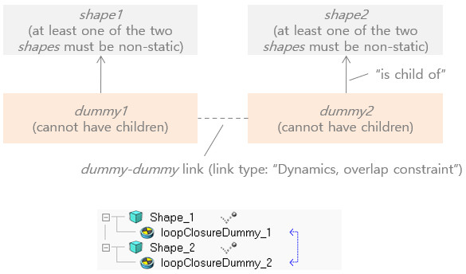

*[Dynamic overlap constraint, that rigidly binds two shapes]*

See also [`dummy.dummy.type`](sim-2/property_dummy_dummy_type.md) and [`dummy.linkedDummy`](sim-2/property_dummy_linkedDummy.md).

Note: in MuJoCo, loop closures are handled via *weld* constraints that can appear soft or wobbly, depending on the setup. Stiffness/rigidity of the related *weld* constraint can be adjusted via the [`dummy.dynamics.mujoco.overlapConstrSolref`](sim-2/property_dummy_dynamics_mujoco_overlapConstrSolref.md), [`dummy.dynamics.mujoco.overlapConstrSolimp`](sim-2/property_dummy_dynamics_mujoco_overlapConstrSolimp.md) and [`dummy.dynamics.mujoco.overlapConstrTorquescale`](sim-2/property_dummy_dynamics_mujoco_overlapConstrTorquescale.md) (the average values are taken between both dummy properties).

## Rigid compounds

Two non-static [shapes](shapes.md) that are not linked through dynamically enabled joints or force sensors move independently from each other during dynamic simulation. If you want two or more shapes to behave as one single shape, you have to group them ([Edit > Shape grouping/merging > group]). Make sure you adjust the inertia matrix of the final shape appropriately. See also [`sim.scene:groupShapes`](sim-2/scene_groupShapes.md), [`shape.dynamics.inertiaMatrix`](sim-2/property_shape_dynamics_inertiaMatrix.md), [`shape.dynamics.centerOfMass`](sim-2/property_shape_dynamics_centerOfMass.md), [`shape.dynamics.mass`](sim-2/property_shape_dynamics_mass.md), and make sure you also read the [section about primitive shapes](#pureShapes) further down:

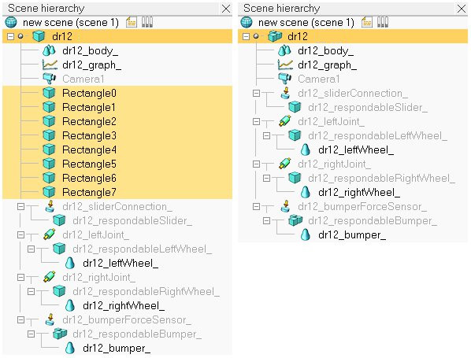

*[Compound of several non-static shapes to obtain a single non-static shape]*

Compound shapes behave as rigid entities and also share identical dynamic properties (e.g. friction coefficient). Sometimes a rigid entity with differentiated dynamic properties is needed. In that case, shapes can be rigidly linked via a force sensor.

## Design consideration 1

**Use primitive shapes.** Whenever possible, try using primitive [shapes](shapes.md) as respondable shapes: primitive shapes are much more stable and faster during dynamic simulation. Instead of using the complicated triangular mesh of a robot model as respondable shape, or its slightly better convex representation, try approximating the triangular mesh with several primitive shapes, then grouping them [Edit > Shape grouping/merging > group]. The following figure illustrates a robot's hidden respondable primitive shapes:

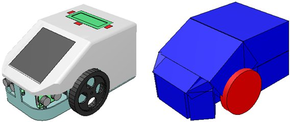

*[Dynamic robot model (left) and underlying primitive non-static shapes used for dynamic simulation (right)]*

See also [`sim.scene:createObject`](sim-2/scene_createObject.md). When a body can collide, but not constantly, or does not play an important role in the stability of a mechanism/robot, then it is not necessary to use primitive shapes, and convex shapes could be a viable alternative too:

## Design consideration 2

**Use convex shapes instead of random shapes.** When using a respondable primitive [shape](shapes.md) is not possible or practical (think of a torus for instance), you can generate a convex shape, or a convex decomposed shape. Convex shapes perform faster and are more stable than random shapes.

Select the shapes, then select [Modules > Geometry / Mesh > Convex hull...]. Refer also to the item [Modules > Geometry / Mesh > Convex decomposition]. The following figure illustrates a convex decomposition:

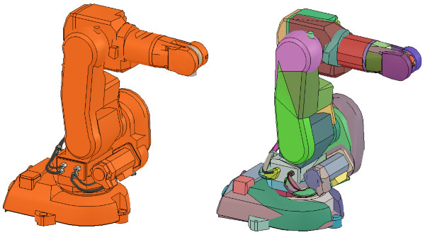

*[Non-convex model (left) and corresponding convex-decomposed model (right)]*

## Design consideration 3

**Carefully inspect the dynamic content of a scene**. It can sometimes be a little bit confusing to work with hidden shapes meant to play an active role in the simulation. This is often the case with dynamically enabled shapes, joints or force sensors: indeed, they are most of the time hidden to the viewer's eye. The dynamic content can however always be inspected during a simulation, by activating the dynamic content visualization button:

*[Dynamic content visualization button]*

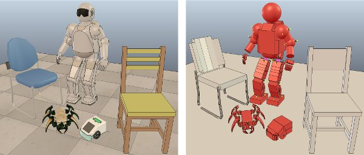

*[Normal and "dynamic content" scene visualization]*

Dynamic objects will appear in various colors, depending on their function or settings. Refer to the following figure:

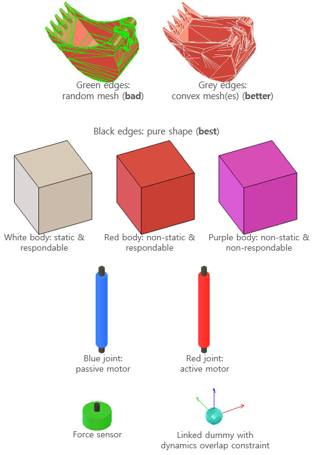

*[Color coding for dynamic objects (in dynamic content visualization mode)]*

Notice in the above figure non-primitive shapes: they have their triangular mesh contour represented in green or grey color. Dynamically simulated non-primitive shapes should be avoided at all cost, since they require much longer calculation times, and present a not very stable behavior (convex shapes are however faster and more stable than non-convex shapes). Refer also to the [design consideration 1](#pureShapes) here above.

## Design consideration 4

**Use a simple hierarchical structure**. When building a model that is meant to be simulated dynamically, attach all non-dynamic objects to the dynamic objects (non-static shapes and dynamically enabled joints). The above wheeled robot model is illustrated in the following figure:

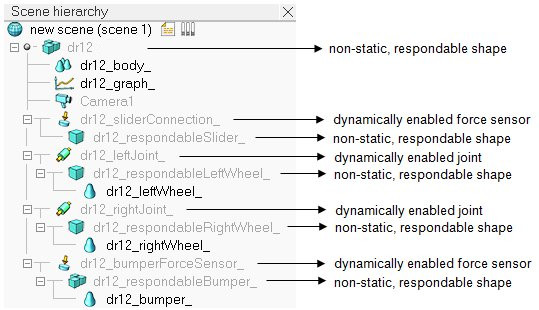

*[Dynamic elements in a robot model]*

## Design consideration 5

**Carefully choose the model base object**. When building a dynamic [model](models.md), actually also when building a static model, always carefully consider what role the model will be playing. Will it be used on its own? Can it be built on top of another model or object? Or can it accept other models or objects to be built on top of it? Consider following example:

You have created a model of a mobile robot. You have also created a model of a gripper that you want to be able to attach to the robot model. The other way round will never make sense (attaching the robot model on top of the gripper model). You might also want to use the robot model and the gripper model on their own. The following is the view of the [scene hierarchy](userInterface.md#SceneHierarchy) of a possible model definition:

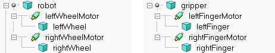

*[Example model definition of a robot and a gripper]*

Notice the model icon next to the 'robot' and 'gripper' shape objects. This indicates that all objects built on top of them are part of the same model definition. The two models operate well on their own. However if you try to attach the gripper on top of the robot (by selecting the gripper model, then the robot model, then clicking [Edit > Set parent, keep pose(s)]), the gripper does not stay fixed on the robot during simulation. The following is the scene hierarchy of the above two models, where the gripper has been attached to the robot:

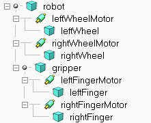

*[Non-functional robot-gripper model assembly]*

Notice in the above scene hierarchy how the [primitive shape](shapes.md) *gripper* is built on top of the primitive shape *robot*. Remembering that non-static shapes fall if not otherwise constrained by a [joint](joints.md) or [force sensor](forceSensors.md), we see that we need a force sensor in-between *gripper* and *robot* to have a rigid connection between both.

The correct model definition of the robot would have to include an attachment point (or several of them) for the gripper as illustrated in the following figure:

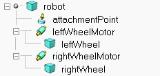

*[Example model definition of a robot with an attachment point]*

The attachment point is a simple force sensor. Assembling the gripper model with the robot model above results in a gripper that stays fixed relative to the robot:

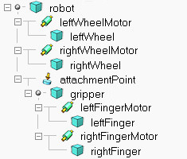

*[Functional robot-gripper model assembly]*

To simplify the assembly procedure even more, you can customize the behavior of the [*assembling* toolbar button](userInterface.md#toolbars), to automatically put the gripper onto the attachment point, with the correct relative position/orientation. For further details refer to the [section on models](models.md) and the dialog item **Assembling** in the [scene object common properties](sceneObjectPropertiesDialog.md#common).

## Design consideration 6

**Use reasonable sizes**. Shapes that are very long and thin or that are too small might behave strangely (jittering, jumping).

This requirement can be loosened [depending on the physics engine](physicsEngineDifferences.md).

## Design consideration 7

**Keep masses similar and not too light**. When linking two shapes with a dynamically enabled joint or a dynamically enabled force sensor, make sure the two shapes' masses are not too different (m1&lt;10\*m2 and m2&lt;10\*m1), otherwise the joint or force sensor might be very *soft* and *wobbly* and present large positional/orientational errors (this effect can however also be used as a *natural damping* sometimes). Additionally, very low mass shapes should be avoided since they won't be able to exert large forces onto other shapes (even if propelled by high force actuators). See also [`shape.dynamics.mass`](sim-2/property_shape_dynamics_mass.md).

This requirement can be loosened [depending on the physics engine](physicsEngineDifferences.md).

## Design consideration 8

**Keep inertia matrices relatively large**. Try keeping the *inertia matrix* relatively large, otherwise mechanical chains might be difficult to control and/or might behave in a strange way. Refer to the [shape dynamics dialog](shapeDynamicsProperties.md). See also[`shape.dynamics.inertiaMatrix`](sim-2/property_shape_dynamics_inertiaMatrix.md) and [`shape.dynamics.centerOfMass`](sim-2/property_shape_dynamics_centerOfMass.md).[`shape.dynamics.mass`](sim-2/property_shape_dynamics_mass.md)

This requirement can be loosened [depending on the physics engine](physicsEngineDifferences.md).

## Design consideration 9

**Assign dynamic shapes to layer 9**. Assign all dynamic shapes which are supposed to be hidden to layer 9 (refer to the [scene object common properties](sceneObjectPropertiesDialog.md#common)): in CoppeliaSim, by default, all layers are visible, except for layers 9-16. When editing or testing a [scene](scenes.md), you can then quickly visualize all hidden shapes in the scene by temporarily enabling layer 9 (refer also to the [layer selection dialog](layerSelectionDialog.md)). See also [`sceneObject.layer`](sim-2/property_sceneObject_layer.md).

## Design consideration 10

**Never have a static shape between two dynamic items** as it interrupts the logical behavior of the dynamic chain:

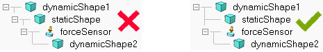

*[Wrong and correct construction]*

## Design consideration 11

**Never build a static respondable shape on top of a dynamic item** as the simulation result would be unpredictable.

Finally, refer also to the [differences between physics engines](physicsEngineDifferences.md).
