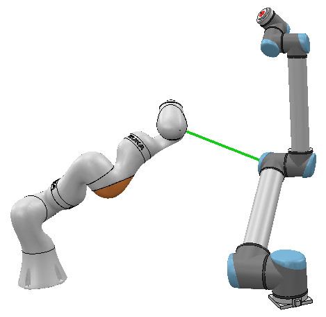

# Distance calculation

CoppeliaSim can measure the minimum distance between two [measurable](measurableObjects.md) [entities](entities.md) in a flexible way. The calculation is an exact minimum distance calculation.



*[Minimum distance calculation between two manipulators]*

Using [`sceneObject:checkDistance`](sim-2/sceneObject_checkDistance.md) and [`collection:checkDistance`](sim-2/collection_checkDistance.md), you can easily calculate the minimum distance between entities, for instance between a robot and its environment, from within a [simulation script](simulationScripts.md), in each simulation step:

```python
#python

def sysCall_init():
    sim = require('sim-2')
    robotBase = sim.self:getObject('/robotModelName')
    self.robotCollection = sim.scene:createObject({'type': 'collection'})
    self.robotCollection:addItem(robotBase, {'mode': 'tree'})

def sysCall_sensing():
    result, distance, dist1, dist2, objectPair = self.robotCollection:checkDistance(sim.handle.all)
    if result:
        txt = 'Robot clearance is ' + str(distance) + 'm, minimum distance object pair is ' + str(objectPair)
        print(txt)
```

```lua
--lua

function sysCall_init()
    sim = require('sim-2')
    local robotBase = sim.self:getObject('/robotModelName')
    robotCollection = sim.scene:createObject({type = 'collection'})
    robotCollection:addItem(robotBase, {mode = 'tree'})
end

function sysCall_sensing()
    local result, distance, dist1, dist2, objectPair = robotCollection:checkDistance(sim.handle.all)
    if result then
        local txt = 'Robot clearance is '.. distance
        txt = txt..'m, minimum distance object pair is '..getAsString(objectPair)
        print(txt)
    end
end
```

One can also display the measured minimum distance, as a colored segment in the scene:

```python
#python

def sysCall_init():
    sim = require('sim-2')
    robotBase = sim.scene:getObject('/robotModelName')
    self.robotCollection = sim.scene:createObject({'type': 'collection'})
    self.robotCollection:addItem(robotBase, {'mode': 'tree'})
    self.distanceSegment = sim.scene:createObject({'type': 'marker', ['marker.type']: 'lines', 'itemColor': [0.0, 1.0, 0.0, 1.0]})

def sysCall_sensing():
    result, distance, dist1, dist2, objectPair = self.robotCollection:checkDistance(sim.handle.all)
    if result:
    	self.distanceSegment:clearItems()
        self.distanceSegment:addItems(dist1:horzcat(dist2)) TODO
```

```lua
--lua

function sysCall_init()
    sim = require('sim-2')
    local robotBase = sim.self:getObject('/robotModelName')
    robotCollection = sim.scene:createObject({type = 'collection'})
    robotCollection:addItem(robotBase, {mode = 'tree'})
    distanceSegment = sim.scene:createObject({type = 'marker', ['marker.type'] = 'lines', itemColor = Color('green')})
end

function sysCall_sensing()
    local result, distance, dist1, dist2, objectPair = robotCollection:checkDistance(sim.handle.all)
    if result then
    	distanceSegment:clearItems()
        distanceSegment:addItems(dist1:horzcat(dist2))
    end
end
```

CoppeliaSim's distance calculation functionality is also available as stand-alone routines via the [Coppelia geometric routines](coppeliaGeometricRoutines.md).
