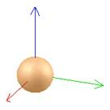

# Dummies

A dummy is an instance of the [dummy type](mainObjectTypes.md#dummy), which in turn derives from the [sceneObject type](mainObjectTypes.md#sceneObject). It is the simplest [scene object](objects.md) available: it is a reference frame. Dummies are multipurpose or helper objects as they are used to identify specific points or reference frames in the scene, or to specify loop closures or tip-target relationships for dynamics and kinematics calculations. The following figure shows a dummy:

*[Dummy]*

Dummies are [collidable](collidableObjects.md), [measurable](measurableObjects.md) and [detectable objects](detectableObjects.md). This means that dummies:

- Can be used in [collision detections](collisionDetection.md) with other collidable objects that are volume based, such as [OC trees](octrees.md).
- Can be used in [minimum distance calculations](distanceCalculation.md) with other measurable objects.
- Can be detected by [proximity sensors](proximitySensors.md).

By default, the collidable, measurable and detectable properties of a dummy are turned off (see the [scene object common properties](sceneObjectPropertiesDialog.md#common)) and refer also to [sceneObject.collidable](sim/property_sceneObject_collidable.htm), [sceneObject.measurable](sim/property_sceneObject_measurable.htm) and [sceneObject.detectable](sim/property_sceneObject_detectable.htm). See also [sceneObject:checkCollision](sim/sceneObject_checkCollision.htm), [collection:checkCollision](sim/collection_checkCollision.htm), [sceneObject:checkDistance](sim/sceneObject_checkDistance.htm), [collection:checkDistance](sim/collection_checkDistance.htm) and [proximitySensor:checkSensor](sim/proximitySensor_checkSensor.htm).

Dummies can be added to the [scene](scenes.md) with [Add > Dummy], or created from a [shape object](shapes.md) in the [vertex edit mode](vertexEditMode.md). Refer also to [sim.scene:createObject](sim/scene_createObject.htm) and [dummy-related methods and properties](apiFunctions.md#methodsAndProperties_dummy).
