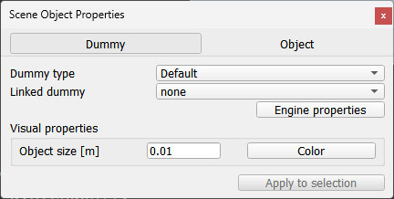

# Dummy dialog

The dummy dialog is part of the [scene object dialog](sceneObjectPropertiesDialog.md), which is located at [Tools > Scene object properties]. You can also open the dialog with a double-click on an object icon in the [scene hierarchy](userInterface.md#SceneHierarchy), or with a click on its [toolbar](userInterface.md#toolbars) button:

*[Scene object properties toolbar button]*

In the scene object dialog, click the **Dummy** button to display the dummy dialog (the **Dummy** button only appears if the last selection is a [dummy](dummies.md)). The dialog displays the settings and parameters of the last selected dummy. If more than one dummy is selected, then some parameters can be copied from the last selected dummy to the other selected dummies (**Apply to selection**-buttons):

*[Dummy dialog]*

- **Dummy type**: the way the dummy operates. Refer also to [`dummy.dummy.type`](sim-2/property_dummy_dummy_type.htm):
  - *Default*: the dummy does not have any specialized behavior or function
  - *Assembly*: the dummy can act as an [assembly point](assembly.md)
  - *Dynamic, overlap constraint*: the dummy and its linked counterpart will try to overlap their position/orientation, allowing you to create a [dynamic loop closure](designingDynamicSimulations.md#loop)
  - *Dynamic, tendon constraint*: the dummy and its linked counterpart will behave as if there was a string or elastic-like constraint between them. Currently only supported with the MuJoCo engine.
- **Linked dummy**: an optional dummy linked to this one. Linked dummies can have special properties or behavior. Refer also to [`dummy.linkedDummy`](sim-2/property_dummy_linkedDummy.htm).
- **Engine properties**: each physics engine has specific parameters related to dummies. Make sure to read the respective engine documentations to achieve best parameter settings
- **Object size**: size of the dummy. This parameter has only a visual effect, and no functional meaning. Refer also to [`dummy.size`](sim-2/property_dummy_size.htm).
- **Color**: allows adjusting a dummy's color
