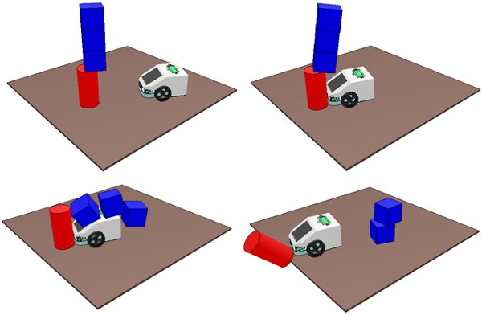

# Dynamics

CoppeliaSim currently supports five different physics engines: the [Bullet physics library](#bullet), the [Open Dynamics Engine](#ode), the [MuJoCo physics engine](#mujoco), the [Vortex Studio engine](#vortex) and the [Newton Dynamics engine](#newton). There are [smaller differences between the engines](physicsEngineDifferences.md), but you can switch at any time from one to another, depending on one's needs. The reason for the large diversity in physics engine support in CoppeliaSim is that physics simulation is a complex task, that can be achieved by emphasising one or another aspect of a simulation, such as precision/realism, speed, or with support of diverse features:

- [Bullet physics library](http://www.bulletphysics.org): an open source physics engine featuring 3D collision detection, rigid body dynamics, and soft body dynamics. It is used in games, and in visual effects in movies. It is often considered as a *game physics engine*.

*[Bullet Physics]*

- [Open Dynamics Engine (ODE)](http://www.ode.org): an open source physics engine with two main components: rigid body dynamics and collision detection. It has been used in many applications and games. It is often considered as a *game physics engine*.

*[Open Dynamics Engine]*

- [MuJoCo](https://mujoco.org/): an open source state-of-the-art physics engine, producing high fidelity physics simulations. It supports a large variety of features such as soft body physics, ropes, strings/elastics, tendons, various specific constraints (e.g. dependency constraints between individual joints). Via [XML injection](simMujoco/simMujoco.htm), you are able to additionally cover many MuJoCo specificities.

*[MuJoCo]*

- [Vortex® Studio](https://www.cm-labs.com/vortex-studio/): a closed source, commercial physics engine producing high fidelity physics simulations. Vortex offers real-world parameters (i.e. corresponding to physical units) for a large number of physical properties, making this engine both realistic and precise. Vortex is mainly used in high performance/precision industrial and research applications. The Vortex plugin for CoppeliaSim is based on [Vortex Studio](https://www.cm-labs.com/vortex-studio/), which requires each user to [register with CM Labs](https://www.cm-labs.com/cm-labs-university/), for a free license key.

*[Vortex Studio]*

- [Newton Dynamics](http://www.newtondynamics.com): Newton Dynamics is a cross-platform life-like physics simulation library. It implements a deterministic solver, which is not based on traditional LCP or iterative methods, but possesses the stability and speed of both respectively. This feature makes Newton Dynamics a tool not only for games, but also for any real-time physics simulation.

*[Newton Dynamics]*

A physics engine allows simulating interactions between [objects](objects.md) that are near to real-world object interactions. It allows objects to fall, collide, bounce back, but it also allows a manipulator to grasp objects, a conveyor belt to drive parts forward, or a vehicle to roll in a realistic fashion over uneven terrain. The following figures illustrate such a simulation:

*[Dynamics simulation]*

Unlike many other simulation software packages, CoppeliaSim is not a *pure* physics-engine-centered simulator. It can rather be seen as a hybrid simulator, that combines kinematics and dynamics to obtain the best performance for various simulation scenarios. Nowadays, physics engines are still relying on many approximations and are relatively imprecise and slow, and wherever possible you should try to use kinematics instead (e.g. for robotic manipulators) and only rely on dynamics where otherwise not feasible (e.g. a robotic manipulator's gripper, mobile robots).
