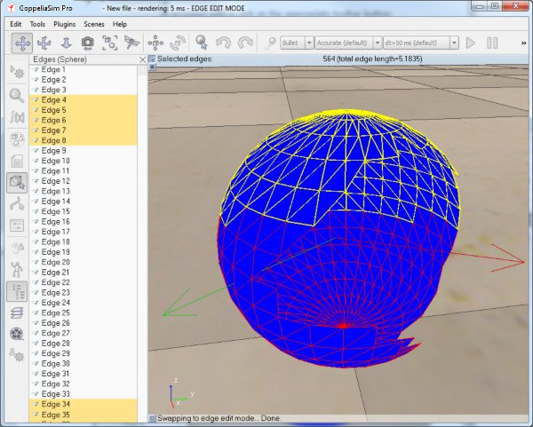
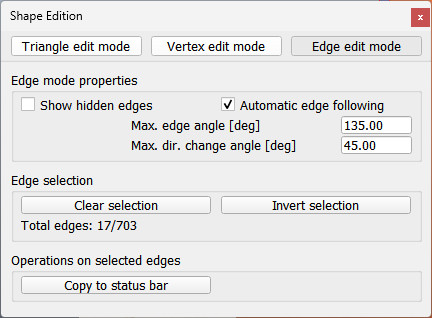
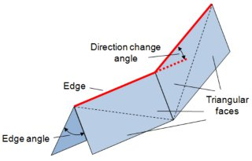

# Edge edit mode

The edge edit mode can be accessed with a click on the appropriate toolbar button:

*[Shape edit mode toolbar button]*

The above toolbar button is only active if a [shape](shapes.md) is selected. If the last selected shape is not a simple shape, but a compound shape, the [edit mode for compound shapes](groupedShapeEditMode.md) will be activated instead. In the edge edit mode all edges composing the shape are individually displayed in red. When selecting edges (using the same procedure as for selecting [objects](objects.md)), they will appear in yellow and the last selected edge in white. Edges can be deleted with the delete-key; however, edges cannot be copied, cut or pasted. Selection can be cleared with the esc-key, with the deselect toolbar button, or by ctrl-clicking onto an empty area of the [scene](scenes.md). A shift-selection will select all edges under the selection area, also hidden edges (if you wish to only select visible edges via a shift-selection, hold down the ctrl-key in addition to the shift-key). In the edge edit mode, the portion of the window that normally displays the [scene hierarchy](userInterface.md#SceneHierarchy) is used to display the edges of the shape being edited as a list. Items in the list can be selected with the mouse as for objects in the hierarchy window.

*[Edge edit mode]*

After entering the edge edit mode, the edit menu items ([Menu bar > Edit]) will become specific to the edge edit mode, and the following dialog will be displayed:

*[Edge edit mode dialog]*

- **Triangle / Vertex / Edge Edit Mode**: the currently activated edit mode. The user can switch from one edit mode to the others via these buttons (the selected items will be preserved).
- **Show Hidden Edges**: when selected, will also display hidden edges.
- **Automatic Edge Following**: when selected, and an edge is selected, that edge will be followed until a loop is created, until the edge changes direction abruptly (**Max. dir. change angle**), or until the edge disappears (**Max. edge angle**). This is a useful feature when you want to extract not only a local edge (one side of a triangle), but a global one (a shape's edge). An edge is only followed in one direction.

*[Edge following]*

- **Clear selection**: clears the selection of edges.
- **Invert selection**: inverts the selection state of edges.
- **Copy to status bar**: prints the selected edges to the status bar.
