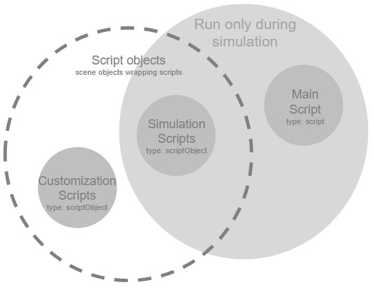

# Embedded scripts

CoppeliaSim supports, next to [sandboxes](sandboxScript.md) and [add-ons](addOns.md), also embedded scripts: those are [scripts](scripts.md) that are embedded in a [scene](scenes.md) (or [model](models.md)), i.e. scripts that are part of the scene and that are saved and loaded together with the rest of the scene (or model). Different types of embedded scripts are supported, each has specific features and application areas:

*[Embedded script types]*

- [Script objects](scriptObjects.md) are instances of the [scriptObject type](mainObjectTypes.md#scriptObject), which in turn derives from the [sceneObject type](mainObjectTypes.md#sceneObject). They wrap an instance of the [script type](mainObjectTypes.md#script) and come in two flavours: [simulation scripts](simulationScripts.md) and [customization scripts](customizationScripts.md)
- [The main script](mainScript.md) is an instance of the [script type](mainObjectTypes.md#script) and represents the simulation loop code that allows a simulation to run. Without a main script, a running simulation won't do anything significant.

Embedded scripts, and all scripts in general, are invoked via [callback functions](callbackFunctions.md) by CoppeliaSim, and follow a [specific execution order](scriptExecution.md). They can [run threaded or non-threaded](threadedAndNonThreadedCode.md).
