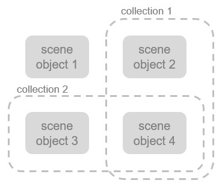

# Entities

An entity is a term that refers to a [scene object](objects.md) or a [collection](collections.md). The following figure illustrates the relationship between scene objects, collections and entities:

*[Entities: scene objects and collections]*
