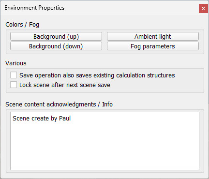

# Environment dialog

The environment dialog can be accessed with [Tools > Environment] or by double-clicking the following icon in the [scene hierarchy](userInterface.md#SceneHierarchy):

*[Environment icon]*

*[Environment dialog]*

- **Background (up / down)**: allows adjusting the background color of a scene. The up component corresponds to the upper part of the screen (sky), the down component corresponds to the lower part of the screen. The background colors are only visible when the fog functionality is disabled.
- **Ambient light**: allows adjusting the ambient light of a [scene](scenes.md). The ambient light can be seen as the minimal light of a scene, it illuminates an object in the exact same way from all directions. See the [section about lights](lights.md) for more details about illumination of a scene. Refer also to [`scene.ambientLight`](sim-2/property_scene_ambientLight.md).
- **Fog parameters**: allows you to adjust various fog parameters.
- **Save operation also saves existing calculation structures**: for [distance calculations](distanceCalculation.md), [collision detections](collisionDetection.md), etc. a data structure is computed at the beginning of a simulation (preprocessing), or the first time a [shape](shapes.md) is involved in such calculations, to speed-up calculations. Calculation of that data structure might be time consuming, so the user can choose to save it together with the [scene](scenes.md) or [model](models.md). However you have to be aware that the additional information that will be saved is large and will result in larger files (sometimes twice as large or more). Refer also to [`scene.finalSaveRequest`](sim-2/property_scene_finalSaveRequest.md).
- **Lock scene after next scene save**: select this item if you want to lock your scene from edition/modification, script content viewing and resource export. After next scene save operation, the scene will be locked. Make sure you have saved the same scene in an unlocked state if you want to be able to modify it at a later time. Refer also to [`scene.locked`](sim-2/property_scene_locked.md).
- **Scene content acknowledgements / Info**: information related to a scene. It is always good practice to acknowledge the original author of a scene, [model](models.md), or imported mesh. When a scene that contains acknowledgment information is opened, it will automatically display that information. Refer also to [`scene.acknowledgment`](sim-2/property_scene_acknowledgment.md).
