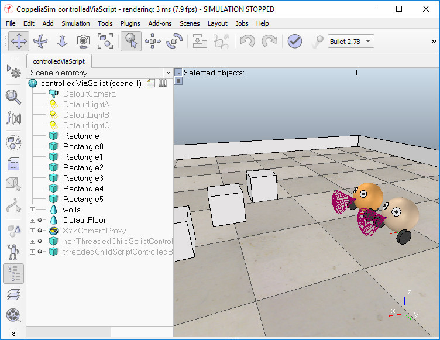

# External controller tutorial

There are several ways you can control a robot or simulation in CoppeliaSim:

- The most convenient way is to write a [simulation script](simulationScripts.md) (in Python or Lua) that handles the behavior of a given robot or [model](models.md). It is the most convenient way, because simulation scripts are [scene objects](objects.md), and as such, they will also be duplicated during a copy operation. Additionally, they do not need any compilation with an external tool, they can run in [threaded or non-threaded mode](threadedAndNonThreadedCode.md), they can be extended via [custom script functions](apiFunctions.md#customizingLuaFunctions) or via Lua/Python language extension mechanisms. Another major advantage in using simulation scripts (in the case of Lua): there is no communication lag as with the last 3 methods mentioned in this section (i.e. the [regular API](apiFunctions.md) is used), and simulation scripts are part of the application main thread (inherent synchronous operation). There are however [small differences between Lua and Python](luaPythonDifferences.md).

- Another way you can control a robot or a simulation is by writing a [plugin](plugins.md). A plugin allows for callback mechanisms, [custom script function registration](apiFunctions.md#customizingLuaFunctions), and of course access to external function libraries. A plugin is often used in conjunction with simulation scripts (e.g. the plugin registers custom script functions, that, when called from a simulation script, will call back a specific plugin function). A major advantage in using plugins is also that there is no communication lag as with the last 3 methods mentioned in this section (i.e. the [regular API](apiFunctions.md) is used), and that a plugin is part of the application main thread (inherent synchronous operation). The drawbacks with plugins are: they are more complicated to program, and they need to be compiled with an external tool. Refer also to the [plugin tutorial](pluginTutorial.md).

- A third way you can control a robot or a simulation is by writing a custom [client application](coppeliaSimLibrary.md). This can be done in C/C++, or in Python for convenience, and allows you to code custom behaviors such as starting CoppeliaSim in a particular manner, while interacting with a simulation at a more global and immediate level.

- A fourth way you can control a robot or a simulation is by writing an external client application that relies on the [remote API](remoteApiOverview.md). This is a very convenient and easy way, if you need to run the control code from an external application, from a robot or from another computer. This also allows you to control a simulation or a [model](models.md) (e.g. a virtual robot) with the exact same code as the one that runs the real robot.

- A fifth way to control a robot or a simulation is via a [ROS](http://www.ros.org) node. In a similar way as the [remote API](remoteApiOverview.md), ROS is a convenient way to have several distributed processes communicate with each other. While the remote API is very lightweight and fast, it allows only communication with CoppeliaSim. ROS on the other hand allows connecting virtually any number of processes with each other, and a large number of compatible libraries are available. It is however heavier and more complicated than the remote API. Refer to the [ROS interfaces](rosInterfaces.md) for details.

- A sixth way to control a robot or a simulation is by writing an external application that communicates via various means (e.g. pipes, [ZeroMQ](meansOfCommunication.md#zmq), [sockets](meansOfCommunication.md#sockets), [serial port](meansOfCommunication.md#serialPort)) with a CoppeliaSim plugin or CoppeliaSim script. Two major advantages are the choice of programming language, which can be just any language, and the flexibility. Here also, the control code can run on a robot, or a different computer. This way of controlling a simulation or a model is however more tedious than the methods with the [remote API](remoteApiOverview.md).

There are 7 scene files related to this tutorial:

- *scenes/controlTypeExamples/controlledViaScript*: three robots are controlled via their respective [simulation script](simulationScripts.md): one runs Lua threaded code, one runs Lua non-threaded code, and the last one runs Python non-threaded code.
- *scenes/controlTypeExamples/controlledViaPlugin*: the robot is controlled via a [plugin](plugins.md).
- *scenes/controlTypeExamples/controlledViaRemoteApi*: the robot is controlled via an [external application](https://github.com/CoppeliaRobotics/bubbleRobClient) and the [ZeroMQ remote API](zmqRemoteApiOverview.md).
- *scenes/controlTypeExamples/controlledViaRos*: the robot is controlled via an [external application](https://github.com/CoppeliaRobotics/ros_bubble_rob) and the [ROS interface](rosInterf.md).
- *scenes/controlTypeExamples/controlledViaRos2*: the robot is controlled via an [external application](https://github.com/CoppeliaRobotics/ros2_bubble_rob) and the [ROS 2 interface](ros2Interface.md).
- *scenes/controlTypeExamples/controlledViaZmq*: the robot is controlled via an [external application](https://github.com/CoppeliaRobotics/bubbleRobZmqServer) and [ZeroMQ](https://zeromq.org/).
- *scenes/controlTypeExamples/controlledViaTcp*: the robot is controlled via an [external application](https://github.com/CoppeliaRobotics/bubbleRobServer) and [LuaSocket](http://w3.impa.br/~diego/software/luasocket/) and TCP.

In all 7 cases, [simulation scripts](simulationScripts.md) are used, mainly to make the link with the outside world (e.g. launch the correct client application, and pass the correct object handles to it). There are two other ways you can control a robot, a simulation, or the simulator itself: by using [customization scripts](customizationScripts.md), or [add-ons](addOns.md). They are however not recommended for control and should rather be used to handle functionality while simulation is not running.

As an example, the simulation script linked to the robot in scene *controlledViaZmq.ttt* has the following main tasks:

- Launch the controller application ([bubbleRobZmqServer](https://github.com/CoppeliaRobotics/bubbleRobZmqServer)) with a connection port as argument
- Locally connect to the controller application
- At each simulation step, send the sensor values to the controller, and read the desired motor values from the controller
- At each simulation step, apply the desired motor values to the robot's joints

Run the simulations, and copy-and-paste the robot: the duplicated robots are directly operational.
