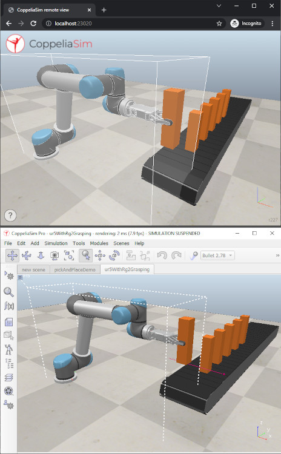

# Web-browser based front-end

The callback function [sysCall_event](callbackFunctions.md), together with the [script:setEventFilters](sim/script_setEventFilters.htm) and the [app:getGenesisEvents](sim/app_getGenesisEvents.htm) methods, allows tracking most changes that happen in CoppeliaSim, and by correctly publishing and interpreting them, you can easily implement an external front-end for CoppeliaSim. This is what the [Three.js front-end for CoppeliaSim](https://github.com/CoppeliaRobotics/threejsFrontend) does:

*[Three.js front-end, and corresponding CoppeliaSim instance]*

To enable it, first enable the visualization stream add-on via [Modules > Connectivity > Visualization stream], then open a web-browser and type http://127.0.0.1:23020
