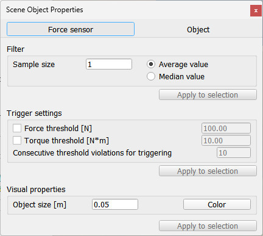

# Force sensor dialog

The force sensor dialog is part of the [scene object dialog](sceneObjectPropertiesDialog.md), which is located at [Tools > Scene object properties]. You can also open the dialog with a double-click on an object icon in the [scene hierarchy](userInterface.md#SceneHierarchy), or with a click on its [toolbar](userInterface.md#toolbars) button:

*[Scene object properties toolbar button]*

In the scene object dialog, click the **Force sensor** button to display the force sensor dialog (the **Force sensor** button only appears if the last selection is a [force sensor](forceSensors.md)). The dialog displays the settings and parameters of the last selected force sensor. If more than one force sensor is selected, then some parameters can be copied from the last selected force sensor to the other selected force sensors (**Apply to selection**-buttons):

*[Force sensor dialog]*

- **Filter**: when force or torque data is acquired by the force sensor, then it is accumulated and can be filtered to obtain less jittery values. Refer also to [forceSensor.dynamics.filter](sim/property_forceSensor_dynamics_filter.htm).
- **Sample size**: the number of values that should be used for the filter. *1* Will not filter values (raw output). Refer also to [forceSensor.dynamics.filterSampleSize](sim/property_forceSensor_dynamics_filterSampleSize.htm).
- **Average value**: if selected, then the force sensor will deliver average values (average of **sample size** values).
- **Median value**: if selected, then the force sensor will deliver median values (median of **sample size** values).
- **Trigger settings**: this section allows you to set up some automatic triggering conditions. A trigger will call the [trigger callback function](triggerCallbackFunctions.md) (inside which you could for instance [break the force sensor](sim/simBreakForceSensor.htm)).
- **Force threshold**: the amplitude of the force vector that activates a threshold violation. Refer also to [forceSensor.dynamics.forceThresholdEnabled](sim/property_forceSensor_dynamics_forceThresholdEnabled.htm) and [forceSensor.dynamics.forceThreshold](sim/property_forceSensor_dynamics_forceThreshold.htm).
- **Torque threshold**: the amplitude of the torque vector that activates a threshold violation. Refer also to [forceSensor.dynamics.torqueThresholdEnabled](sim/property_forceSensor_dynamics_torqueThresholdEnabled.htm) and [forceSensor.dynamics.torqueThreshold](sim/property_forceSensor_dynamics_torqueThreshold.htm).
- **Consecutive threshold violations for breaking**: the number of consecutive times the sensor is allowed to violate a threshold before triggering. See also [forceSensor.dynamics.consecutiveViolationsToTrigger](sim/property_forceSensor_dynamics_consecutiveViolationsToTrigger.htm).
- **Object size**: size of the sensor's 3D representation. This has no functional effect. See also [forceSensor.size](sim/property_forceSensor_size.htm).
- **Color**: allows adjusting the color of the sensor.
