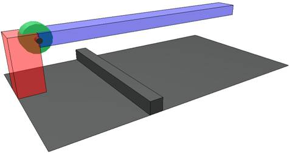
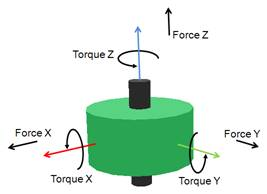

# Force sensors

A force sensor is an instance of the [forceSensor type](mainObjectTypes.md#forceSensor), which in turn derives from the [sceneObject type](mainObjectTypes.md#sceneObject). It is a rigid link between two [shapes](shapes.md), able to measure transmitted forces and torques. The following figure illustrates an application using a force sensor:

*[Force sensor object (green) measuring the force and torque exerted by a beam (blue) anchored in a wall (red)]*

A force sensor measures a pair of 3 values representing the force on the sensor along the x-, y- and z-axis, and the torque on the sensor about the x-, y- and z-axis:

*[Forces and torques measured by a force sensor]*

Refer also to [`forceSensor.force`](sim-2/property_forceSensor_force.htm), [`forceSensor.torque`](sim-2/property_forceSensor_torque.htm), [`forceSensor.filteredForce`](sim-2/property_forceSensor_filteredForce.htm) and [`forceSensor.filteredTorque`](sim-2/property_forceSensor_filteredTorque.htm). Initially, a force sensor acts as a rigid link. During [simulation](simulation.md), a force sensor can however be *broken* when a specified force/torque threshold is overshot or when some other user-defined conditions are met, by detaching it from its parent.

A force sensor is only operational during simulation if it is dynamically enabled. For more information on dynamically enabled force sensors, refer also to the section on [designing dynamic simulations](designingDynamicSimulations.md). [Joints](joints.md) are also able to measure a force or a torque, however only along/about their z-axis.

Force sensors are added to the [scene](scenes.md) with [Add > Force sensor]. Refer also to [`sim.scene:createObject`](sim-2/scene_createObject.md) and [forceSensor-related methods and properties](apiFunctions.md#methodsAndProperties_forceSensor).
