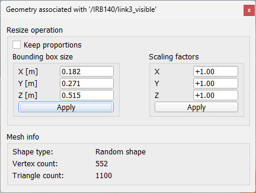

# Shape geometry dialog

The shape geometry dialog is part of the [shape dialog](shapeProperties.md). The dialog allows you to view a geometry associated with a [shape](shapes.md), and to modify it to a certain extent. It displays the number of vertices and triangles, and the size of the [shape's bounding box](shapeReferenceFrames.md). The number of vertices and triangles of a mesh is directly linked to the rendering and calculation times (e.g. during [collision detection](collisionDetection.md) or [distance calculation](distanceCalculation.md)), and the more vertices/triangles a mesh has, the slower the simulation or scene display will be. The dialog allows you to scale a shape along the x-, y- or z-axes. Remember however that some [primitive shapes](shapes.md) have restrictions regarding non-uniform scaling.

*[Shape geometry dialog]*
