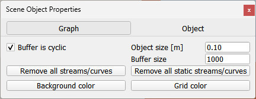

# Graph dialog

The graph dialog is part of the [scene object dialog](sceneObjectPropertiesDialog.md), which is located at [Tools > Scene object properties]. You can also open the dialog with a double-click on an object icon in the [scene hierarchy](userInterface.md#SceneHierarchy), or with a click on its [toolbar](userInterface.md#toolbars) button:

*[Scene object properties toolbar button]*

In the scene object dialog, click the **Graph** button to display the graph dialog (the **Graph** button only appears if the last selection is a [graph](graphs.md)). The dialog displays the settings and parameters of the last selected graph:

*[Graph dialog]*

- **Object size**: size of the graph object. This parameter has no functional effect. Refer also to [`graph.size`](sim-2/property_graph_size.md).
- **Buffer is cyclic**: when selected and the number of elements in each data stream reaches the buffer size, then the first elements will be erased to be able to record new elements. Otherwise recording stops when the buffer is full. Refer also to [`graph.cyclic`](sim-2/property_graph_cyclic.md).
- **Buffer size**: number of elements each data stream can record. Refer also to [`graph.bufferSize`](sim-2/property_graph_bufferSize.md).
- **Remove all streams/curves**: clears all data streams and curves.
- **Remove all static streams/curves**: clears all static data streams and curves. A static data stream or curve is a "frozen" data stream or curve that can't be modified anymore.
- **Background color**: allows adjusting the background color in the time graph or x/y graph view. Refer also to [`graph.backgroundColor`](sim-2/property_graph_backgroundColor.md).
- **Grid color**: allows adjusting the grid and graduation color in the time graph or x/y graph view. Refer also to [`graph.foregroundColor`](sim-2/property_graph_foregroundColor.md).

The graph object itself is mainly operated via a [customization script](customizationScripts.md) that could be adapted in various ways, if needed. The behavior of the graph can also be altered in various ways by clicking the [user parameter](userConfigCallbackFunctions.md) icon next to the customization script.
