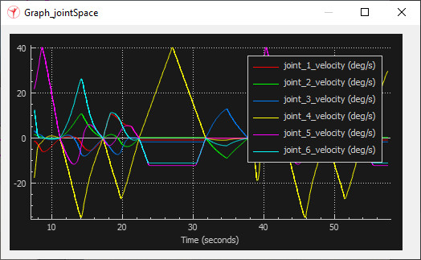

# Graphs

A graph is an instance of the [graph type](mainObjectTypes.md#graph), which in turn derives from the [sceneObject type](mainObjectTypes.md#sceneObject). A graph records and visualizes data from a [simulation](simulation.md). Data is recorded in data signals, which are lists of sequential values associated with time stamps.

Signals can directly be visualized as time plots. By combining 2 signals, you can obtain x/y curves. The following figure illustrates a time plot, showing 6 signals visualizing joint velocities:



*[Examples of a time plot]*

A graph is added to the scene with [Add > Graph]. Its basic properties are accessed and adjusted in the [graph dialog](graphPropertiesDialog.md). Refer also to [sim.scene:createObject](sim/scene_createObject.htm) and [graph-related methods and properties](apiFunctions.md#methodsAndProperties_graph).

The user is in charge of defining signals, curves, and feeding them with appropriate data on a regular basis (usually once per simulation step). The following illustrates how to record and visualize 2 signals (the velocity of two joints over time):

```lua
--lua

function sysCall_init()
    sim = require('sim-2')
    joint1 = sim.self:getObject('/joint1')
    joint2 = sim.self:getObject('/joint2')
    graph = sim.self:getObject('/Graph')
    joint1Vel = graph:addSignal({name = 'joint 1 velocity', unit = 'deg/s', color = Color'red', drawLine = true})
    joint2Vel = graph:addSignal({name = 'joint 2 velocity', unit = 'deg/s', color = Color'green', drawLine = true})
end

function sysCall_sensing()
	graph:setSignalPoint(joint1Vel, 180.0 * joint1.velocity / math.pi)
	graph:setSignalPoint(joint2Vel, 180.0 * joint2.velocity / math.pi)
end
```

The next example shows how to record and visualize an x/y position curve of an object:

```lua
--lua

function sysCall_init()
    sim = require('sim-2')
    object = sim.self:getObject('/object')
    graph = sim.self:getObject('/Graph')
    objectPosX = graph:addSignal()
    objectPosY = graph:addSignal()
    graph:addCurve({objectPosX, objectPosY}, {name = 'object pos x/y', unit = 'm by m', color = Color'red'})
end

function sysCall_sensing()
    local pos = object.worldPosition
	graph:setSignalPoint(objectPosX, pos[1])
	graph:setSignalPoint(objectPosY, pos[2])
end
```
