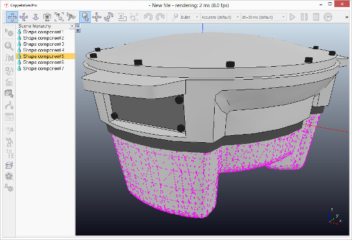
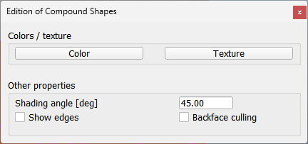

# Edit mode for compound shapes

The edit mode for compound shapes can be accessed with a click on the appropriate toolbar button:

*[Shape edit mode toolbar button]*

The above toolbar button is only active if a [shape](shapes.md) is selected. If the last selected shape is not a compound shape, but a simple shape, the [triangle edit mode](triangleEditMode.md) will be activated instead. In the edit mode for compound shapes, you can edit the individual visual parameters of the shape's components. The shape's components can be selected in the hierarchy window.

*[Edit mode for compound shapes]*

After entering the edit mode for compound shapes, the following dialog displays:

*[Edit mode dialog for compound shapes]*

- **Adjust color**: allows editing the colors of the shape components.
- **Adjust texture**: opens the [texture dialog](textureDialog.md) for the selected shape component.
- **Shading angle**: the shading angle is the angle from which individual faces are distinguished. A small angle makes a shape appear sharp, with many edges; a large angle makes a shape appear smooth and with fewer edges.
- **Show edges**: displays edges in black.
- **Backface culling**: each triangle composing a shape has an inside and an outside face. When Backface culling is enabled, then inside faces won't be displayed. This is a useful parameter for closed shapes and for shapes that are transparent.
