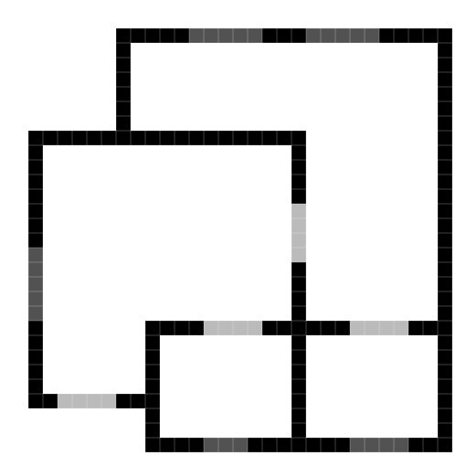

# Import/export

Several types of data and formats can be imported to, or exported from CoppeliaSim:

- [Mesh data, via various formats](#mesh)
- [scene/model data, via CoppeliaSim's XML format](xmlFormat.md)
- [scene/model data, via the URDF format](#urdf)
- [scene/model data, via the SDF format](#sdf)
- [Animation or scene data, via the GLTF format](#gltf)
- [Video data, via various formats](aviRecorder.md)
- [Image data, via various formats](#image)
- [text/binary data](#text)
- [Floor plan data](#floorPlan)
- [LDR / MPD models](#ldraw)

New importers/exporters can easily be created via an [add-on](addOns.md), or via a [plugin](plugins.md).

## <a id="mesh"></a>Importing/exporting mesh data

The mesh import/export functionality is handled via the [Assimp plugin for CoppeliaSim](https://github.com/CoppeliaRobotics/simAssimp). More formats can be supported if the Assimp library (and Assimp plugin) are recompiled with the required flags. The plugin's functionality is exposed to CoppeliaSim's GUI and can be reached at [File > Import > Meshes...] or [File > Export > Selected shapes...].

If after the import operation you can't see any shapes in the [scene](scenes.md), but the [scene hierarchy](userInterface.md#SceneHierarchy) indicates the presence of newly added shapes, then most probably your shapes are either too big or too small to be seen. You can then proceed to a scaling operation. Additionally, you can subdivide imported meshes via [Edit > Shape grouping/merging > divide]. See also [`shape:divide`](sim-2/shape_divide.md).

Make sure that imported meshes do not contain too many triangles (for a robot, typically between 10'000-20'000 triangles in total), otherwise CoppeliaSim could slow down. You can decimate an imported mesh via [Modules > Geometry / Mesh > Mesh decimation...].

Heightfields in CoppeliaSim are also meshes, and can be imported via [File > Import > Heightfield...]. Supported formats are image formats (the color or grey tone components represent elevations), or csv or txt formats (comma-separated values (y rows with x values)).

See also the [import/export-related methods and properties](apiFunctions.md#methodsAndProperties_importExport).

## <a id="urdf"></a>Importing/exporting URDF files

One can access the URDF importer/exporter functionality via the following two add-ons: [Modules > Importers > URDF importer...] and [Modules > Exporters > URDF exporter...].

See also the [API functions related to URDF import/export](simURDF/simURDF.htm).

## <a id="sdf"></a>Importing SDF files

One can access the SDF importer functionality via the following add-on: [Modules > Importers > SDF importer...].

See also the [API functions related to SDF import](simSDF/simSDF.md).

## <a id="gltf"></a>Exporting a simulation as GLTF

A scene or simulation can be exported via the GLTF format. The result is a still or animated scene. The functionality is available via two distinct add-ons: [Modules > Exporters > GLTF exporter...] and [Modules > Exporters > GLTF animation exporter...].

See also the [API functions related to GLTF export](simGLTF/simGLTF.md).

## <a id="image"></a>Importing/exporting images

Images can be imported/exported with [`sim.app:loadImage`](sim-2/app_loadImage.md) and [`sim.app:saveImage`](sim-2/app_saveImage.md). See also [`sim.app:transformImage`](sim-2/app_transformImage.md), [`sim.app:transformBuffer`](sim-2/app_transformBuffer.md) and the [OpenCV plugin API reference](simIM/simIM.md).

## <a id="text"></a>Importing/exporting text/binary data

The following example illustrates how to log a joint angle to a file, as text data:

```python
import sim
import math
from types import SimpleNamespace
state = SimpleNamespace()

def sysCall_init():
    state.joint = sim.self:getObject('/Joint')
    with open('jointAngles.txt', 'w+') as file:
        file.write('Joint angles for each simulation step:\n\n')

def sysCall_sensing():
    v = 180 * state.joint.joint.position / math.pi
    with open('jointAngles.txt', 'a') as file:
        file.write(f'time: {sim.scene.simulation.time + sim.scene.simulation.step:.3f} [s]')
        file.write(f', joint angle: {v:.1f} [deg]\n')
```

```lua
import 'sim-2'

function sysCall_init()
    joint = sim.self:getObject('/Joint')
    file = io.open('jointAngles.txt', 'w+')
    file:write('Joint angles for each simulation step:\n\n')
end

function sysCall_sensing()
    local v = 180 * joint.joint.position / math.pi
    file:write(string.format('time: %.3f [s]', sim.scene.simulation.time + sim.scene.simulation.step))
    file:write(string.format(', joint angle: %.1f [deg]\n', v))
end

function sysCall_cleanup()
    file:close()
end
```

The following example illustrates how to read a file, line by line:

```python
import sim

with open('textFile.txt', 'r') as file:
    for line in file:
        print(line.strip())
```

```lua
import 'sim-2'

for line in io.lines('textFile.txt') do
    print(line)
end
```

## <a id="floorPlan"></a><a id="misc"></a>Importing miscellaneous data

The floor plan importer add-on, available via [Modules > Importers > Floor plan importer...], can create shapes from a floor plan image, by mapping each pixel value to either a *wall*, a *door* or a *window*.

A floor-plan image looks like this:



*[Example of a floor-plan image]*

Note that the above image is zoomed in, and actual lines are 1px thick.

Different gray levels are used to indicate different classes. In this example, 0 is used for walls, 82 for window holes, and 187 for door holes. These values can be configured (see below) and anything outside the given ranges will be ignored, so it is possible to use a floor plan that contains more annotations, but only extract wall/door/window lines if given in a specific gray value.

Various other formats derived from or related to images can also be imported. For a complete list of supported formats, use [simUI.supportedImageFormats](simUI/simUI.md#supportedImageFormats). The following example illustrates the PGM format:

```
P2
18 6
3
0 0 0 0 0 0 0 0 0 0 0 0 2 2 2 2 0 0
0 3 3 3 3 3 3 3 3 3 3 3 3 3 3 3 3 0
0 3 3 3 3 3 3 3 3 3 3 3 3 3 3 3 3 0
0 3 3 3 3 3 3 3 3 3 3 3 3 3 3 3 3 0
0 3 3 3 3 3 3 3 3 3 3 3 3 3 3 3 3 0
0 0 1 1 1 1 0 0 0 0 0 0 2 2 2 2 0 0
```

After selecting the menu entry, an image file must be selected; then a few import options can be specified:

- *Pixel size*: the scaling of the image. One pixel in the image will correspond to this length in the real world.
- For every class (walls, windows, doors):
- *Height*: the height of the wall/hole in the real world.
- *Range*: the range of the intensity (grayscale value) in the image.
- *Color*: the color of the walls shape.
- *Respondable*: whether the walls shape will be respondable.
- *Optimize*: if checked, the lines will be dissected into a minimal number of rectangles, so the shape will contain a low count of primitive (cuboid) shapes.
- *Invert image values*: if checked, the image values will be inverted before processing.

## <a id="ldraw"></a>Importing LDR / MPD models

The [LDraw](http://www.ldraw.org/) importer add-on is available via [Modules > Importers > LDraw importer...]. Make sure the LDraw parts library is installed. The simLDraw plugin uses the [ldrawloader](https://github.com/pixeljetstream/ldrawloader) from Christoph Kubisch.

See also the [API functions related to LDR / MPD import](simLDraw/simLDraw.md).
