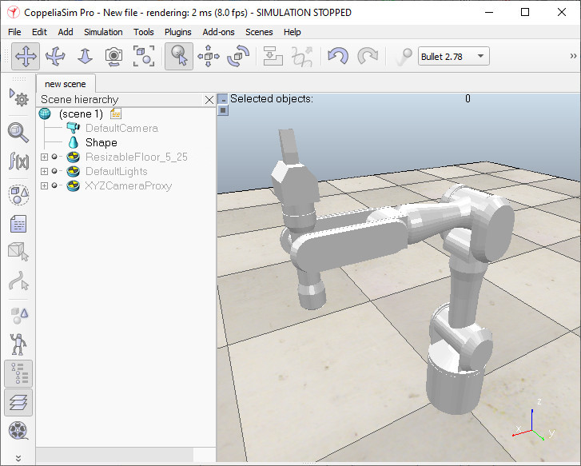
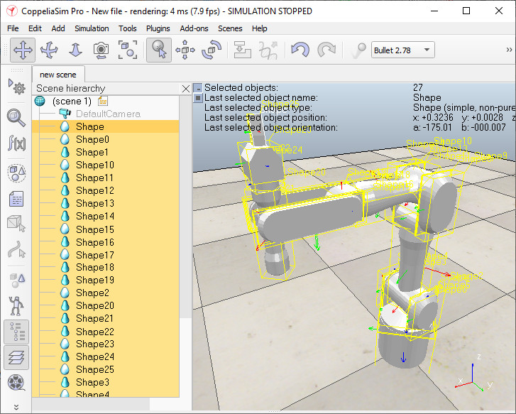
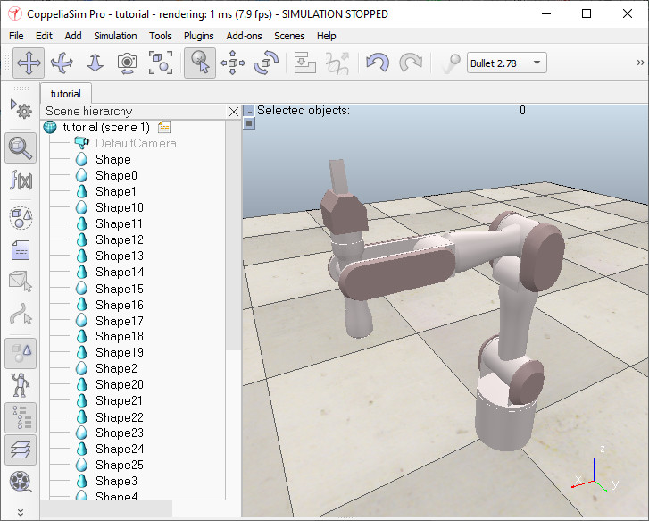
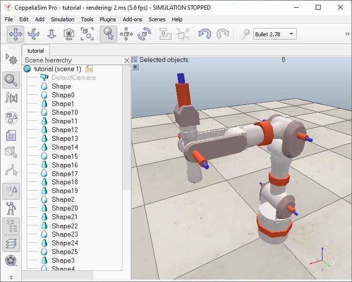
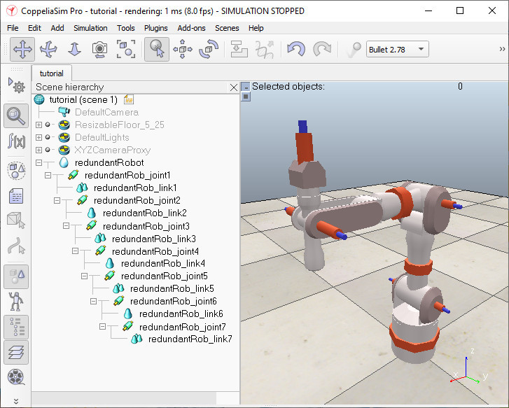
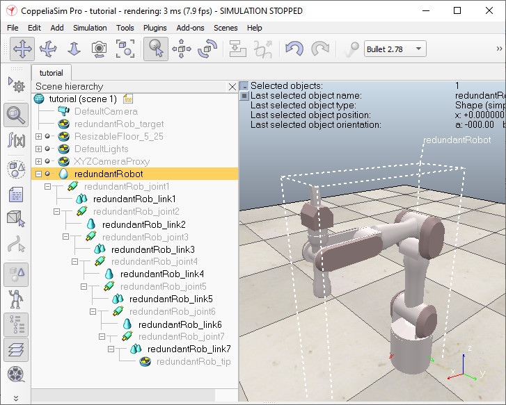
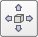

# Inverse kinematics tutorial

This tutorial explains how to use CoppeliaSim's [kinematics functionality](kinematics.md), while building a 7 DoF redundant manipulator. But before that, make sure to have a look at the various example scenes related to IK and FK in folder *scenes/kinematics*.

This tutorial is segmented into 3 parts:

- [Building](#model) the simple simulation model of a redundant manipulator
- [Setting up](#setup) an inverse kinematics task
- [Testing](#run) the inverse kinematics

## <a id="model"></a>Simple simulation model

For this tutorial, we will build a non-dynamic manipulator that just uses inverse kinematics without using any physics engine functionality. The CoppeliaSim CAD data related to this tutorial (*redundantManipulator.stl*) is located in CoppeliaSim's installation folder *cadFiles*. A CoppeliaSim scene related to this tutorial can be found in *scenes/tutorials/InverseKinematics*. Click [File > Import > Mesh...] then select the file to import. Refer to the section on how to [import/export shapes](importExport.md). A dialog pops open with various import options. Click *Import*. A single [shape](shapes.md) was imported and is located in the middle of the scene. The shape also appears in the [scene hierarchy](userInterface.md#SceneHierarchy) on the left hand side of the main window. Depending on how the original CAD data was exported, the imported CAD data could be at a different scale, different location, or even subdivided into several shapes. The following figure shows the imported shape:



As you can see, the import operation has left us with a single shape, where we expected several shapes. This means that we will have to divide the manipulator object ourselves: select the object (just click on it in the scene or the scene hierarchy), then click [Edit > Shape grouping/merging > divide]. Then, to have the origin for each generated shape located at its geometric center, click [Edit > Shape reference frame > relocate to mesh center]. The following is what you should have:



The original shape was divided into several sub-shapes (see also the scene hierarchy). The shape division algorithm operates by grouping all triangles that are linked by common edges. Depending on how the original mesh was created or exported, such a division procedure cannot be performed. In that case you will have to manually extract shapes in the [triangle edit mode](triangleEditMode.md) or in an external editor.

Next, we will change colors of the various objects so as to have a nice visual appearance. First double-click a shape icon in the scene hierarchy. The [shape dialog](shapeProperties.md) opens. While a shape is selected, click on **Adjust color** in the dialog: this allows you to adjust the various color components of the selected shape. For now, just adjust the ambient/diffuse color component of your shapes. To transfer the color of one shape to another shape, select both shapes and make sure the last selected shape (indicated with a white bounding box) is the one you want to take the color from, then simply click the **Apply to selection** button in the **Colors** section of the shape dialog. Once you finished coloring, you might have following situation:



In next step, we add the 7 [joints](joints.md) of the manipulator. One way of doing this is to add the joints into the scene, then specify their appropriate pose (through the [position dialog](positionDialog.md) and the [orientation dialog](orientationDialog.md)). This is however not possible, when you don't know the exact joint linear/angular positions as in our case, and so we will have to *extract* them from the shapes that we have:

Select all imported shapes and click [Edit > Shape bounding box > align with world]. This operation aligns [bounding boxes](shapeReferenceFrames.md) with the absolute reference frame, and given the current manipulator configuration, represents the smallest bounding boxes. Click [Add > Joint > Revolute] to insert a revolute joint into the scene. The default position is at (0;0;0) and its default orientation is vertical, and so the joint is hidden by the manipulator's base cylinder. While the joint is still selected, ctrl-select the base cylinder, then open the [position dialog](positionDialog.md) on the **position** tab and click the **Apply to selection**. This just positioned the joint at the exact same coordinates as the base cylinder (this operation however only slightly adjusted the joint's vertical position since it was already almost in position). Now repeat the procedure for all other joints in the manipulator (remember there should be a total of 7). All joints are in position now, however, some of them have the wrong orientation. Select all joints that should be aligned with the world's Y-axis, then enter (90,0,0) for the **Alpha**, **Beta** and **Gamma** items in the [orientation dialog](orientationDialog.md), on the **orientation** tab, then click the **Apply to selection** button. Next, select the joint that should be aligned with the world's X-axis, then enter (0,90,0) for **Alpha**, **Beta** and **Gamma**. All joints have the right pose now.

You can now adjust the joint sizes (check the **Length** and **Diameter** items) in the [joint dialog](jointProperties.md) (that you can open by double-clicking a joint icon in the scene hierarchy). Make sure that all joints are clearly visible. This is what you should have:



The next step in this tutorial is to group shapes that belong to the same rigid entity. Select the 5 shapes that are part of link 1 (the base cylinder being link 0), then click [Edit > Shape grouping/merging > group]. Once the shapes are grouped in a compound shape, you could re-align its bounding box with the world, but this step is not required (and has only a visual effect). Repeat the same procedure with all shapes that logically belong together. In this tutorial we do not actuate the gripper's fingers, and so simply rigidly group them with the last link. When all shapes that are meant to be grouped share the same visual attributes, try merging them together instead: [Edit > Shape grouping/merging > merge].

At this point you can rename all objects in the scene in the following way, when going from base to tip: *redundantRobot* - *redundantRob_joint1* - *redundantRob_link1* - *redundantRob_joint2*, etc. Just double-click an object's name in the scene hierarchy to edit it.

Now we can build the kinematic chain, going from tip to base: select object *redundantRob_link7*, then ctrl-select object *redundantRob_joint7* and click [Edit > Set parent, keep pose(s)]. Alternatively you can drag an object onto another one in the scene hierarchy to achieve a similar operation. Next do the same for object *redundantRob_joint7* and object *redundantRob_link6*. Continue in the same way until the whole kinematic chain of the manipulator is built. This is what you should have (notice the scene hierarchy structure):



Select all joints, then in the joint dialog, select **kinematic mode**, then click **Apply to selection**. Keep the joints selected, then open the [scene object common properties](sceneObjectPropertiesDialog.md#common) and in the **Visibility layers** section, disable layer 2 and enable layer 10, then click the related **Apply to selection** button. This just sent all joints to the visibility layer 10, effectively making them invisible. Have a look at the [layer selection dialog](layerSelectionDialog.md) if you wish to temporarily enable/disable some layers.

In CoppeliaSim, an IK task requires specifying at least following elements:

- A kinematic chain described with a *tip* dummy and a *base* object.
- A *target* dummy that the *tip* dummy is constrained to follow.

We already have the base object (object *redundantRobot*). Let's add a [dummy object](dummies.md), rename it to *redundantRob_tip* and set its position to (0.324,0,0.62) using the coordinate and transformation dialog. Next, attach the dummy to *redundantRob_link7* (select *redundantRob_tip*, then *redundantRob_link7*, then [Edit > Set parent, keep pose(s)]). The *tip* dummy is ready!

Now let's prepare the *target* dummy: copy and paste *redundantRob_tip* and rename the copy to *redundantRob_target*. The *target* dummy is ready.

Now we add a way to easily manipulate the robot, without having to worry about breaking it by shifting the wrong objects around. We therefore define it as a [model](models.md). First, move *redundantRob_tip* and *redundantRob_target* to layer 11 to make both dummies invisible. Then shift-select all visible objects in the scene view, ctrl-click the object *redundantRobot* in the scene hierarchy to remove it from the selection, then open the [scene object common properties](sceneObjectPropertiesDialog.md#common). Check the **Select base of model instead** item, then the related **Apply to selection** button. Clear the selection with &lt;ESC>, then select *redundantRobot*. In the same dialog, check the **Object is model base** item, then close the dialogs. Notice how a stippled bounding box now encompasses the whole manipulator:



Click any object on the manipulator and notice how the base object *redundantRobot* always gets selected instead.

Next, we add a *manipulation sphere* that we use to manipulate the robot's gripper position/orientation. Click [Add > Primitive shape > Sphere] to open the [primitive shape dialog](primitiveShapes.md), indicate 0.05 for the **X-Size**, **Y-Size** and **Z-Size**, then uncheck the **Create dynamic and respondable shape** item and click **OK**. Adjust the newly added sphere's position to be the same as *redundantRob_target* (using the coordinate and transformation dialog). The sphere now appears at the tip of the manipulator. Rename the sphere to *redundantRob_manipSphere*, then make it parent of *redundantRob_target*. Make *redundantRobot* parent of *rendundantRob_manipSphere*: the target dummy and the manipulation sphere are now also part of the robot model. Collapse the *redundantRobot* tree in the scene hierarchy. The redundant manipulator model is ready!

## <a id="setup"></a>Setting up the inverse kinematics task

Inverse kinematics is entirely set up by having a script calling appropriate methods: the idea is to build an equivalent kinematic model via the methods provided by the [`IK class`](sim-2/IK_new.md). The approach uses the concept and terminology of [IK groups and IK elements](solvingIkAndFk.md).

Select object *redundantRobot*, then [Add > Script object > simulation script > Non-threaded > Lua] to attach a [simulation script](simulationScripts.md) to that object. Double-click the new script icon in the scene hierarchy, and replace the script content with the following code:

```lua
import 'sim-2'
import 'simIK-2'

function sysCall_init()
    -- Build a kinematic chain and 2 IK groups (undamped and damped)
    -- based on the kinematics of the robot in the scene:

    local simBase = sim.self:getObject('..')
    local simTip = sim.self:getObject('../redundantRob_tip')
    local simTarget = sim.self:getObject('../redundantRob_target')
    -- create an IK environment:
    ik = simIK()
    -- create an undamped IK group, with an IK element:
    ikGroup_undamped = ik:createGroup({method = 'pseudoInverse', maxIterations = 6})
    ikGroup_undamped:addElementFromScene(simBase, simTip, simTarget, ik.constraint_pose)

    -- create another IK group (with IK element), this time damped:
    ikGroup_damped = ik:createGroup({method = 'dampedLeastSquares', damping = 1.0, maxIterations = 100})
    ikGroup_damped:addElementFromScene(simBase, simTip, simTarget, ik.constraint_pose, {weights = {1.0, 0.001}})

end

function sysCall_actuation()
    -- try to solve with the undamped method:
    if not ikGroup_undamped:solve() then
        -- the position/orientation could not be reached.
        -- try to solve with the damped method:
        ikGroup_damped:solve({ignoreTolerance = true})
    end
end

function sysCall_cleanup()
    -- erase the IK environment:
    ik:remove()
end
```

Above script creates an equivalent kinematic model from the CoppeliaSim model, then in each simulation step, reads the position/orientation of the CoppeliaSim target, applies it to the target of the equivalent kinematic model, runs the IK solver, and finally reads the joint angles of the equivalent kinematic model, and applies them to the joints of the CoppeliaSim model. To handle singular configurations and situations where the target is out of reach, we first try with a non-damped solver, and if it fails, we revert to a damped solver (with a damped solver, when damping is large, resolution becomes more stable but convergence slower).

## <a id="run"></a>Running the simulation

Our inverse kinematics task is ready! Let's test it. Run the simulation, then select the green manipulation sphere. Next, select the [object translation](positionDialog.md) toolbar button:



Now drag the object with the mouse: the manipulator should follow. Try the [object rotation](orientationDialog.md) toolbar button:


Try also holding down the ctrl- or shift-keys during manipulation. Switch back to the object translation toolbar button, and try to drag the object as far as possible, and notice how the inverse kinematics task is quite robust, thanks to the damped component. Stop the simulation, then disable the damped IK group and try again. Try also to disable individual constraints in the corresponding IK element and notice how the manipulator behaves during simulation.

Run the simulation, and copy-paste a few times the manipulator and shift/rotate the copies around, also changing their configurations by dragging their manipulation spheres. Notice how every manipulator instance is fully functional regarding IK.
