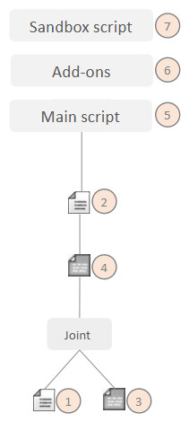

# Joint callback functions

[Scripts](scripts.md) can include a joint callback function, which is one of many [system callback functions](callbackFunctions.md#systemCallbacks). When present and the script's parent is a [joint](joints.md) or a descendant of a joint, then it is called by CoppeliaSim in various situations:

- When the joint is in kinematic mode: modifying [`joint.targetPosition`](sim-2/property_joint_targetPosition.md) or [`joint.targetVelocity`](sim-2/property_joint_targetVelocity.md) triggers the joint callback function. The [main script](mainScript.md) contains such a joint callback function, which offers a default behavior, i.e. a specific motion profile will be applied.
- When the joint is in dynamic mode, is [dynamically enabled](designingDynamicSimulations.md#dynamicallyEnabled), and is set to custom control: the physics engine triggers the joint callback function for each dynamics simulation step, which is quite often, normally 10 times per simulation step for a given joint.

Joint callback functions enable the user to customize the control loop for specific joints to write low-level control algorithms.

The following represents a simple position control joint callback function, for a joint in dynamic mode:

```python
import sim

def sysCall_joint(inData):
    # inData['mode'] : sim.jointMode.kinematic or sim.jointMode.dynamic
    # inData['joint'] : the joint to control
    # inData['revolute'] : whether the joint is revolute or prismatic
    # inData['cyclic'] : whether the joint is cyclic or not
    # inData['bounds'] : the lower and upper bounds of the joint (if the joint is not cyclic)
    # inData['dt'] : the step size used for the calculations
    # inData['pos'] : the current position
    # inData['vel'] : the current velocity (only with Mujoco)
    # inData['accel'] : the current acceleration (only with Mujoco)
    # inData['targetPos'] : the desired position
    # inData['targetVel'] : the desired velocity
    # inData['initVel'] : the desired initial velocity
    # inData['error'] : targetPos-currentPos (with revolute cyclic joints, the shortest cyclic distance)
    # inData['maxVel'] : a maximum velocity
    # inData['maxAccel'] : a maximum acceleration
    # inData['maxJerk'] : a maximum jerk
    # inData['first'] : whether this is the first call from the physics engine, since the joint
    #                was initialized (or re-initialized) in it.
    # inData['passCnt'] : the current dynamics calculation pass. 1-10 by default
    # inData['totalPasses'] : the number of dynamics calculation passes for each "regular" simulation pass.
    # inData['effort'] : the last force or torque that acted on this joint along/around its axis. With Bullet,
    #                 torques from joint limits are not taken into account
    # inData['force'] : the joint force/torque, as set via joint.targetForce

    if inData['mode'] == sim.jointMode.dynamic:
        # Simplest position controller example:
        ctrl = inData['error'] * 20.0
        max_velocity = ctrl
        if max_velocity > inData['maxVel']:
            max_velocity = inData['maxVel']
        if max_velocity < -inData['maxVel']:
            max_velocity = -inData['maxVel']
        force_or_torque_to_apply = inData['maxForce']

        # Following data must be returned to CoppeliaSim:
        outData = {'vel': max_velocity, 'force': force_or_torque_to_apply}
        return outData

    # Expected return data:
    # For kinematic joints:
    # outData = {'pos': pos, 'vel': vel, 'immobile': False}
    #
    # For dynamic joints:
    # outData = {'force': f, 'vel': vel}
```

```lua
import 'sim-2'

function sysCall_joint(inData)
    -- inData.mode : sim.jointMode.kinematic or sim.jointMode.dynamic
    --
    -- inData.joint : the joint to control
    -- inData.revolute : whether the joint is revolute or prismatic
    -- inData.cyclic : whether the joint is cyclic or not
    -- inData.bounds : the lower and upper bounds of the joint
    -- inData.dt : the step size used for the calculations
    -- inData.pos : the current position
    -- inData.vel : the current velocity (only with Mujoco)
    -- inData.accel : the current acceleration (only with Mujoco)
    -- inData.targetPos : the desired position
    -- inData.targetVel : the desired velocity
    -- inData.initVel : the desired initial velocity
    -- inData.error : targetPos-currentPos (with revolute cyclic joints, the shortest cyclic distance)
    -- inData.maxVel : a maximum velocity
    -- inData.maxAccel : a maximum acceleration
    -- inData.maxJerk : a maximum jerk
    -- inData.first : whether this is the first call from the physics engine, since the joint
    --                was initialized (or re-initialized) in it.
    -- inData.passCnt : the current dynamics calculation pass. 1-10 by default
    -- inData.totalPasses : the number of dynamics calculation passes for each "regular" simulation pass.
    -- inData.effort : the last force or torque that acted on this joint along/around its axis. With Bullet,
    --                 torques from joint limits are not taken into account
    -- inData.force : the joint force/torque, as set via joint.targetForce

    if inData.mode == sim.jointMode.dynamic then
        -- Simplest position controller example:
        local ctrl = inData.error * 20.0
        local maxVelocity = ctrl
        if maxVelocity > inData.maxVel then
            maxVelocity = inData.maxVel
        end
        if maxVelocity < -inData.maxVel then
            maxVelocity = -inData.maxVel
        end
        local forceOrTorqueToApply = inData.maxForce

        -- Following data must be returned to CoppeliaSim:
        local outData = {vel = maxVelocity, force = forceOrTorqueToApply}
        return outData
    end

    -- Expected return data:
    -- For kinematic joints:
    -- outData = {pos = pos, vel = vel, immobile = false}
    --
    -- For dynamic joints:
    -- outData = {force = f, vel = vel}
end
```

A joint callback call is applied to all scripts located in the upward hierarchy of the joint, and interrupted as soon as a script handles the call, i.e. returns data:



*[Script execution precedence with a joint callback]*
