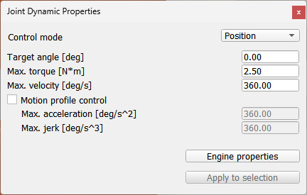

# Joint dynamics dialog

The joint dynamics dialog is part of the [joint dialog](jointProperties.md) and displays the dynamics settings and parameters of the last selected [joint](joints.md). If no joint is selected, or the joint is not dynamic, then the dialog is inactive. If more than one joint is selected, then some parameters can be copied from the last selected joint to the other selected joints:

*[Joint dynamics dialog]*

Several control modes are supported:

- **Free** **(no control)**: the joint is free, i.e. non-motorized
- **Force/torque control**: the joint is controlled in force/torque, i.e. a constant force/torque is applied. Can be modulated with [`joint.dynamics.targetForce`](sim-2/property_joint_dynamics_targetForce.htm)
- **Velocity control**: the joint is controlled in velocity: the specified force/torque is applied until the desired velocity is reached. Optionally, a specific motion profile for the velocity can be applied. Can be modulated with [`joint.targetVelocity`](sim-2/property_joint_targetVelocity.htm) and [`joint.setTargetVelocity`](sim-2/joint_setTargetVelocity.htm)
- **Position control**: the joint is controlled in position: the specified force/torque is applied and the velocity is modulated accordingly, until the target position/angle is reached. Can be modulated with [`joint.targetPosition`](sim-2/property_joint_targetPosition.htm) and [`joint.setTargetPosition`](sim-2/joint_setTargetPosition.htm)
- **Spring-damper control**: the joint is controlled in position by modulating the exerted force/torque via a simple KC controller, trying to reach the zero displacement position/angle. Parameters can be adjusted with [`joint.targetPosition`](sim-2/property_joint_targetPosition.htm) and [`joint.dynamics.springDamper`](sim-2/property_joint_dynamics_springDamper.htm)
- **Custom control**: the joint calls a [joint callback function](jointCallbackFunctions.md) for control, where the return value is a computed force/torque

See also [`joint.dynamics.ctrlMode`](sim-2/property_joint_dynamics_ctrlMode.htm). In addition to the above settings, joints have specific parameters related to each physics engine that can be adjusted with **Engine properties** or via [joint-related methods and properties](apiFunctions.md#methodsAndProperties_joint). Make sure to read the respective engine documentation to achieve best parameter settings.
