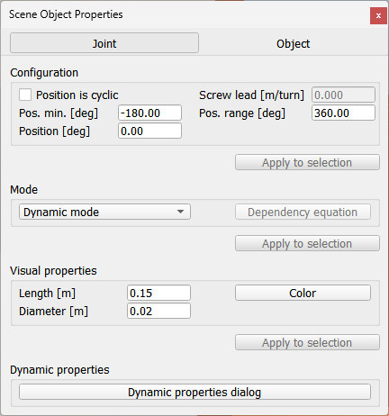

# Joint dialog

The joint dialog is part of the [scene object dialog](sceneObjectPropertiesDialog.md), which is located at [Tools > Scene object properties]. You can also open the dialog with a double-click on an object icon in the [scene hierarchy](userInterface.md#SceneHierarchy), or with a click on its [toolbar](userInterface.md#toolbars) button:

*[Scene object properties toolbar button]*

In the scene object dialog, click the **Joint** button to display the joint dialog (the **Joint** button only appears if the last selection is a [joint](joints.md)). The dialog displays the settings and parameters of the last selected joint. If more than one joint is selected, then some parameters can be copied from the last selected joint to the other selected joints (**Apply to selection**-buttons). Be aware that this however only has an effect between joints of the same type or mode:

*[Joint dialog]*

- **Position is cyclic**: indicates whether the angular joint position is cyclic (varies between -180 and +180 degrees without limitation). Only revolute joints can be cyclic. Refer also to [`joint.cyclic`](sim-2/property_joint_cyclic.htm).
- **Screw lead**: the z-axis displacement per turn. This property becomes available only with the Revolute/Screw-type of joint, when the **Position is cyclic**-checkbox is left unchecked and the joint is kinematic. Refer also to [`joint.screwLead`](sim-2/property_joint_screwLead.htm).
- **Position minimum**: the minimum allowed value of a non-cyclic revolute joint, a screw, or a prismatic joint. Refer also to [`joint.bounds`](sim-2/property_joint_bounds.htm).
- **Position range**: the variation range of a non-cyclic revolute joint, a screw or a prismatic joint. A position of such a joint is limited between **Position minimum** and **Position minimum**+**Position range**. Refer also to [`joint.bounds`](sim-2/property_joint_bounds.htm).
- **Position**: linear/angular joint position. Refer also to [`joint.joint.position`](sim-2/property_joint_joint_position.htm).
- **Mode**: a joint can be in kinematic, dependent, or dynamic mode. Refer also to [`joint.mode`](sim-2/property_joint_mode.htm).
- **Dependency equation**: if the joint is in dependent mode, then a linear equation can be specified that links the joint to another one. The values in this section of the dialog are all indicated in meters or radians. Refer also to [`joint.dependencyMaster`](sim-2/property_joint_dependencyMaster.htm) and [`joint.dependencyParams`](sim-2/property_joint_dependencyParams.htm).
- **Length**: length of the joint. Has no functional meaning. Refer also to [`joint.length`](sim-2/property_joint_length.htm).
- **Diameter**: diameter of the joint. Has no functional meaning. Refer also to [`joint.diameter`](sim-2/property_joint_diameter.htm).
- **Color**: allows adjusting the color of the joint.
- **Dynamic properties dialog**: toggles the [joint dynamics dialog](jointDynamicsProperties.md). The joint dynamics dialog allows you to adjust a joint's dynamic properties.
