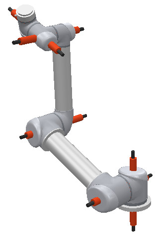
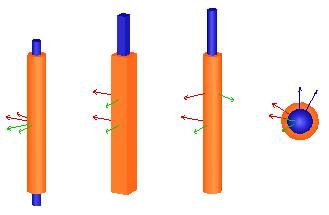
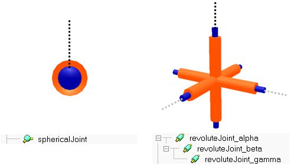
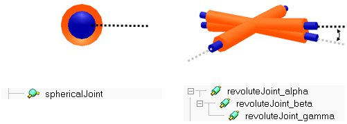

# Joints

A joint is an instance of the [joint type](mainObjectTypes.md#joint), which in turn derives from the [sceneObject type](mainObjectTypes.md#sceneObject). It allows for a relative movement between its parent and its children. When a parent-child relationship is built between a joint and an object, the object is attached to the joint's second reference frame, thus, a change of the joint's intrinsic linear/angular position is directly reflected onto its children. A joint can operate in different [modes](jointModes.md). A joint is added to a [scene](scenes.md) with [Add > Joint]. Refer also to [`sim.scene:createObject`](sim-2/scene_createObject.htm) and [joint-related methods and properties](apiFunctions.md#methodsAndProperties_joint).

*[Robotic manipulator with highlighted joints]*

4 types of joints are supported:

*[Revolute joint, prismatic joint, screw and spherical joint]*

- **Revolute joints** have one intrinsic DoF and are used to describe a rotational movement between objects. The rotation happens about a joint's reference frame's z-axis
- **Prismatic joints** have one intrinsic DoF and are used to describe a translational movement between objects. The translation happens along a joint's reference frame's z-axis
- **Screws** have one intrinsic DoF and are used to describe a movement similar to a screw between objects. A lead parameter defines the amount of translation for a full rotation. The translation/rotation happens along/about a joint's reference frame's z-axis
- **Spherical joints** have three intrinsic DoFs and are used to describe a rotational movement between objects. In some situations, a spherical joint can be thought of as 3 concurrent and orthogonal joints, that are parented in a hierarchy-chain. The analogy is however only valid while all revolute joints keep an orientation distinct from any of the other two: indeed, should two joints come close to coinciding, a singular situation might appear and the mechanism will lose one DoF. This does never happen with spherical joints, which are internally handled to avoid this kind of situation:

*[Two equivalent mechanisms (in this configuration): spherical joint (left) and 3 revolute joints (right)]*

*[Two non-equivalent mechanisms: the right configuration is close to a singularity]*

Refer also to [`joint.joint.type`](sim-2/property_joint_joint_type.htm), [`joint.bounds`](sim-2/property_joint_bounds.htm), [`joint.cyclic`](sim-2/property_joint_cyclic.htm), [`joint.joint.position`](sim-2/property_joint_joint_position.htm), [`joint.joint.quaternion`](sim-2/property_joint_joint_quaternion.htm) and [`joint.configuration`](sim-2/property_joint_configuration.htm).
