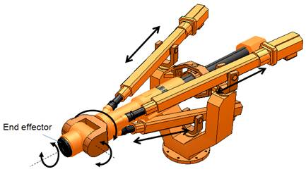

# Kinematics

CoppeliaSim's kinematics functionality is a highly capable and flexible solution for handling a wide range of mechanisms in both inverse kinematics (IK) and forward kinematics (FK) modes. The functionality is made available through the [Coppelia Kinematics Routines](coppeliaKinematicsRoutines.md), a collection of C++ functions that can be integrated into standalone applications and accessed through the [kinematics plugin](kinematicsPlugin.md).

The IK problem involves finding the joint values that correspond to a specific position and/or orientation of a body element, typically the end effector. This can be seen as a transformation from task space coordinates to joint space coordinates. For instance, in the case of a serial manipulator, the problem is to determine the values of all joints given the position (and/or orientation) of the end effector. The reverse problem, finding the end effector position and/or orientation given the joint values, is known as the FK problem and is often considered easier than IK, although this may not be the case for all machines, as demonstrated by the following example:

*[Non-trivial FK problem: determining the end effector pose given the joint values indicated by the arrows.]*

The kinematics functionality is accessed through the [kinematics plugin](kinematicsPlugin.md) and enables the setup of complex kinematics tasks in a separate IK environment, allowing for neat separation from other aspects of the simulation model (such as dynamics, for example). The calculations are based on the Jacobian, and various resolution methods are supported, including the Jacobian pseudoinverse, damped least squares pseudoinverse, and null-space projections, among others.

In CoppeliaSim, IK tasks are solved using [IK groups and IK elements](solvingIkAndFk.md). To fully understand the capabilities and usage of the inverse kinematics functionality, we recommend reviewing the [inverse kinematics tutorial](inverseKinematicsTutorial.md) and the various example scenes located in the folder scenes/kinematics.
