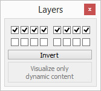

# Layer selection dialog

The layer selection dialog is a convenient way to show or hide specific parts of a [scene](scenes.md). Each [scene object](objects.md) can be assigned to any of the 16 available visibility layers (refer to the [scene object common properties](sceneObjectPropertiesDialog.md#common), [sceneObject.layer](sim/property_sceneObject_layer.htm) and [sim.scene.visibilityLayers](sim/property_scene_visibilityLayers.htm)). Using this dialog, you can activate/deactivate each layer individually. If some objects should be invisible, try hiding them in a non-activated layer (e.g. current layer+8). When saving a scene, always try to stick to the default activation state (all 8 first layers enabled, the last 8 layers disabled). The reason for this is that if you copy and paste a [model](models.md) from your scene into another scene, then some objects that were supposed to be invisible might become suddenly visible. During simulation the dialog offers the possibility to only display the scene's dynamic content (**Visualize only dynamic content**), which oftentimes is helpful for debugging purposes.

The layer selection dialog can be accessed with "Tools > Layers" or by clicking the following toolbar button:

*[Layer selection dialog toolbar button]*

*[Layer selection dialog. All layers are activated except for layers 9-16 (default)]*
