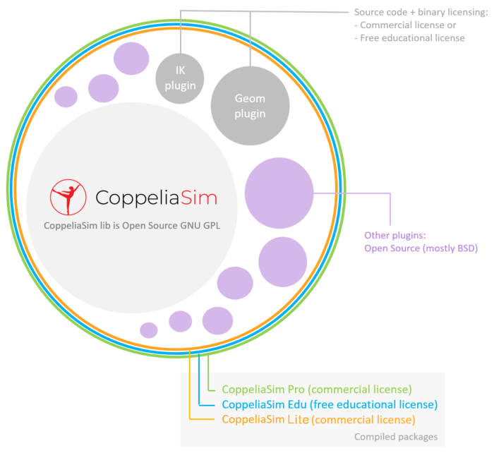

# Licensing

CoppeliaSim Edu, CoppeliaSim Pro, CoppeliaSim Lite and other components (e.g. plugins) are licensed according to the following scheme (see further below for the license texts):

## CoppeliaSim Pro license

CoppeliaSim Pro commercial license. Contact us for details.

## CoppeliaSim Lite license

CoppeliaSim Lite commercial license. Contact us for details.

## CoppeliaSim Edu license

CoppeliaSim Edu educational license:

---

CoppeliaSim Edu is exclusively available for use by students, teachers and professors of schools and universities.

CoppeliaSim Edu cannot be used by companies, research institutions, non-profit organisations, foundations, or any other entity which is not a school or a university.

CoppeliaSim Edu cannot be used commercially.

CoppeliaSim Edu is distributed in the hope that it will be useful, but WITHOUT ANY WARRANTY; without even the implied warranty of MERCHANTABILITY or FITNESS FOR A PARTICULAR PURPOSE. In no event will the original authors and Coppelia Robotics AG be held liable for any injuries, death, data loss, damages, loss of profits or any other loss while using or misusing this software.

---

## Geometric/kinematics plugin commercial license

Geometric/kinematics plugin commercial license. Contact us for details.

## Geometric/kinematics plugin educational license

Geometric/kinematics plugin educational license:

---

The Geometric/kinematics plugin educational license applies ONLY to **educational entities** composed by the following people and institutions:

1\. Hobbyists, students, teachers and professors

2\. Schools and Universities

&lt;string>Educational entities do NOT include companies, research institutions, non-profit organisations, foundations, etc.

An **educational entity** may use, modify, compile and distribute the modified/unmodified plugin under the following conditions:

1\. Distribution should be free of charge.

2\. Distribution should be to **educational entities** only.

3\. Usage should be non-commercial.

4\. Altered source versions must be plainly marked as such and distributed along with any compiled code.

5\. When using the plugin in conjunction with CoppeliaSim, the "EDU" watermark in the CoppeliaSim scene view should not be removed.

6\. The origin of the plugin must not be misrepresented. You must not claim that you wrote the original software.

The plugin is distributed in the hope that it will be useful, but WITHOUT ANY WARRANTY; without even the implied warranty of MERCHANTABILITY or FITNESS FOR A PARTICULAR PURPOSE. In no event will the original authors and Coppelia Robotics AG be held liable for any injuries, death, data loss, damages, loss of profits or any other loss while using or misusing this software.

---
