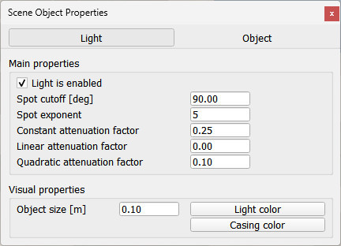

# Light dialog

The light dialog is part of the [scene object dialog](sceneObjectPropertiesDialog.md), which is located at [Tools > Scene object properties]. You can also open the dialog with a double-click on an object icon in the [scene hierarchy](userInterface.md#SceneHierarchy), or with a click on its [toolbar](userInterface.md#toolbars) button:

*[Scene object properties toolbar button]*

In the scene object dialog, click the **Light** button to display the light dialog (the **Light** button only appears if the last selection is a [light](lights.md)). The dialog displays the settings and parameters of the last selected light. If more than one light is selected, then some parameters can be copied from the last selected light to the other selected lights (**Apply to selection**-buttons):

*[Light dialog]*

- **Light is enabled**: enables or disables a light. A maximum of 8 enabled lights can exist at the same time in a [scene](scenes.md). Refer also to [`light.enabled`](sim-2/property_light_enabled.htm).
- **Spot cutoff**: in the case the light is a spotlight, this value specifies the cutoff angle of the light. Small angles result in narrow spotlights. Refer also to [`light.spotCutoffAngle`](sim-2/property_light_spotCutoffAngle.htm).
- **Spot exponent**: in the case the light is a spotlight, this value specifies the intensity distribution of the light. 0 results in a wide spotlight, 128 results in a narrow spotlight. Refer also to [`light.spotExponent`](sim-2/property_light_spotExponent.htm).
- **Constant/linear/quadratic attenuation factor**: attenuation factors. Refer also to [`light.attenuationFactors`](sim-2/property_light_attenuationFactors.htm).
- **Object size**: size of the light. This parameter has only a visual effect and no functional meaning. Refer also to [`light.size`](sim-2/property_light_size.htm).
- **Light / casing color**: allows adjusting a light color, or casing color.
