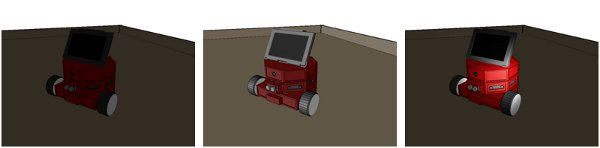
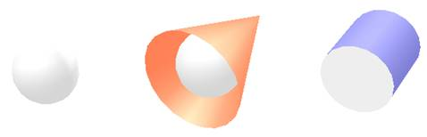

# Lights

A light is an instance of the [light type](mainObjectTypes.md#light), which in turn derives from the [sceneObject type](mainObjectTypes.md#sceneObject). It allows you to light a [scene](scenes.md). Without light in the scene, objects appear in unshaded colors (in that case objects are only illuminated with an ambient light component that can be set in the [environment dialog](environmentPropertiesDialog.md)). The following figure illustrates the effect of lights in a scene:

*[Scene illuminated (1) with ambient light only, (2) with a directional light, (3) with a spotlight]*

There can be up to eight active lights in a scene. There are three different types of lights:

- **Omnidirectional lights** illuminate the scene as point light sources.
- **Spotlights** illuminate the scene only in specific directions, with specific light cone angles.
- **Directional lights** illuminate the scene only in specific directions and their strength does not fade with distance.

*[(1) omnidirectional light, (2) spotlight, (3) directional light]*

A light can be added to the scene with [Add > Light]. Refer also to [`sim.scene:createObject`](sim-2/scene_createObject.md) and [light-related methods and properties](apiFunctions.md#methodsAndProperties_light).
