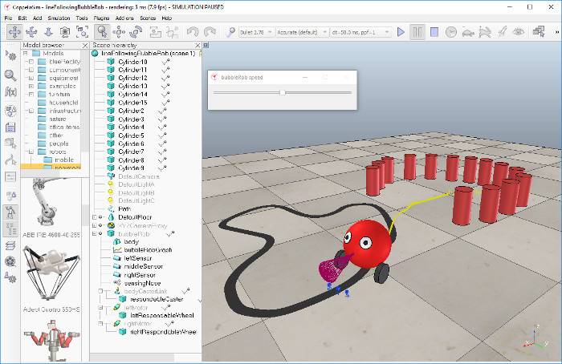
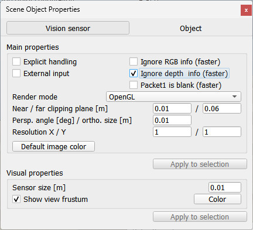
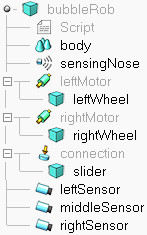

# Line following BubbleRob tutorial

In this tutorial we aim at extending the functionality of BubbleRob to let it follow a line on the ground. Make sure you have fully read and understood the [first BubbleRob tutorial](bubbleRobTutorial.md). This tutorial is courtesy of Eric Rohmer.

Load the scene of the first BubbleRob tutorial located in *scenes/tutorials/BubbleRob*. The scene file related to this tutorial is located in *scenes/tutorials/LineFollowingBubbleRob*. The following figure illustrates the simulation scene that we will design:



We first create the first of 3 [vision sensors](visionSensors.md) that we will attach to the *bubbleRob* object. Select [Add > Vision sensor > Orthogonal type]. Edit its properties, by double-clicking on the newly created vision sensor icon in the [scene hierarchy](userInterface.md#SceneHierarchy), and change the parameters to reflect the following dialog:



The vision sensor has to be facing the ground, so select it, and in the [orientation dialog](orientationDialog.md), on the **orientation** tab, set [180;0;0] for the *Alpha*-*Beta*-*Gamma* items.

We have several possibilities to read a vision sensor. Since our vision sensor has just one pixel and operates in an easy way, we will simply query the average intensity value of the image read by our vision sensor. For more complex cases, we could have set up a [vision callback function](visionCallbackFunctions.md). Now copy and paste the vision sensor twice, and adjust their names to *leftSensor*, *middleSensor* and *rightSensor*. Make *bubbleRob* their parent (i.e. attach them to the *bubbleRob* object). Your sensors should now look like this in the scene hierarchy:



Let's position the sensors correctly. For that, use the [position dialog](positionDialog.md), on the **position** tab, and set the following absolute coordinates:

- Left sensor: [0.2;0.042;0.018]
- Middle sensor: [0.2;0;0.018]
- Right sensor: [0.2;-0.042;0.018]

Now let's modify the environment. We can remove a few cylinders in front of BubbleRob. Next, we will build the [path](paths.md) that the robot will try to follow: click [Add > Path > Closed]. You have several possibilities to adjust the shape of the path, by manipulating its control points: you can delete or duplicate them, and you can shift/reorient them. Enable the [object movement with the mouse](objectMovement.md), and adjust the path to your liking.

Once you are satisfied with the geometry of the path (you can always modify it at a later stage), open the [customization script](customizationScripts.md) attached to it and replace its content with:

```lua
--lua

pathModel = require'models/path-2'

function sysCall_init()
    local opt = {}
    opt.closed = true
    opt.hiddenDuringSim = false
    opt.orientationMetric = 0.5
    opt.forwardAndUpAxes = 'xz'
    opt.upVector = nil -- {0.0, 0.0, 1.0}
    opt.ctrlPoints = {}
    opt.ctrlPoints.pointType = 'none'
    opt.ctrlPoints.lineType = 'line'
    opt.ctrlPoints.lineColor = Color'#00ffa0'
    opt.ctrlPoints.showAxes = false
    opt.ctrlPoints.duplicateThreshold = 0.01
    opt.ctrlPoints.linearityTolerance = 0.01
    opt.pathPoints = {}
    opt.pathPoints.pointType = 'none'
    opt.pathPoints.lineType = 'line'
    opt.pathPoints.lineColor = Color'#00dd00'
    opt.pathPoints.showAxes = false
    opt.pathPoints.type = 'quadraticBezier'
    opt.pathPoints.bezierSmoothing = 1.0
    opt.pathPoints.samplingDistance = 0.05
    opt.extrusion = {}
    opt.extrusion.section = {-0.02, 0.001, 0.02, 0.001}
    opt.extrusion.color = Color'#555555'
    opt.extrusion.selectable = false
    opt.extrusion.upVector = nil
    opt.dummy = {}
    opt.dummy.size = 0.01
    opt.dummy.color = Color'#00ccff'
    opt.dummy.visible = true
    pathModel.update(opt)
end
```

Restart the customization script for the changes to take effect, then comment out or remove the line pathModel.update(opt).

The last step is to adjust the controller of BubbleRob, so that it will also follow the black path. Open the [simulation script](simulationScripts.md) attached to *bubbleRob*, and replace it with the following code:

```lua
--lua

function sysCall_init()
    sim = require('sim-2')
    simUI = require('simUI')
    bubbleRobBase = sim.self:getObject('..')
    leftMotor = sim.self:getObject("../leftMotor")
    rightMotor = sim.self:getObject("../rightMotor")
    noseSensor = sim.self:getObject("../sensingNose")
    minMaxSpeed = {50 * math.pi / 180, 300 * math.pi / 180}
    backUntilTime = -1 -- Tells whether bubbleRob is in forward or backward mode
    floorSensors = {}
    floorSensors[1] = sim.self:getObject("../leftSensor")
    floorSensors[2] = sim.self:getObject("../middleSensor")
    floorSensors[3] = sim.self:getObject("../rightSensor")
    robotTrace = sim.scene:createObject({type = 'marker', ['marker.type'] = 'lines', cyclic = true, itemCnt = 200, itemColor = Color('#ffff00ff')})
    -- Create the custom UI:
    xml = '<ui title="' .. bubbleRobBase:getName({mode = 'shortPath'}) .. ' speed" closeable="false" resizeable="false" activate="false">'..[[
                <hslider minimum="0" maximum="100" on-change="speedChange_callback" id="1"/>
            <label text="" style="* {margin-left: 300px;}"/>
        </ui>
        ]]
    ui = simUI.create(xml)
    speed = (minMaxSpeed[1] + minMaxSpeed[2]) * 0.5
    simUI.setSliderValue(ui, 1, 100 * (speed - minMaxSpeed[1]) / (minMaxSpeed[2] - minMaxSpeed[1]))
    prevPos = bubbleRobBase.worldPosition
end

function sysCall_sensing()
    robotTrace:addItems(prevPos:horzcat(bubbleRobBase.worldPosition))
    prevPos = bubbleRobBase.worldPosition
end 

function speedChange_callback(ui, id, newVal)
    speed = minMaxSpeed[1] + (minMaxSpeed[2] - minMaxSpeed[1]) * newVal / 100
end

function sysCall_actuation() 
    local result = noseSensor.detectedObject
    if result then
        backUntilTime = sim.scene.simulation.time + 4
    end
    
    -- read the line detection sensors:
    sensorReading = {false, false, false}
    for i = 1, 3, 1 do
        local data = floorSensors[i].packet1
        if #data > 0 then
            sensorReading[i] = (data[11] < 0.5) -- data[11] is the average of intensity of the image
        end
    end
    
    -- compute left and right velocities to follow the detected line:
    rightV = speed
    leftV = speed
    if sensorReading[1] then
        leftV = 0.03 * speed
    end
    if sensorReading[3] then
        rightV = 0.03 * speed
    end
    if sensorReading[1] and sensorReading[3] then
        backUntilTime = sim.scene.simulation.time + 2
    end
    
    if backUntilTime < sim.scene.simulation.time then
        -- When in forward mode, we simply move forward at the desired speed
        leftMotor.targetVelocity = leftV
        rightMotor.targetVelocity = rightV
    else
        -- When in backward mode, we simply backup in a curve at reduced speed
        leftMotor.targetVelocity = -speed / 2
        rightMotor.targetVelocity = -speed / 8
    end
end 

function sysCall_cleanup() 
    simUI.destroy(ui)
end
```
