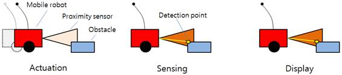
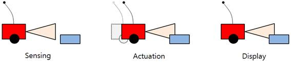

# The main script

By default, each [scene](scenes.md) in CoppeliaSim has a single main script. It contains the basic code that allows a [simulation](simulation.md) to run. Without a main script, a running simulation won't do anything significant. See also [`sim.scene.mainScript`](sim-2/property_scene_mainScript.md).

The main script contains a collection of [callback functions](callbackFunctions.md) that are appropriately called by CoppeliaSim. The default main script is typically divided into four callback functions:

- The initialization function: **sysCall_init**. It is called once, at the beginning of a simulation.
- The actuation function: **sysCall_actuation**. It is called in each simulation step. The code handles all the actuation functionality of the simulation. One function is of particular interest: [`sim.scene:handleSimulationScripts`](sim-2/scene_handleSimulationScripts.md), which calls [simulation scripts'](simulationScripts.md) *sysCall_actuation* callback functions. Without that command, [simulation scripts](simulationScripts.md) won't execute, or won't execute their actuation function, and specific [model](models.md) functionality or behavior won't operate as intended.
- The sensing function: **sysCall_sensing**. It is called in each simulation step. The code handles all the sensing functionality of the simulation ([proximity sensors](proximitySensors.md), etc.) in a generic way. One function is of particular interest: [`sim.scene:handleSimulationScripts`](sim-2/scene_handleSimulationScripts.md)[`sim.handleSimulationScripts`](sim-1/simHandleSimulationScripts.md), which calls [simulation scripts'](simulationScripts.md) *sysCall_sensing* callback functions. Without that command, [simulation scripts](simulationScripts.md) won't execute their sensing function, and specific [model](models.md) functionality or behavior won't operate as intended.
- The restoration function: **sysCall_cleanup**. It is executed once, just before a simulation ends. The code restores the initial poses of [scene objects](objects.md), clears sensor states, etc.

The following is the typical main script, slightly simplified:

```lua
import 'sim-2'

function sysCall_init()
end

function sysCall_actuation()
    sim.scene:handleSimulationScripts(sim.syscb_actuation)
    sim.scene:handleCustomizationScripts(sim.syscb_actuation)
    sim.app:handleAddOns(sim.syscb_actuation)
    sim.app:handleSandboxes(sim.syscb_actuation)
    sim.scene:stepKinematicJoints()
    sim.scene.dynamics:step()
end

function sysCall_sensing()
    local proxSensors = sim.scene:getObjects({types = {'proximitySensor'}})
    for i = 1, #proxSensors do
        local s = proxSensors[i]
        if not s.explicitHandling then
            s:handleSensor()
        end
    end
    local visionSensors = sim.scene:getObjects({types = {'visionSensor'}})
    for i = 1, #visionSensors do
        local s = visionSensors[i]
        if not s.explicitHandling then
            s:handleSensor()
        end
    end
    sim.scene:handleSimulationScripts(sim.syscb_sensing)
    sim.scene:handleCustomizationScripts(sim.syscb_sensing)
    sim.app:handleAddOns(sim.syscb_sensing)
    sim.app:handleSandboxes(sim.syscb_sensing)
end

function sysCall_cleanup()
    sim.scene:handleSimulationScripts(sim.syscb_cleanup)
    local proxSensors = sim.scene:getObjects({types = {'proximitySensor'}})
    for i = 1, #proxSensors do
        local s = proxSensors[i]
        if not s.explicitHandling then
            s:resetSensor()
        end
    end
    local visionSensors = sim.scene:getObjects({types = {'visionSensor'}})
    for i = 1, #visionSensors do
        local s = visionSensors[i]
        if not s.explicitHandling then
            s:resetSensor()
        end
    end
end

function sysCall_suspend()
    sim.scene:handleSimulationScripts(sim.syscb_suspend)
    sim.scene:handleCustomizationScripts(sim.syscb_suspend)
    sim.app:handleAddOns(sim.syscb_suspend)
    sim.app:handleSandboxes(sim.syscb_suspend)
end

function sysCall_suspended()
    sim.scene:handleSimulationScripts(sim.syscb_suspended)
    sim.scene:handleCustomizationScripts(sim.syscb_suspended)
    sim.app:handleAddOns(sim.syscb_suspended)
    sim.app:handleSandboxes(sim.syscb_suspended)
end

function sysCall_resume()
    sim.scene:handleSimulationScripts(sim.syscb_resume)
    sim.scene:handleCustomizationScripts(sim.syscb_resume)
    sim.app:handleAddOns(sim.syscb_resume)
    sim.app:handleSandboxes(sim.syscb_resume)
end
```

However, there are many more [system callback functions](callbackFunctions.md#systemCallbacks) the main script can use to react to various events.

The main script is not supposed to be modified. The reason for this is as follows: one of CoppeliaSim's strengths is that any [model](models.md) (robot, actuator, sensor, etc.) can be copied into a [scene](scenes.md) and is immediately operational. When modifying the main script, you run the risk that models won't perform as expected anymore (e.g. if your main script lacks a command such as [`sim.scene:handleSimulationScripts`](sim-2/scene_handleSimulationScripts.md), then all models copied into the scene won't operate at all). Another reason is that keeping a default main script allows old scenes to easily adapt to new functionality.

If, however, for one reason or another, you really need to modify the main script of a scene, you can do so by double-clicking the light-red script icon next to the world icon at the top of the [scene hierarchy](userInterface.md#SceneHierarchy):


*[Main script icon]*

Most of the simulation scripts' system callback functions are called from the main script via [`sim.scene:handleSimulationScripts`](sim-2/scene_handleSimulationScripts.md), which [operates in a cascading fashion](scriptExecution.md) upon the scene hierarchy and the simulation/customization scripts.

If you look at the default main script, you will notice that the actuation function allows actuating or modifying the scene content (e.g. [`sim.scene.dynamics:step`](sim-2/scene_dynamics_step.md)), while the sensing function allows sensing and probing the scene content (e.g. [`proximitySensor:handleSensor`](sim-2/proximitySensor_handleSensor.md)). The following illustrates what happens in the default main script when a mobile robot equipped with a [proximity sensor](proximitySensors.md) is simulated:



*[Default actuation - sensing - display sequence]*

With the above sequence in mind, [simulation scripts](simulationScripts.md) will always read (e.g. with [`proximitySensor.detectedObject`](sim-2/property_proximitySensor_detectedObject.md)) the proximity sensor's state from the previous sensing pass, then react to obstacles.

If you need to explicitly handle a sensor, then make sure to always do so while in the sensing section. Otherwise, you might end up with situations where the display appears wrong, as illustrated in the following figure:



*[Sensing - actuation - display sequence]*

Just as the main script has an actuation-sensing sequence, so do [simulation scripts](simulationScripts.md) and [customization scripts](customizationScripts.md).
