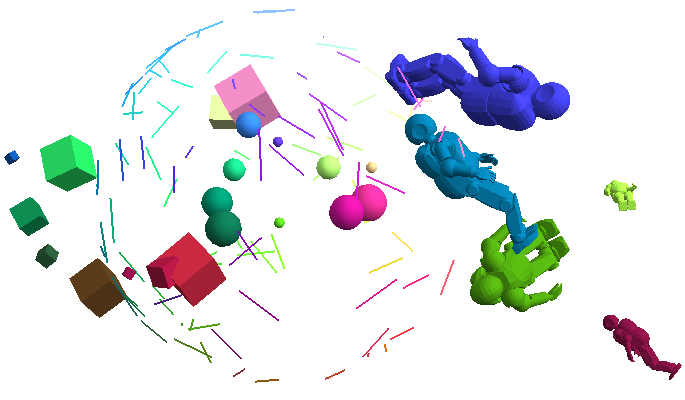

# Markers

A marker is an instance of the [marker type](mainObjectTypes.md#marker), which in turn derives from the [sceneObject type](mainObjectTypes.md#sceneObject). It allows you to augment a scene with visual items, such as points, lines, primitive shapes, but also custom meshes. The following figure shows several markers:

*[Markers]*

A marker can be added to the scene with [Add > Marker]. Refer also to [`sim.scene:createObject`](sim-2/scene_createObject.md) and [marker-related methods and properties](apiFunctions.md#methodsAndProperties_marker).
