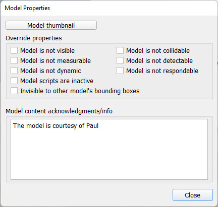

# Model dialog

The properties of a model can be individually adjusted in the model dialog. It can be opened with a double-click on a model icon in the [scene hierarchy](userInterface.md#SceneHierarchy):

*[Model icon in the scene hierarchy]*

*[Model dialog]*

- **Model thumbnail**: when saving a model, a dialog pops open asking for a model thumbnail (that will be displayed in the [model browser](userInterface.md#ModelBrowser)). If however you wish to save a thumbnail of your model in a different configuration (e.g. you wish to save a model of a snake robot in straight configuration, but you want the thumbnail to visualize the snake robot in a bent configuration), then you can specify the thumbnail here.
- **Override properties**: here you can disable (override) specific properties for the whole model (i.e. for all objects in the model hierarchy tree). This is convenient to quickly disable a model that takes too much calculation time for instance. See also the sections on [collidable objects](collidableObjects.md), [measurable objects](measurableObjects.md) and [detectable objects](detectableObjects.md). Refer also to [sceneObject.model.notCollidable](sim/property_sceneObject_model_notCollidable.htm), [sceneObject.model.notMeasurable](sim/property_sceneObject_model_notMeasurable.htm), [sceneObject.model.notDetectable](sim/property_sceneObject_model_notDetectable.htm), [sceneObject.model.notDynamic](sim/property_sceneObject_model_notDynamic.htm), [sceneObject.model.notInParentBB](sim/property_sceneObject_model_notInParentBB.htm), [sceneObject.model.notRespondable](sim/property_sceneObject_model_notRespondable.htm), [sceneObject.model.notVisible](sim/property_sceneObject_model_notVisible.htm) and [sceneObject.model.scriptsNotActive](sim/property_sceneObject_model_scriptsNotActive.htm).
- **Model content acknowledgments/Info**: information related to a model. It is always good practice to acknowledge the original author of a model, or imported mesh. When a model that contains acknowledgment information is opened, it will automatically display that information. Refer also to [sceneObject.modelAcknowledgment](sim/property_sceneObject_modelAcknowledgment.htm).
