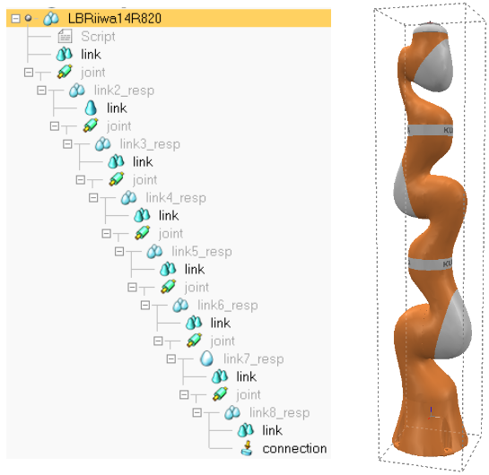

# Models

A model is a sub-element of a [scene](scenes.md). A model by itself cannot exist, except in a file (*\*.ttm* file) or a buffer, nor can it be simulated by itself: a model has to be contained in a scene to be operational.

Models are defined by a selection of [scene objects](objects.md) built on the same hierarchy tree, where the base of the tree has to be an object tagged as **model**. They can be loaded with [File > Load model...]. It is however much easier and more convenient to load a model with a drag-and-drop operation between the [model browser](userInterface.md#ModelBrowser) and a [scene view](pagesAndViews.md). Models can be saved with [File > Save model as...]. Just make sure one single object tagged as **model** is selected, otherwise the **Save model as...**-menu item will not be available. Make also sure to follow the [tutorial on how to build a clean simulation model](buildingAModelTutorial.md). See also [`sceneObject.modelbase`](sim-2/property_sceneObject_modelBase.htm), [`scene:loadModel`](sim-2/scene_loadModel.htm), [`scene:loadModelFromBuffer`](sim-2/scene_loadModelFromBuffer.htm), [`sceneObject:saveModel`](sim-2/sceneObject_saveModel.htm) and [`sceneObject:saveModelToBuffer`](sim-2/sceneObject_saveModelToBuffer.htm).

A model is defined in the following steps:

- Attach (directly or indirectly) all objects that logically belong to the model to the base of the model tree
- Check **Object is model** in the [scene object common properties](sceneObjectPropertiesDialog.md#common). See also [`sceneObject.modelbase`](sim-2/property_sceneObject_modelBase.htm)
- In the same dialog, by clicking **Model properties**, you can define special overriding properties (e.g. make the whole model invisible, non-collidable). That allows you to quickly disable some properties for all objects in the model. Refer also to [`sceneObject.model.notCollidable`](sim-2/property_sceneObject_model_notCollidable.htm), [`sceneObject.mode.notDetectable`](sim-2/property_sceneObject_model_notDetectable.htm), [`sceneObject.model.notMeasurable`](sim-2/property_sceneObject_model_notMeasurable.htm), [`sceneObject.model.notDynamic`](sim-2/property_sceneObject_model_notDynamic.htm), [`sceneObject.model.notRespondable`](sim-2/property_sceneObject_model_notRespondable.htm), [`sceneObject.model.notVisible`](sim-2/property_sceneObject_model_notVisible.htm), [`sceneObject.model.scriptsNotActive`](sim-2/property_sceneObject_model_scriptsNotActive.htm) and [`sceneObject.model.notInParentBB`](sim-2/property_sceneObject_model_notInParentBB.htm).
- For all objects in the model, except for the base object, check **select base of model instead** in the [scene object common properties](sceneObjectPropertiesDialog.md#common). This protects your model: you won't be able to directly select individual objects in your model. See also [`sceneObject.selectModel`](sim-2/property_sceneObject_selectModel.htm).
- For all objects that are normally not visible, check **Ignored by model bounding box**. This makes the model bounding box appear in the right size around the model. See also [`sceneObject.hideFromModelBB`](sim-2/property_sceneObject_hideFromModelBB.htm).
- Think about the role of the model: will you be able to attach it to some other object? (e.g. your model is a gripper that you could attach to a manipulator wrist). Or will you be able to attach some other model to it? (e.g. your model is a manipulator that could accept a gripper model). Once the role is decided, define the model's [assembling behavior](assembly.md). Refer also to this [dynamics design consideration](designingDynamicSimulations.md#modelBaseSelection) and [`sceneObject:setParent`](sim-2/sceneObject_setParent.htm).

Now, individual objects built on the model base cannot be selected anymore in the scene (selecting them selects the base of the model instead); however, they can still be individually selected by holding down the ctrl- and shift-key during selection, or by selecting them in the [scene hierarchy](userInterface.md#SceneHierarchy). In addition to that, when the base object is selected, a stippled bounding box encompassing the whole model is displayed as can be seen in the following figure:

*[Scene hierarchy view and corresponding 3D view]*

Notice the model tag on the left-hand side of the model base:

*[Model tag]*

A double-click on a model tag opens the [model dialog](modelDialog.md), where model properties can be adjusted. It is also good practice to collapse a model's hierarchy once the model has been edited to easily identify the number of logically grouped elements/models. See also [`sceneObject.collapsed`](sim-2/property_sceneObject_collapsed.htm).

Copy and pasting a model behaves exactly like saving the model, then loading it (using however a memory buffer instead of the disk space). Models can be copied from one scene to another like any other object. Model files also support drag-and-drop operations between the explorer window and the application window. See also [`sim.scene:duplicateObjects`](sim-2/scene_duplicateObjects.htm), [`sim.scene:copyObjects`](sim-2/scene_copyObjects.htm), [`sim.scene:cutObjects`](sim-2/scene_cutObjects.htm) and [`sim.scene:pasteObjects`](sim-2/scene_pasteObjects.htm).
