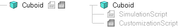
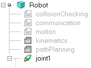
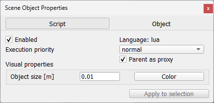

# Script objects

[Simulation scripts](simulationScripts.md) and [customization scripts](customizationScripts.md) are now, as of CoppeliaSim V4.7, [scene objects](objects.md) on their own: [script objects](scriptObjects.md):

*[Prior to V4.7 (associated scripts), and as of V4.7 (script objects)]*

This simplifies the way those scripts are created, handled and destroyed. Additionally, there is no limit anymore to the number of scripts a scene object can have attached, thus code and functionality can better be compartmentalized:

*[Object with several script objects attached, each with a different function]*

Associated scripts are still supported, and they still operate in parallel to the new script objects. However, it is recommended to not use them anymore.

Older scenes and models can be automatically ported by setting the [user settings](commandLine.md#settingsFile) parameter *scriptConversion* to 1. This converts associated scripts to script objects in a compatibility mode:

*[Script object compatibility mode (*Parent as proxy* enabled)]*

The compatibility mode allows most older scenes and models to run seamlessly within the new script object framework. Best is however to disable the compatibility mode (uncheck *Parent as proxy*) and adjust the related script code.

With script objects, the interpreter language is fixed upon script creation, and does not need to be specified as a comment in the code anymore.
