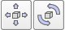

# Object movement with the mouse

In addition to modifying [object](objects.md) poses through the [coordinate and transformation dialog](coordinateDialog.md), objects can also directly be manipulated using the mouse: when objects (and some items) are selected, then they can be translated or rotated using the following toolbar buttons:

*[Manipulation toolbar buttons (position and orientation)]*

By default, translation is performed in the world's X-Y plane. It can also be performed along a different axis/plane and relative to a different reference frame for each individual object, depending on the settings in the [position dialog](positionDialog.md). An overlay drawing indicates the current translation plane or axis.

By default, rotation is performed around the object's own Z axis. It can also be performed around a different axis or relative to a different reference frame for each individual object, depending on the settings in the [orientation dialog](orientationDialog.md). An overlay drawing indicates the current rotation axis.

Default translation and rotation step sizes (snapping) can be adjusted in the [user settings dialog](settings.md), but it is recommended to keep values of 5 centimeters and 5 degrees respectively, or to set the step sizes for objects on an individual basis. Snapping can temporarily be disabled by holding down the shift-key **AFTER** the mouse button was pressed down during object manipulation. In a similar way, alternative translation or rotation axes can be temporarily activated by holding down the ctrl-key **AFTER** the mouse button was pressed down during object manipulation.

The object/item translation toolbar button can also be used when the simulator is in the [vertex edit mode](vertexEditMode.md).
