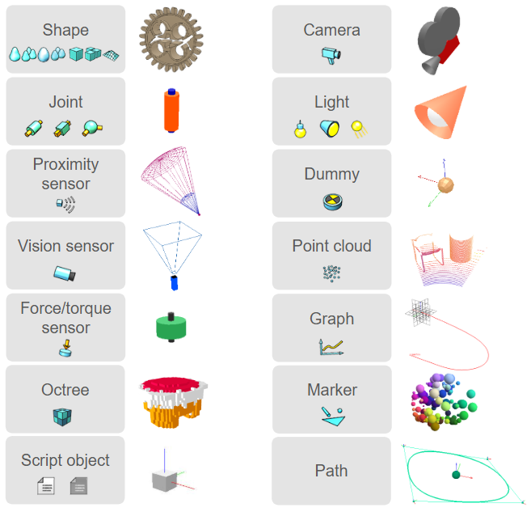

# Scene objects

A scene object is an instance of the [sceneObject type](mainObjectTypes.md#sceneObject), which in turn derives from the [base class object](mainObjectTypes.md#object). The main elements in CoppeliaSim that are used for building a [scene](scenes.md) or a [model](models.md) are scene objects. They are visible in the [scene hierarchy](userInterface.md#SceneHierarchy) and in the scene [view](pagesAndViews.md). In the scene view, scene objects have a three dimensional representation as illustrated in the following figure:

*[Scene object types and their 3 dimensional representation]*

The following list gives a brief functional description of each scene object type:

- [Shapes](shapes.md) wrap one or more meshes (a collection of vertices, edges and triangular faces that define a rigid surface)
- [Joints](joints.md) allow 1 or 3 degrees of freedom between connecting objects. A joint is either passive or active (actuator)
- [Graphs](graphs.md) record and visualize simulation data
- [Dummies](dummies.md) are minimalistic and multipurpose scene objects
- [Proximity sensors](proximitySensors.md) detect specific scene objects in a geometrically exact fashion within their detection volume
- [Vision sensors](visionSensors.md) generate synthetic images of the scene. Images can be extracted and processed
- [Force sensors](forceSensors.md) measure forces and torques applied to them
- [Cameras](cameras.md) display synthetic images of the scene. Images cannot directly be extracted or processed
- [Lights](lights.md) illuminate the scene
- [OC trees](octrees.md) are spacial partitioning data structures made up by voxels
- [Point clouds](pointClouds.md) are OC tree structures that contain points
- [Markers](markers.md) augment the scene with visual items
- [Paths](paths.md) are a succession of points with orientation in space. A path is a *pseudo scene object*, since it is actually a model composed of several scene objects. A path should not be mixed up with the [Path class](mainObjectTypes.md#path)
- [Script objects](scriptObjects.md) wrap (naked) [scripts](mainObjectTypes.md#script) of type *simulation* or *customization*

Some of the above scene objects can have special properties allowing other scene objects or [various functionality](functionality.md) to interact with them. They can be:

- [Collidable](collidableObjects.md): collidable objects can be tested for [collision](collisionDetection.md) against other collidable objects. Refer also to [sceneObject.collidable](sim/property_sceneObject_collidable.htm).
- [Measurable](measurableObjects.md): measurable objects can have the [minimum distance](distanceCalculation.md) between them and other measurable objects calculated. Refer also to [sceneObject.measurable](sim/property_sceneObject_measurable.htm).
- [Detectable](detectableObjects.md): detectable objects can be detected by [proximity sensors](proximitySensors.md). Refer also to [sceneObject.detectable](sim/property_sceneObject_detectable.htm).
- [Viewable](viewableObjects.md): viewable objects can be *looked through*, *looked at*, or their image content can be visualized in views. Refer also to the [pages and views section](pagesAndViews.md), and to [sceneObject.layer](sim/property_sceneObject_layer.htm).

Each scene object has a [pose](positionOrientationTransformation.md) within the simulation scene. Objects can be attached to other objects (or built on top of each other). If object A is built on top of object B, then object B is the parent and object A is the child. To create a parent-child relationship between object B and object A, select object A, then select object B. Then select [Edit > Set parent, keep pose(s)].

Alternatively, you can drag and drop an object onto another in the [scene hierarchy](userInterface.md#SceneHierarchy) to obtain a similar result. Notice that object A's absolute pose was not changed. However, looking at the scene hierarchy, you can see that object A became a child of object B. If you now move object B, object A will automatically follow, since object A is attached to object B. Object A can be detached by selecting it, then selecting [Edit > Set parent-less]. Doing so detaches object A without changing its pose. Alternatively, you can drag and drop an object onto the world icon to obtain a similar result.

Every scene object has an absolute pose (or world pose) that is relative to the world's reference frame, and a local pose (or relative pose) that is relative to the parent object's reference frame. In the above example, when object A became a child of object B, object A's world pose didn't change, but its local pose was modified. Refer also to [sceneObject.pose](sim/property_sceneObject_pose.htm) and [sceneObject.worldPose](sim/property_sceneObject_worldPose.htm).

The absolute pose of the last selected scene object is displayed in the [information text](userInterface.md#InformationText). To modify or adjust the world or local pose of an object, refer to the [coordinates and transformations dialog](coordinateDialog.md) and the section on [object position/orientation manipulation](objectMovement.md).

Refer also to [sim.scene:createObject](sim/scene_createObject.htm) and [sceneObject-related methods and properties](apiFunctions.md#methodsAndProperties_sceneObject).
